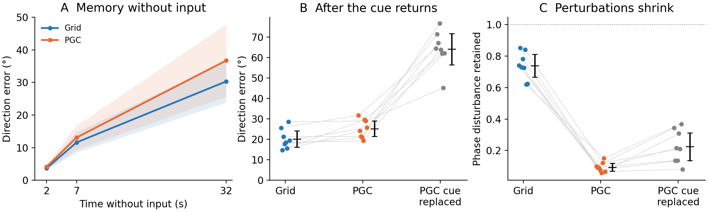

# Memory and cue anchoring without the nonlinear encoder

All eight paired Grid/PGC seeds (3001–3008), all 16 final checkpoints, and their untrained controls are included. These are secondary diagnostics of the raw-input architecture, separate from the 16-pair encoder cohort and from the 24-model tracking evaluation. The recurrent layer still has 64 units; the nonlinear encoder is absent. Removing it also reduces parameter count, so this comparison does not isolate nonlinearity from capacity or optimization.

*All eight training-seed pairs are shown. Intervals and bands are descriptive 95% intervals across seeds. Disturbance shrinkage must be read alongside direction accuracy.*

The predictive cue still makes disturbed states converge. However, convergence is less accurately aligned with physical direction. After five seconds of the stationary cue, mean direction error is 25.22° with native PGC input, compared with 64.11° after replacing its predictive rates with ordinary rates. Grid-trained models have 20.20° error. Thus the PGC cue is used, but the raw architecture does not reproduce the encoder cohort's precise directional anchoring.

| Five-second cue outcome | Grid native | PGC native | PGC given ordinary code |
| --- | ---: | ---: | ---: |
| Direction error | 20.20° | 25.22° | 64.11° |
| Local phase disturbance retained | 0.739 | 0.094 | 0.225 |
| Sampled angular coverage | 0.911 | 0.843 | 0.328 |

Descriptive 95% training-seed intervals for PGC native error and retention are 21.40–29.03° and 0.069–0.119. Reversed displacement gives 78.67° error; restoring the native shift after one second gives 26.78°. A low retained-disturbance ratio can therefore coexist with an inaccurate direction estimate. The strict criterion of coverage ≥ 0.90 and lower error than ordinary replacement is met by 0/8 raw PGC models; one has coverage 0.899989, only just below the specified threshold. All continuous values and all models remain reported.

| Cue-free memory | Grid | PGC |
| --- | ---: | ---: |
| Normal distance remaining after 1 s | 10.53% | 13.58% |
| Median phase displacement retained after 1 s | 98.01% | 99.36% |
| Direction error after 2 s blank | 3.70° | 4.15° |
| Direction error after 7 s blank | 11.60° | 13.10° |
| Direction error after 32 s blank | 30.32° | 36.72° |

Memory contexts are averaged within each seed over (0,0) and (0.8,−0.8); anchoring averages the five fixed in-region contexts. Blank durations count from initial-cue removal; perturbation times count from disturbing the state after two seconds of blank settling. Phase retention uses the median local displacement ratio, not a winding-invariant mean. Untrained results, new-position tests, full-state distances, output amplitudes and all uncertainty intervals are retained in the linked data. These measurements are not a binary full-state ring classifier.

[Memory summary](memory_summary.json) · [Anchoring summary](anchor_summary.json) · [Frozen evaluator sources](frozen_sources.json) · [Raw-architecture protocol](../../../docs/research/heading_raw_architecture_protocol.md)
