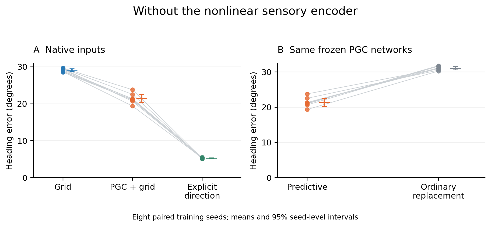

# Prediction with a simpler sensory interface

All 24 planned networks completed training and evaluation: eight new paired seeds, three input populations. These are separate from the primary 48 networks. The nonlinear encoder is replaced by a linear map; this also reduces parameter count. Recurrent size, task, noise, and the 6,000-update budget remain fixed. This is an architecture and capacity sensitivity.

Each dot is a training seed. Lines connect paired conditions; bars show means and 95% seed-level intervals. Each model is evaluated on 2,048 fresh trajectories.

| Input population | Native heading error | Error at new locations |
| --- | ---: | ---: |
| Grid | 29.08° | 29.10° |
| PGC + grid | 21.38° | 21.52° |
| Grid + explicit direction | 5.28° | 5.29° |

Replacing predictive values with ordinary grid values in the frozen PGC networks increases error to 31.12°.

| Prespecified paired contrast | Mean difference, degrees | 95% paired interval | Holm-adjusted exact p |
| --- | ---: | --- | ---: |
| PGC minus Grid tracking | −7.694 | −8.570 to −6.818 | 0.0234375 |
| Ordinary replacement minus native PGC | +9.735 | +8.534 to +10.937 | 0.0234375 |
| PGC minus Grid at new locations | −7.585 | −8.488 to −6.681 | 0.0234375 |

Every comparison has the predicted sign in all eight seed pairs. Exact tests enumerate all 256 paired sign patterns; correction covers these three secondary tests. The explicit-direction condition is descriptive and receives the same measured heading used to create the predictive shift.

Predictive information remains useful in this simpler network, but the gain is smaller than in the larger encoder architecture. The separate [stationary memory and anchoring diagnostics](../raw_memory_evaluation/README.md) show that strong local contraction can coexist with an inaccurate directional map. Better tracking and precise stationary anchoring are different outcomes.

[Frozen protocol](../../../docs/research/heading_raw_architecture_protocol.md) · [All per-seed values and statistics](summary.json) · [Plot source](../../../scripts/plot_heading_raw_sensitivity.py)
