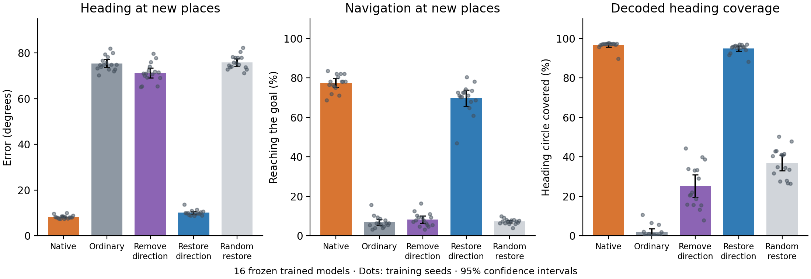

# The learned direction component: all 16 models

**Complete cohort: every planned predictive-model seed, 2001–2016, is included.** The pilot is excluded. Each dot below is one trained model, not one simulated episode.

| Drive entering the same frozen RNN | Heading error at new places | Navigation success | Static decoded heading coverage |
|---|---:|---:|---:|
| Native | 8.2° | 77.4% | 96.6% |
| Ordinary | 75.4° | 6.8% | 1.8% |
| Remove direction plane | 71.3° | 8.2% | 25.1% |
| Restore direction plane | 10.0° | 69.8% | 94.9% |
| Three random-plane restorations, averaged within model | 75.9° | 7.2% | 36.9% |

We found two directions in each frozen encoder's drive associated with cosine and sine of measured travel direction. We fitted them using separate calibration positions, then removed or restored only the observed predictive-versus-ordinary difference inside that fixed plane. All recurrent weights stayed unchanged. The experiment supplied the paired native and counterfactual ordinary inputs; no true-heading label entered the intervention.

The plane contains 66.0% of the predictive-versus-ordinary drive difference's energy at held-out positions, averaged over models. Its held-out direction-readout error is 14.2°. These are measurements of a useful rank-2 component, not a claim that the entire input difference is intrinsically two-dimensional. The three random-plane controls match preactivation-drive norm per input; their values are averaged within each trained model before comparisons.

Forced heading uses 256 matched trajectories per model, after four shared native initialization steps and excluding the first eight steps. Navigation uses 128 matched episodes per model, with each branch controlling its own physical path. Both functional endpoints above use a 10 m translation. Static decoded-heading coverage uses five fixed in-region contexts at 5 s after substitution of neighboring states initialized at headings ±10° apart; it accompanies phase/full-state perturbation measurements so collapse cannot masquerade as useful correction. Angular readout coverage is not a test of smooth full-state ring geometry.

The seed is the inferential unit. Positive differences below favor useful native/direction-plane input. Each endpoint has its own four-comparison Holm family, as fixed in the [protocol](PROTOCOL.md). Confidence intervals are nominal paired-t intervals; p values are exact two-sided paired sign-flip tests with Holm correction.

Heading comparisons (degrees):

| Paired comparison | Difference [95% interval] | Exact Holm p | Seeds with positive difference |
|---|---:|---:|---:|
| Native benefit over ordinary | 67.20° [65.57, 68.83] | 0.00012207 | 16/16 |
| Cost of removing the plane | 63.07° [60.83, 65.30] | 0.00012207 | 16/16 |
| Full-plane restoration benefit over ordinary | 65.38° [63.59, 67.17] | 0.00012207 | 16/16 |
| Full-plane restoration benefit over random | 65.85° [64.00, 67.71] | 0.00012207 | 16/16 |

Navigation comparisons (percentage points):

| Paired comparison | Difference [95% interval] | Exact Holm p | Seeds with positive difference |
|---|---:|---:|---:|
| Native benefit over ordinary | 70.61 pp [68.53, 72.68] | 0.00012207 | 16/16 |
| Cost of removing the plane | 69.24 pp [66.37, 72.10] | 0.00012207 | 16/16 |
| Full-plane restoration benefit over ordinary | 62.99 pp [59.00, 66.98] | 0.00012207 | 16/16 |
| Full-plane restoration benefit over random | 62.61 pp [58.62, 66.61] | 0.00012207 | 16/16 |

The [separate fixed-mean diagnostic](../tonic_direction_confirmation/README.md) tests whether the effect can be reproduced by a global constant offset. It leaves these tests and data unchanged. Whether the full recurrent state forms a smooth ring is a separate geometry question: coarse conditional curves can hide sharp changes in hidden dimensions even when decoded direction is smooth. The present result concerns useful direction information and input-supported correction; it does not require an unqualified global-ring interpretation.

Validation includes checkpoint-bound calibration artifacts, unchanged checkpoint hashes, native/ordinary full-state and independent navigation identities, deletion/residual equivalence, per-input sham norms, and zero intervention during blackouts. A [documented numerical-validation amendment](NUMERICAL_VALIDATION_AMENDMENT.md) handles float32 roundoff in seed 2012's unused residual-only alias; no scientific computation or contrast changes. Exact per-model source snapshots, [paired seed values](paired_seeds.csv), [full summary](summary.json), and the [source manifest](frozen_manifest.json) are archived here. This cohort contains the newly trained heading models, not the original navigation LSTMs or published internal-PGC path integrators.
