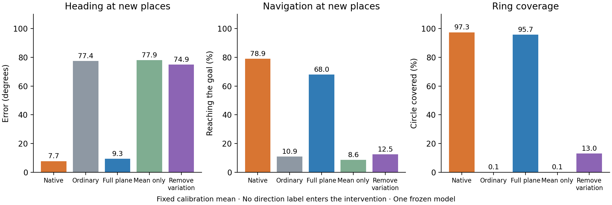

# Does a fixed average input explain the rescue?

**In this pilot, the changing component matters. Restoring only the fixed average does not recover heading or navigation.**

We split the fitted direction-plane signal into its average over the original independent calibration data and its variation around that average. The average is fixed for every new episode. It is switched off during sensory blackouts using the observed availability flag.

| Drive entering the frozen RNN | Heading error at new places | Reached the goal |
|---|---:|---:|
| Native | 7.7° | 78.9% |
| Ordinary | 77.4° | 10.9% |
| Restore the full direction-plane signal | 9.3° | 68.0% |
| Restore only its fixed average | 77.9° | 8.6% |
| Keep its average but remove its variation | 74.9° | 12.5% |

The fixed average contributes only **0.011% of the projected signal's energy** in this model. Its small effect is therefore unsurprising. In the static assay, average-only restoration collapses to one incorrect heading: 90° error and 0.05% circle coverage. Keeping the average while removing variation also loses accurate heading and most coverage. The full direction-plane restoration retains 95.7% coverage and 10.3° static error.

This rules out a simple global constant-offset explanation for this pilot. It does not test every position-dependent offset or the nonlinear effect of a fluctuating drive's magnitude. The “varying” component can also contain position-dependent and sensor-dependent variation within the fitted direction plane.

All original weights, calibration data, projectors, and source files remain unchanged. The two new conditions have exactly zero intervention during blackouts. The decomposition error is below 1.2×10⁻⁷, and native/ordinary navigation matches the independent evaluator. These are additional diagnostics in one pilot model. The separate [16-seed follow-up protocol](../../tonic_direction_confirmation/PROTOCOL.md) preserves the earlier frozen test families.
