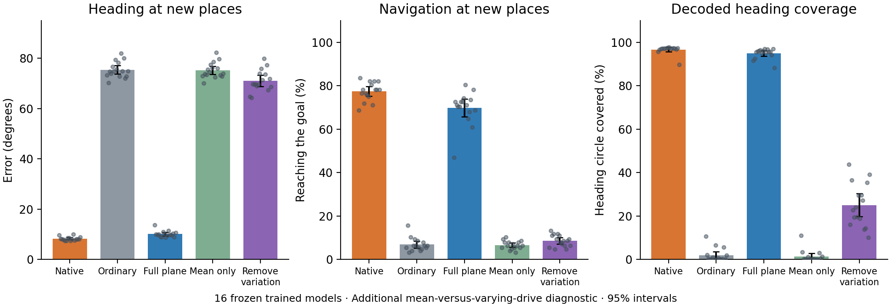

# Fixed mean versus changing direction signal: all 16 models

**Complete additional diagnostic: all 16 planned predictive models are included.** This analysis is separate from the frozen original direction-plane comparison.

| Drive entering the same frozen RNN | Heading error at new places | Navigation success | Static decoded heading coverage |
|---|---:|---:|---:|
| Native | 8.2° | 77.4% | 96.6% |
| Ordinary | 75.4° | 6.8% | 1.8% |
| Restore full direction plane | 10.0° | 69.8% | 94.9% |
| Restore only the fixed mean | 75.2° | 6.6% | 1.3% |
| Keep the mean; remove variation | 71.0° | 8.5% | 24.9% |

We split each model's fitted direction-plane drive difference into its fixed independent-calibration mean and its variation around that mean. We tested restoring the mean alone and removing the variation while retaining the mean. The only online gate on the fixed mean is the observed spatial-availability flag, so it disappears during blackouts. No true direction or position is supplied to the intervention.

The fixed mean accounts for 0.1580% of projected-drive energy on average across models (range 0.0041–0.5591%). This control addresses a simple global input offset. It does not remove every position-dependent average or match all nonlinear effects of fluctuations in drive magnitude. Variation within the fitted plane can also depend on position and other observed sensors.

The settings, episodes, calibration data, and projectors are identical to the original subspace assay. Shared native, ordinary, and full-plane restoration heading metrics agree to maximum error 0 degrees, and navigation success agrees exactly. All new blackout effects are zero. Frozen original source files and test families remain unchanged. Seed 2012 uses the same [validation-only roundoff amendment](../subspace_confirmation/NUMERICAL_VALIDATION_AMENDMENT.md) as the original subspace assay. [Cross-study validation](cross_study_validation.json).

Three additional exploratory contrasts were fixed for each endpoint in the [diagnostic protocol](PROTOCOL.md). Positive differences indicate benefit for the named source of input or cost of its removal. Intervals are nominal paired-t intervals; exact paired sign-flip p values are Holm-corrected separately within each three-test family.

Heading comparisons (degrees):

| Paired comparison | Difference [95% interval] | Exact Holm p | Seeds with positive difference |
|---|---:|---:|---:|
| Mean-only benefit over ordinary | 0.21° [-0.24, 0.66] | 0.338623 | 10/16 |
| Full-plane benefit over mean-only | 65.17° [63.40, 66.94] | 9.15527e-05 | 16/16 |
| Cost of removing variation while retaining the mean | 62.82° [60.53, 65.10] | 9.15527e-05 | 16/16 |

Navigation comparisons (percentage points):

| Paired comparison | Difference [95% interval] | Exact Holm p | Seeds with positive difference |
|---|---:|---:|---:|
| Mean-only benefit over ordinary | -0.20 pp [-1.68, 1.29] | 0.838867 | 5/16 |
| Full-plane benefit over mean-only | 63.18 pp [59.34, 67.03] | 9.15527e-05 | 16/16 |
| Cost of removing variation while retaining the mean | 68.85 pp [66.53, 71.17] | 9.15527e-05 | 16/16 |

The diagnostic was specified after the pilot and after six confirmation models had their original subspace analyses computed. It is a recorded mechanistic follow-up, not an externally preregistered primary study. [Paired seed values](paired_seeds.csv) · [Full summary](summary.json) · [Source manifest](source_manifest.json).
