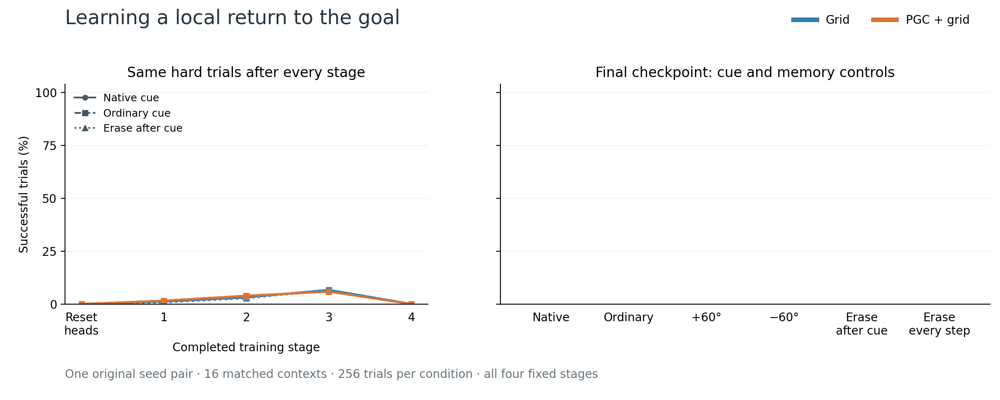
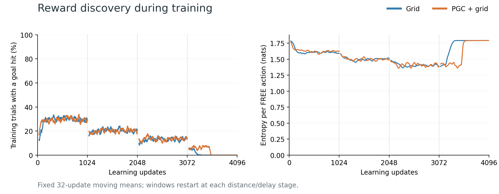

# Local goal-return training

At the fixed endpoint, Grid returned successfully in **0/256** trials and PGC + grid in **0/256**. Erasing recurrent state after the cue changed those counts to **0** and **0**.

Both models retained their original 1B spatial/visual/recurrent features initially, received identical fresh action/value heads, then trained all weights using goal-pickup reward. Each completed four fixed stages, 4,096 updates and 131,072 trials. Evaluation always used the same hard trial bank.

| Final control | Grid successes | PGC + grid successes | Valid contexts: Grid / PGC |
|---|---:|---:|---:|
| Blind: native cue | 0/256 | 0/256 | 16/16 · 16/16 |
| Blind: ordinary cue | 0/256 | 0/256 | 16/16 · 16/16 |
| Blind: cue +60° | 0/256 | 0/256 | 16/16 · 16/16 |
| Blind: cue −60° | 0/256 | 0/256 | 16/16 · 16/16 |
| Blind: erase after cue | 0/256 | 0/256 | 16/16 · 16/16 |
| Blind: erase every blind input | 0/256 | 0/256 | 16/16 · 16/16 |
| Visible: native cue | 0/256 | 0/256 | 16/16 · 16/16 |
| Visible: ordinary cue | 0/256 | 0/256 | 16/16 · 16/16 |
| Visible: cue +60° | 0/256 | 0/256 | 16/16 · 16/16 |
| Visible: cue −60° | 0/256 | 0/256 | 16/16 · 16/16 |
| Visible: erase after cue | 0/256 | 0/256 | 16/16 · 16/16 |
| Visible: erase on matched blind clock | 0/256 | 0/256 | 16/16 · 16/16 |

Every condition includes all 256 trials in 16 matched physical contexts; invalid trials count as failures. The visible controls use the same scheduled cue changes and state erasures.

| Frozen final criterion | Grid | PGC + grid |
|---|---:|---:|
| Native successes ≥167/256 | 0 | 0 |
| Post-cue erasure loss ≥39 successes | 0 | 0 |
| Certified opposite-heading pairs | 128/128 | 128/128 |
| Numeric behavior gate | Fail | Fail |
| Certified memory gate | Fail | Fail |

The saved physical tapes give common-information success bounds of 50% (Grid) and 50% (PGC + grid). These bounds apply to the specified opposite-heading trials after heading information is erased.

Training curves average fixed 32-update windows within each stage. Action entropy is weighted by the number of FREE decisions. Setup, forced actions and padding contribute no actor reward.

This is one original training-seed pair. The counts describe its matched physical trials; the report does not treat 256 headings as 256 independently trained networks. All four stage results, context counts, input hashes and accepted training history are in [summary.json](summary.json).

Reproduce after both final audits pass: `python scripts/plot_local_goal_return_training.py`.
