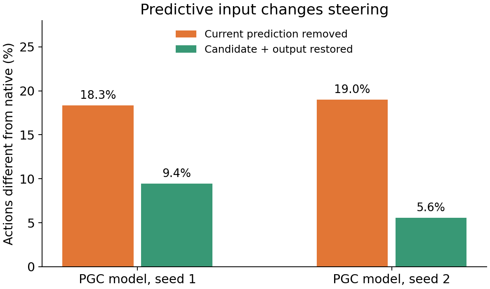
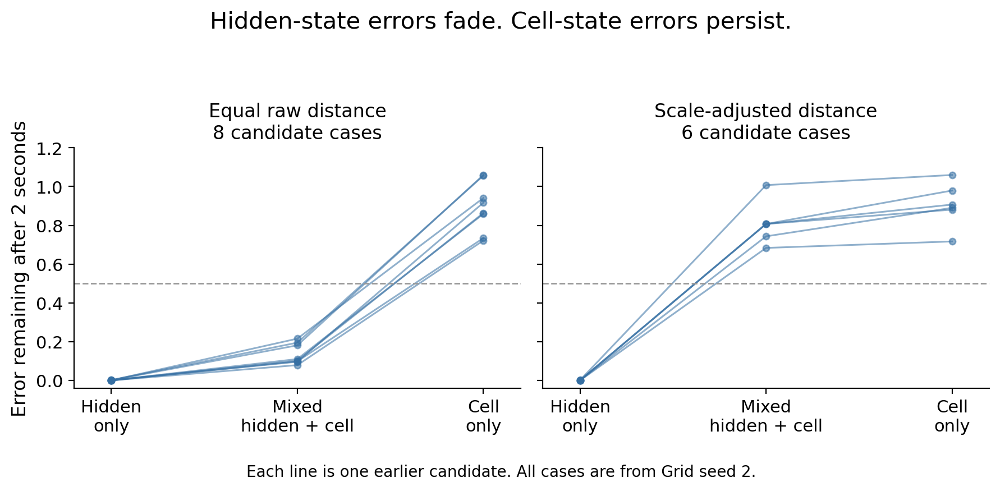

# Further searches for a ring in the navigation RNN

**The clearest positive result is that current predictive input changes steering through the LSTM's candidate-update and output pathways. The new circular-manifold tests have not identified predictive stabilization of a useful ring in the original agents.**

These are additional experiments on the original 1B-frame checkpoints, using two discovery seed pairs. All original weights stayed fixed. No cloud compute or new training was used for this batch.

## Prediction changes steering

We recorded 128 complete native episodes and selected the first eligible repeated-turn segment from each episode. This gave 29 segments across the four models. In the PGC models, replacing the 169 **current** predictive inputs with their ordinary-grid equivalents changed about **18–19% of sampled actions**. The saved goal code stayed predictive and unchanged at the intervention; the original actor, CNN, maps and six actions were retained.

Restoring predictive influence to the **candidate update and output gate** reduced the action differences to **9.4% and 5.6%**. The other two gates continued to receive the ordinary-current-code influence. This identifies a route by which current prediction changes the network's action computation.

Removing current prediction reduced two-second goal progress by **1.09 and 1.26 cm** in the two PGC discovery models. Gate rescue brought action choices closer to native, while progress recovery was mixed. These short, selected movement windows complement the earlier eight-seed navigation results; they are not a new population-wide performance estimate.

[Native census](../native_movement_cycles/README.md) · [All input routes and state impulses](../native_movement_pulses/report/README.md) · [Hidden-bound robustness](../native_movement_bounded_pulses/report/README.md)

## A circular trace can preserve the wrong kind of error

We tested a new circular variable: **phase within a grid module**. A grid module repeats in two lattice directions. We changed one module's saved-goal code through a complete repeat, then gave all resulting recurrent states identical future inputs.

This is a targeted synthetic intervention. Within the altered module, the ordinary and predictive cells retain their actual maps and predictive offsets. Other modules stay fixed, so intermediate codes need not describe one physical goal. Native access and behavioral usefulness would be required after a successful dynamical candidate.

The first screen found **14 output-curve candidates in Grid seed 2**, with none in either PGC model. We followed every candidate with additional disturbances.

**Activity errors faded quickly; stored-memory errors largely remained.** After two seconds, cell-only disturbances retained **72–106%** of their initial distance from the evolving activity curve. All 14 candidates failed the broader two-second recovery test. One raw-metric actor case passed the tested direction-wise median criteria after five seconds; its scale-adjusted counterpart failed.

This suggests fast adjustment of hidden activity around slower stored information. The earlier radial recovery remains a real result, but it depends on which recurrent-state component is disturbed.

[Module-phase methods and complete screens](../lstm_module_phase_ring/README.md) · [Broader perturbations](../lstm_module_phase_normal_audit/README.md)

## Check the second phase, the fixed points and the detector

| Analysis | Motivation | Result |
| --- | --- | --- |
| Published trained memory RNN | Check that our assay detects a genuine curved learned ring | Both unstable branches trace the ring; the original geometric test passes all eight criteria |
| Analytic Newton search, 512 starts | Find unstable equilibria that earlier residual minimization could miss | One previously known stable activity branch per input case; no additional unstable branch found |
| Complete state, 192 module-phase cases | Test persistence and invariance without choosing neurons or a fitted plane | No stationary complete-state candidate |
| Fixed future outputs, 768 cases | Check for a ring beneath common state drift | 14 selected-direction candidates, all in Grid seed 2 |
| Broader disturbances of every candidate | Separate fast hidden-state recovery from actual memory recovery | No candidate passes all 19 tested normal-direction median criteria at two seconds |
| Two phases together, 768 cases | Avoid mistaking the second torus phase for an off-manifold error | No centered or noncentered torus nomination |
| Local two-versus-eight phase control, 768 comparisons | Check whether other grid modules explain the remaining errors | After removing all eight known phase directions, stored-pattern disturbances retain about 93% of their residual error in Grid and 87% in PGC at two seconds |

The two-phase check matters: some disturbances perpendicular to a single ring slice do point along its second grid phase. The joint test removes both phase tangents before assessing recovery, and separately checks the surface geometry and invariance. Its result remains negative under the fixed criteria.

The local eight-phase control goes further. Other modules explain much of the final error outside the selected two phases, but the remaining full-state error still persists. Hidden activity can settle faster than that stored-memory error. Near-perfect fits in action-score space require large implied phase changes and fail the local-fit guard; they cannot be interpreted as local recovery. This analysis accounts for known nuisance directions without claiming a global eight-dimensional attractor.

[Two-phase surface test](../lstm_module_phase_torus/README.md) · [All-eight-phase control](../lstm_module_all_phase_control/README.md)

The published positive control provides a useful comparison. After one second, **8–12% of the worst transverse disturbance remains**, while **94–103% of displacement along the ring remains**. This was measured using the published trained network's full 256-dimensional dynamics. The original navigation assay recognizes its curved ring and slow drift. That control is separate from the navigation models.

[Published learned-ring control](published_benchmark_1000s/README.md) · [Original LSTM equilibrium search](native_equilibria/README.md) · [Research design](../../docs/research/nonlinear_ring_search_protocol.md) · [Primary literature](../../docs/research/alternative_ring_methods_literature_2026.md)

## Recovery during actual movement

We also nudged recurrent state during the selected native turns, then compared real navigation with replay of the exact recorded inputs. Each input route had its own unperturbed control. Random tapes, initial physical states and saved goal cues were matched.

Observed turning-state changes mostly faded. Random disturbances orthogonal to the observed turn and between-turn drift produced much larger finite responses. Removing current prediction increased this response in PGC seed 1 and decreased it in seed 2. The result persisted when every initial hidden coordinate was kept within its legal range and all pulses within a case were matched in realized size.

The bounded normal-pulse gains after two seconds were **12.30 versus 15.29** for native versus ordinary current input in PGC seed 1, and **19.06 versus 16.45** in seed 2. These are finite state-error gains in the stated metric, not Lyapunov exponents. They show no consistent predictive stabilization in this selected movement sample. The unpulsed steering results were exactly identical in the original and bounded experiments.

## Interpretation

The supported picture is **ongoing steering computations coupled to slower cell memory**. Current predictive features influence the candidate update and output gate; the earlier eight-seed work also shows a useful inward goal cue and selective protection of some memory directions through the forget gate. The new tests separate these effects from a general ring-restoration mechanism.

The search remains exploratory. Families, time points and signed perturbations are repeated measurements within four trained networks, not independent seeds. Candidate criteria, failed attempts, numerical corrections, source hashes and every retained case are included. No significance claim is based on counting these nested probes as independent experiments.

[Earlier eight-seed gate dissociation](../../mechanisms/predictive-memory-gates.md) · [Earlier navigation mechanism](../../mechanisms/navigation-explanation.md) · [Reproduction guide](../nonlinear_ring_release/REPRODUCE.md)
