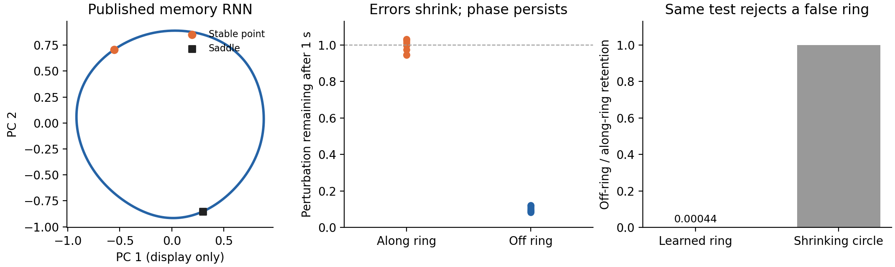

**The same geometric test used on the navigation agents recognizes a genuine learned ring in a published memory network.** This is a calibration using the original 256-neuron weights from [Marraffa et al., Nature Communications (2026)](https://www.nature.com/articles/s41467-026-75924-7). It establishes what a positive result looks like before applying new searches to the navigation LSTMs.



We loaded the published weights and independently reconstructed every neuron update. We found the full network's saddle point, displaced its state slightly in each direction along its unstable eigenvector, and followed both branches. Both reach the same stable point and together form a closed ring. No circle, angle decoder, or task-angle labels were fitted. PCA is used only to display the independently traced 256-dimensional curve.

| Test | Published trained ring | Contracting plane |
| --- | ---: | ---: |
| Worst transverse error remaining after 1 second, across all 255 normal directions at eight locations | 8.2–12.1% | 36.8% |
| Along-ring displacement remaining after 1 second | 94.4–103.3% | 36.8% |
| Median radial / tangent retention after 5 seconds, original geometric assay | 0.00044 | 1.00 |
| Departure from original curve after 5 seconds, 90th percentile, as fraction of radius | 0.000034 | 0.993 |
| Phase coverage after 5 seconds | 99.6% | 99.6% |
| Original geometric criteria passed | 8 of 8 | 6 of 8 |

The difference is simple: **the learned network removes errors away from the ring much faster than it removes differences along the ring.** A shrinking circle loses both equally. Phase coverage and a circular picture alone would accept the shrinking circle; the recovery and invariance tests reject it.

The ring has a preferred state: activity drifts slowly along it toward the stable point. The old assay successfully detects this ring despite that drift. Its requirements already allow the heteroclinic ring mechanism highlighted in the new paper.

Both the continuous dynamics used in the paper and the original discrete update show the same full-state structure. For the discrete update, both branch endpoints lie within 1.1 × 10⁻¹³ of the ring radius from the stable point after 1,000 seconds. Across 128 nonlinear normal kicks at 16 locations, at most 6.7% of the initial off-ring error remains after one second. The derivative agrees with finite differences to relative error 7.7 × 10⁻¹⁰ and with autograd to absolute error 3.6 × 10⁻¹⁵.

The separate published cubic surrogate is approximate. Corrected validation on 24 full-network branch states gives median reconstruction error 2.37% of the state scale and one-second forecast error 2.84%; its differential invariance error is 25.95% of state scale per second. The full-network ring result uses the actual weights and trajectories, independently of that surrogate.

All initial results are retained. At 400 seconds one branch was still moving, leaving a 40% endpoint gap; the original authors' 1,000-second horizon resolves it. An initial surrogate-validation helper accidentally closed open branches with straight chords. The corrected open-arc validation and its regression test replace those surrogate numbers; full-network branch tracing and recovery were unaffected. See the [400-second run](../published_benchmark/summary.json), [corrected surrogate validation](../published_benchmark_corrected_rom/corrected_cubic_validation.json), [full-network results](summary.json), and [unchanged original assay comparison](old_assay_comparison.json).

This result is about the published memory RNN. The mechanistic search in the trained navigation LSTMs remains a separate experiment.

Reproduce from the repository root:

```bash
python -m pytest -q tests/test_published_ssm_ring_benchmark.py
OPENBLAS_NUM_THREADS=1 OMP_NUM_THREADS=1 MKL_NUM_THREADS=1 python scripts/published_ssm_ring_benchmark.py --duration 1000 --out results/ring_nonlinear_design/published_benchmark_1000s
OPENBLAS_NUM_THREADS=1 OMP_NUM_THREADS=1 MKL_NUM_THREADS=1 python scripts/published_ssm_ring_benchmark.py --validate-stored-from results/ring_nonlinear_design/published_benchmark_1000s --out results/ring_nonlinear_design/published_benchmark_corrected_rom
OPENBLAS_NUM_THREADS=1 OMP_NUM_THREADS=1 MKL_NUM_THREADS=1 python scripts/published_ssm_ring_report.py
```

The current benchmark script includes the open-branch correction. Re-running it produces corrected surrogate results directly. The originally executed source for the retained run is saved beside its outputs as `executed_source.py`. Downloaded author code was read but not executed; weights and arrays were loaded without pickle. Source provenance is recorded in the vendor manifest and each run's protocol.
