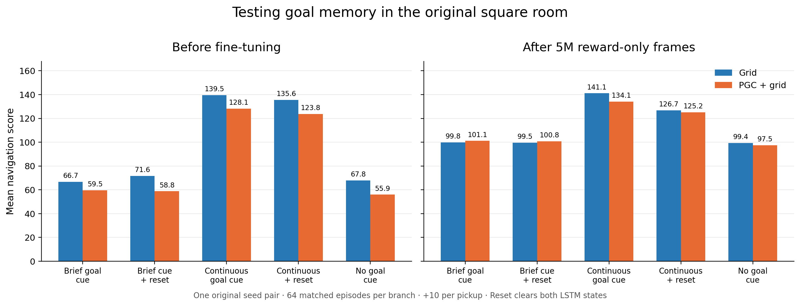

# Original-agent goal-memory pilot

**Fine-tuning mainly improved searching.** Navigation improved substantially even when no saved goal message was supplied. After training, clearing both recurrent states as the brief cue disappeared cost only **0.31 score points for Grid and 0.31 for PGC + grid**. The results favor more effective search over newly learned, useful retention of the brief goal message.

The PGC flash advantage over no goal message was 3.59 points before training and 3.59 afterward. Most of that small advantage survives the state reset. A brief cue can change the first few actions and the resulting pose/momentum, which persist after the hidden-state reset; this is a plausible explanation for a small cue benefit without sustained recurrent goal storage.

This is one original Grid/PGC seed pair, before and after reward-only fine-tuning. The two task changes are circular goal centers within the same square room and a four-update goal-code flash. Episodes are descriptive trials, not independent trained-network replicates.

Each cell below is **mean raw score / mean subsequent returns per episode**. Failed discoveries and failed returns remain in these means. Score is +10 per pickup; subsequent returns exclude the first discovery.

| Network | Stage | Brief cue | Brief cue + reset | Continuous cue | Continuous + reset | No goal cue |
|---|---|---:|---:|---:|---:|---:|
| Grid | before | 66.72 / 5.67 | 71.56 / 6.16 | 139.53 / 12.95 | 135.62 / 12.56 | 67.81 / 5.78 |
| Grid | after | 99.84 / 8.98 | 99.53 / 8.95 | 141.09 / 13.11 | 126.72 / 11.67 | 99.38 / 8.94 |
| PGC + grid | before | 59.53 / 4.97 | 58.75 / 4.89 | 128.12 / 11.83 | 123.75 / 11.39 | 55.94 / 4.61 |
| PGC + grid | after | 101.09 / 9.11 | 100.78 / 9.08 | 134.06 / 12.41 | 125.16 / 11.52 | 97.50 / 8.75 |

Reset occurs immediately before the first update without the brief cue. It clears h and c while preserving the environment, previous action, and previous reward. The continuous+reset branch measures the corresponding disruption when the goal message is still externally available.

| Network | Stage | Brief cue − no goal | Brief-cue reset cost | Continuous-cue reset cost | Additional reset cost without continuous cue |
|---|---|---:|---:|---:|---:|
| Grid | before | -1.09 | -4.84 | +3.91 | -8.75 |
| Grid | after | +0.47 | +0.31 | +14.38 | -14.06 |
| PGC + grid | before | +3.59 | +0.78 | +4.38 | -3.59 |
| PGC + grid | after | +3.59 | +0.31 | +8.91 | -8.59 |

Positive reset costs mean performance fell after erasing the recurrent state. A larger cost after the cue disappears is compatible with useful retained goal information, but the reset is not selective for a proven goal subspace. No ring architecture or auxiliary target was imposed, and successful goal memory alone would not demonstrate a neural ring attractor.

Each model received **5,004,800 learned frames** (391 complete original A2C updates), plus **2,560,000 zero-learning-rate exposure frames** (200 warmup updates). Warmup weights were independently checked tensor by tensor against the immutable original checkpoint. All five branches reproduce identical first-discovery times within each evaluation.

The source, original asset, protocol, and final checkpoint hashes were validated before producing this report. No p-values or population confidence intervals are computed for a single seed pair.

[Numerical summary](pilot_summary.json) · [Frozen protocol](../../docs/research/rl_goal_memory_pilot_protocol.json) · [Methods and interpretation](../../docs/research/rl_goal_memory_pilot.md).
