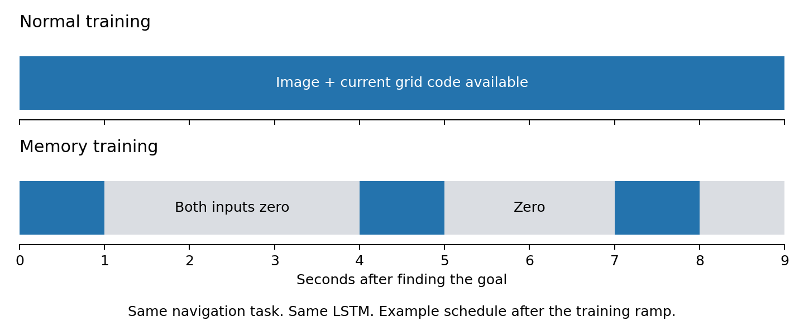

# Give the agent a reason to remember

The agent plays the same navigation task as before. The one change is simple: after finding the goal, its view and current grid code sometimes disappear for **2–4 seconds**. Remembering where it was can help it navigate between views.

| Training task | Grid only | PGC + grid |
|---|---|---|
| Inputs always available | 4 seeds × 1B frames | 4 seeds × 1B frames |
| Brief sensory blackouts | 4 seeds × 1B frames | 4 seeds × 1B frames |

Each seed starts with identical network weights across the four conditions. The full network learns from navigation reward. The maps, actions, movement noise, reward, and stored goal code stay the same.

After a goal pickup, the agent sees normally for one second. It then alternates brief views with blackouts. Blackouts grow gradually over the first 200M frames. Before the first goal discovery, everything stays visible.

**During a blackout:** the image and all 512 current grid-code entries are zero. The LSTM still receives the stored goal, its previous action, and its previous reward. No extra movement or direction information is supplied.

We will ask three simple questions:

1. **Does it learn to remember?** Erase the LSTM's hidden and cell states and measure the navigation cost, with the same erasure in a visible control.
2. **Do predictive cells help that memory?** Replace current predictive activity with ordinary grid activity, then compare retention, recovery, and navigation.
3. **What form does the memory take?** Examine activity and perturb the complete recurrent state. A ring needs a continuous family of memories that survives without cues and recovers from disturbances.

The run target is 16 models, each trained for exactly 1B environment frames. The cumulative cloud ceiling is **$600**, including previous recorded research spending. The GPU test passed speed and exact restart checks. Every worker has an enforced deletion deadline.

**Status at November 9, 2026, 05:17 UTC: seven models have completed exactly 1B frames, eight workers are running, and one model awaits a free worker.** The latest completion is PGC + grid, native task, seed 1. Its [final checkpoint audit](../ring_simple_memory_recovery_inventory/cohort_technical_audit_7/ring-20261105-simplemem-pgc33-native-s1.json) verified all 33,525 continuation updates, the original initialization, and the full saved state. Its worker has been deleted, and PGC + grid, native task, seed 4 has started in the freed slot; see the [handoff record](../ring_simple_memory_recovery_inventory/pgc33_native_s1_completion_handoff.json). The earlier [Grid native seed-2 audit](../ring_simple_memory_recovery_inventory/gc100_native_s2_final_audit.json) and [PGC native seed-2 audit](../ring_simple_memory_recovery_inventory/first_v2_final_audit.json) are retained.

Grid native seed 4 needed an early host move because the first worker was too slow. We preserved its complete checkpoint at update 781 and resumed on a replacement. The [host-recovery record](../../docs/research/operational_amendments/20261108_seed4_host_recovery/amendment.json) preserves both attempts. The [replacement startup audit](../../docs/research/operational_amendments/20261108_seed4_host_recovery/replacement_startup_audit.json) verifies exact restoration and the first 258 updates; measured throughput passes the deadline check.

The [cohort training audit](../ring_simple_memory_recovery_inventory/cohort_technical_audit_7/summary.json) has verified all seven completed models with one consistent check. Each has exactly 1B frames, a continuous accepted training history, verified restart states, and all 20 parameter tensors recording the full 78,125 optimizer steps. Available matched conditions share identical starting weights. The other nine models remain pending. The [auditor](../../scripts/audit_simple_memory_training.py) requires all sixteen by default; `--allow-partial` explicitly permits an interim check.

**Four earlier interruptions came from a numerical check.** Two calculations of the same LSTM outputs differed slightly beyond its tolerance. The first failure was PGC + grid, blackout, seed 1 at 348M frames; its complete restart state at 345.6M frames is preserved. Grid, native, seed 2 and PGC + grid, native, seeds 1 and 2 later stopped at the same check. See the [first failure record](../ring_simple_memory_design/replay_failure_20261107.json) and [additional failure records](../ring_simple_memory_recovery_inventory/inventory.json).

The [GPU diagnostic](../ring_cloud_artifacts/ring-20261105-simplemem-replaydiag-s1/diagnostic/summary.json) reproduced the first interruption exactly after replaying all 188 saved updates. The difference starts when images are processed in different batch sizes: tiny rounding differences grow through the LSTM. Using the same batch size made both calculations match exactly, with and without gradients. The diagnostic worker has been collected and deleted; its conservative recorded cost was **$0.17**.

The [four-run GPU validation](../ring_cloud_artifacts/ring-20261105-simplemem-guardcheck-v2/validation/summary.json) passed: all 375 earlier updates replayed exactly, and all four interrupted updates passed the amended check. Gradients, weight updates, optimizer state and random state matched the original learning calculation exactly. All nine deliberately corrupted inputs/states were rejected. The validation worker has been deleted; its conservative recorded cost was **$0.22**.

**Training recovery started November 8.** The four completed models are retained. Four interrupted models resume from their exact saved states, and eight fresh models retain their original 1B targets. The [recovery plan](../../docs/research/simple_memory_recovery_host_plan.json) runs at most eight workers at a time. An automatic [follow-up controller](../../docs/research/simple_memory_recovery_followup_host_plan.json) waits for all sixteen authenticated finals before running the eight original paired analyses.

All four resumed models have now passed their original failing updates. The four fresh seed-3 models started with exactly identical network weights. The two Grid seed-4 conditions also have [exactly matching initial weights](../ring_simple_memory_recovery_inventory/seed4_blackout_startup.json), and both pass their deadline checks. These checks confirm the intended setup; navigation, memory and ring results come after training and evaluation.

Cloud monitoring now checks whether each running job can finish before its original deletion deadline. The [operational amendment](../../docs/research/operational_amendments/20261107_monitor_recovery/amendment.json) preserves the earlier monitoring files and documents the change. Scientific training and analysis methods remain frozen.

The completed runs have not undergone scientific analysis yet. The experiment tests whether memory pressure produces useful recurrent structure and whether predictive cues help preserve or repair it. A ring is a hypothesis to test.

The analysis methods are now fixed, with **68 private control tests passing**. We will measure PCA activity variance, remembered direction, recovery after a state disturbance, and navigation after a single correct or misleading predictive cue. These checks have been tested on private fixtures; trained-model findings come after the runs finish.

The follow-up plan waits for all sixteen verified 1B checkpoints, then evaluates eight Grid/PGC pairs. Each evaluation worker has a **two-hour deletion deadline**, with an inner analysis limit of 110 minutes. Startup and saving results also use worker time. Every diagnostic or continuation must fit the live **$600 cumulative ceiling**, including earlier research spending. The latest orchestration, recovery and reporting checks passed **89 private tests**.

We checked Google's component prices and the completed workers' deletion records, retaining a generous cost allowance. The full-study upper estimate is now **$587.86**, including the four continuations, eight fresh training runs, and eight paired analyses. The [numerical amendment](../../docs/research/operational_amendments/20261108_replay_guard_recovery/amendment.json) records the repair, exact parent histories, and cost review.

The [analysis-time amendment](../../docs/research/operational_amendments/20261108_analysis_runtime/amendment.json) adds $10 of reserved time. Each pair's navigation and intervention tests can require about 28M additional environment frames, plus activity and spectrum calculations. Two hours gives those tests more time to finish. All training settings, scientific tests, inputs and model comparisons remain unchanged.

[Training protocol](../../docs/research/simple_memory_training_protocol.json) · [Analysis protocol](../../docs/research/simple_memory_analysis_protocol.json) · [Training cloud plan](../../docs/research/simple_memory_cloud_plan.json) · [Evaluation cloud plan](../../docs/research/simple_memory_followup_plan.json)
