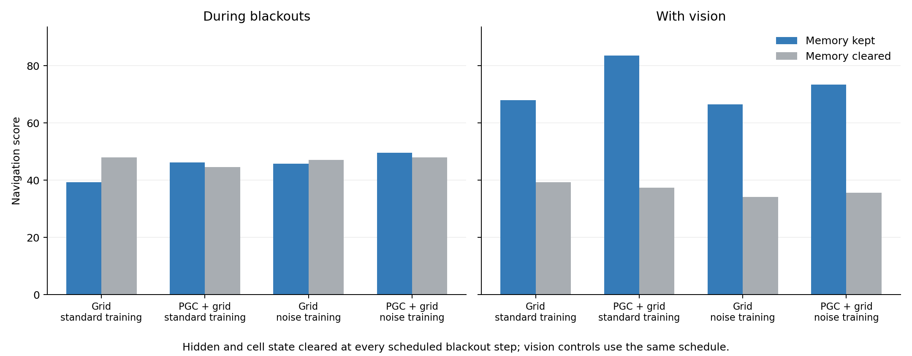

# What longer blackout training changed

**After 75M additional learning frames, most blackout performance still survived clearing recurrent state at every dark step.** Clearing both LSTM states barely reduced PGC blackout scores. The same reset strongly disrupted control when vision was available.

We continued both fixed 25M checkpoints for another **50,048,000 learning frames**, using the final 2–4-second blackouts throughout. A second arm started from the same parents and added small independent noise to the hidden and cell states during dark inputs. Everything else followed the same fixed schedule, navigation reward and original network. All five new checkpoints were retained; the final checkpoint was specified before training.

| Fixed 75.072M model | Blackouts | Clear state every dark step | Vision | Matched resets with vision |
|---|---:|---:|---:|---:|
| Grid, ordinary continuation | 39.38 | 47.97 | 67.97 | 39.38 |
| PGC + grid, ordinary continuation | 46.25 | 44.53 | 83.59 | 37.34 |
| Grid, noise training | 45.78 | 47.03 | 66.56 | 34.22 |
| PGC + grid, noise training | 49.53 | 47.97 | 73.44 | 35.63 |

These are clean evaluations: training noise was off. The reset removed **hidden and cell state carryover** at every scheduled black-input update. Current spatial inputs, the externally saved goal code, previous action/reward, physical motion and visible refresh periods remained available. The result suggests that these surviving signals support much of the blackout behavior. The vision reset effect shows disruption of visible-input control; clearing the state also changes the input distribution seen by the recurrent computation.

The original 1B models scored **83.28 for Grid and 85.00 for PGC with vision**. Relative to those original agents, blackout return counts at the final endpoints were 40–53%; relative to each final model's own vision performance, they were 51–64%. Longer training and state noise did not cross the predeclared 70% return-retention reference or produce a five-point additional reset cost in darkness.

We also evaluated all four models with **exactly the same underlying random draws for state noise**, applied during each model's scheduled windows. Blackout scores were 42.19, 44.38, 45.47 and 50.63 in the table's order. Both noise-trained models reproduced their earlier CUDA episode results exactly. These comparisons describe one preselected trained seed pair per arm, with 64 paired evaluation episodes per condition.

[All ordinary-continuation stages](noiseless_continuation_learning.png) · [All noise-training stages](noise_continuation_learning.png) · [Reset, current-PGC and exposure checks](continuation_checks.png) · [Complete numerical results](continuation_summary.json) · [Final diagnostic results](final_diagnostics_summary.json)

The complementary [activity and state-recovery analysis](../lstm_final75_memory/README.md) and [brief predictive-cue experiments](../lstm_heading_memory/travel_cue_pulse/final75/README.md) examine the internal mechanism directly. A separate blind-reorientation task was designed to remove the immediate-input shortcuts identified here; its results are kept separate from this continuation.

The [training audit](continuation_cloud_audit/artifact_verification.json) verifies all fixed frames, source/checkpoint hashes, optimizer continuation and exact noise replay. The [common-noise audit](final_eval_cloud_audit/verification.json) and [every-step reset audit](final_eval_cloud_audit/reset_retry_verification.json) verify unchanged weights and exact control rows. The first reset process stopped before evaluation because a plotting dependency was absent; its failure was retained. A reset-only retry installed pinned Matplotlib 3.9.2, preserved NumPy/PyTorch versions, recorded the environment and passed clean imports before the unchanged evaluator ran.

All four training VMs and both diagnostic VMs, including boot disks, were deleted and independently checked. Their conservative combined compute envelope was **$5.4720** within the original cumulative $500 authorization. This excludes the earlier 25M pilot and the separately running reorientation experiment.
