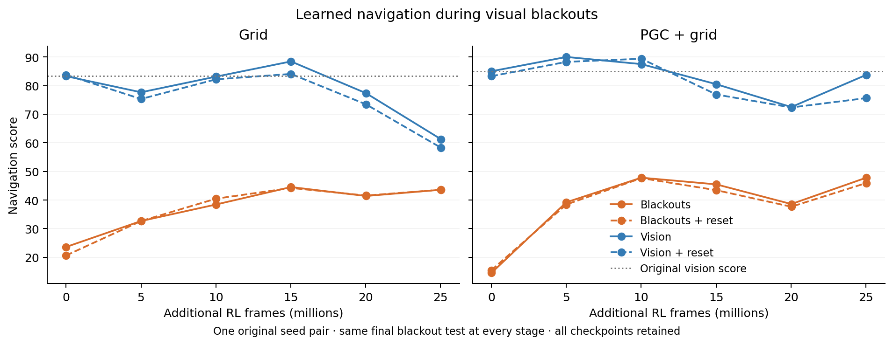

# Learning to navigate through visual blackouts

We continued training the original navigation LSTMs using only their original navigation rewards. The maps, hidden goals, saved goal codes, actions, environment and network stayed the same. After finding the goal, the agents alternated between one second of normal images and short blackouts. The fixed curriculum gradually increased blackouts to 2–4 seconds.

**Both agents learned better blackout navigation. The PGC agent also preserved its original performance with vision.** The final blackout scores rose from 23.59 to 43.59 for Grid and from 14.53 to 47.81 for PGC + grid. The same 64 paired episodes and final blackout distribution were tested at baseline and every fixed stage.

| Final test | Grid | PGC + grid |
|---|---:|---:|
| Blackouts | 43.59 | 47.81 |
| Blackouts, clear recurrent state at each onset | 43.59 | 45.94 |
| Continuous vision | 61.25 | 83.75 |
| Continuous vision, matched scheduled state resets | 58.28 | 75.63 |
| Blackouts, ordinary current code during blackout windows | 43.59 | 48.28 |
| Continuous vision, same current-code replacement windows | 61.25 | 77.66 |
| Original 1B checkpoint with vision | 83.28 | 85.00 |

Clearing the recurrent state at blackout onset changed scores little: **0.00 points for Grid and 1.88 points for PGC**. The same scheduled resets with vision cost 2.97 and 8.13 points. Thus the additional reset cost in darkness was −2.97 and −6.25 points. The improvement currently looks like adaptation of the controller to intermittent vision, with rapid recovery from the spatial inputs that remain available. Further state perturbations test how that recovery works.

Replacing the current predictive values cost the PGC model **6.09 points with vision**, while its blackout score changed by +0.47 points. This replacement affected only the 169 current predictive channels during scheduled blackout windows. The saved goal code, remaining ordinary channels, movement, previous action and reward stayed intact. The corresponding Grid intervention was an exact no-op in every evaluation.

| Retained return rate at the final checkpoint | Grid | PGC + grid |
|---|---:|---:|
| Blackouts / same checkpoint with vision | 0.669 | 0.525 |
| Blackouts / original checkpoint with vision | 0.475 | 0.505 |
| Actual blackout fraction after discovery | 71.80% | 71.54% |

Neither agent met the predeclared practical references of 0.70 retained return rate and five additional reset-cost points. These are descriptive pilot references, not statistical population thresholds. This is one preselected original seed pair; episode trials are not independent trained-network replicas.

[View every-stage reset, predictive-input and exposure checks](visual_memory_checks.png). [Read the full numerical summary](curriculum_summary.json). All intermediate checkpoints were retained; the final model was fixed by the protocol. Each agent completed 25,024,000 learning frames plus 2,560,000 separately counted zero-LR warmup frames. Only the last 5,004,800 learning frames used the final 2–4-second gap distribution. A separate, fixed 50,048,000-frame continuation at that distribution has been authorized to test longer adaptation, without changing the task or objective.

The [methods](../../docs/research/rl_visual_memory_pilot.md), [frozen protocol](../../docs/research/rl_visual_memory_pilot_protocol.json), [artifact checks](cloud_audit/artifact_verification.json), and [cloud cleanup audit](cloud_audit/provider_cleanup.json) document the experiment. Both warmup policy tensors match their original checkpoints exactly; all learned stage weights are finite and all frozen sources/original assets remain unchanged. Both cloud workers and their boot disks were deleted. The pilot's conservative compute envelope was $1.626 within the existing cumulative $500 authorization.
