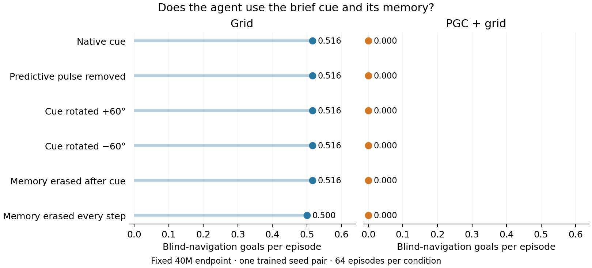

# Blind reorientation: fixed 40M pilot

The same navigation LSTM was trained to move after a blind turn. A short real forward movement supplied one predictive direction cue. The cue then disappeared during further turning, before the agent chose its next movements. Learning used the original goal reward.

**The Grid agent’s blind-navigation score largely survives memory erasure. The PGC agent has not learned successful blind free movement at this fixed endpoint.** With vision restored, both agents reach goals during the corresponding free windows. The action diagnostic below examines the PGC agent’s concentrated turning policy.

**These scores count goals reached during freely chosen blind movement.** Forced-movement goals are excluded. Every original episode remains in the denominator, including episodes with no free window.

| Intervention | Grid, blind | PGC + grid, blind | Grid, visible | PGC + grid, visible |
|---|---:|---:|---:|---:|
| Native cue | 0.5156 | 0.0000 | 0.7500 | 0.6250 |
| Predictive pulse removed | 0.5156 | 0.0000 | 0.7500 | 0.6094 |
| Cue rotated +60° | 0.5156 | 0.0000 | 0.7500 | 0.6250 |
| Cue rotated −60° | 0.5156 | 0.0000 | 0.7500 | 0.5938 |
| Memory erased after cue | 0.5156 | 0.0000 | 0.6406 | 0.7031 |
| Memory erased every step | 0.5000 | 0.0000 | 0.6562 | 0.5312 |

## What was changed?

- **Pulse removal:** replace only the 169 current predictive entries with their ordinary-grid values for the one cue update.
- **Wrong cue:** rotate that predictive displacement by +60° or −60°, while preserving all other input entries.
- **Memory erasure:** set both hidden and cell state to zero after the cue, or before every black input. The saved goal, previous action and reward, held ordinary position code, and physical state remain available.
- **Visible control:** preserve the same imposed movements and code interventions, while restoring vision.

Grid has no predictive slots, so its cue-removal and rotation branches are exact identity checks. They are retained.

## All outcomes and uncertainty

[All five fixed endpoints](free_navigation_learning.png) include the baseline and every training stage. [Complete results](summary.json) include free-goal counts, goalward progress, path length, exposure, whole-episode scores, and paired intervention contrasts. Descriptive 95% intervals resample 32 environment slots, keeping each slot’s two episodes together. There is one trained seed per population; stages, windows and angular samples are not independent trained models.

[Training method](../../docs/research/rl_blind_reorientation_implementation.md) · [Frozen behavior analysis](behavior_analysis_protocol.json) · [Frozen neural tests](../../docs/research/reorientation_mechanism_protocol.json) · [Action diagnostic](../rl_blind_reorientation_review/entropy_diagnostic/README.md)
