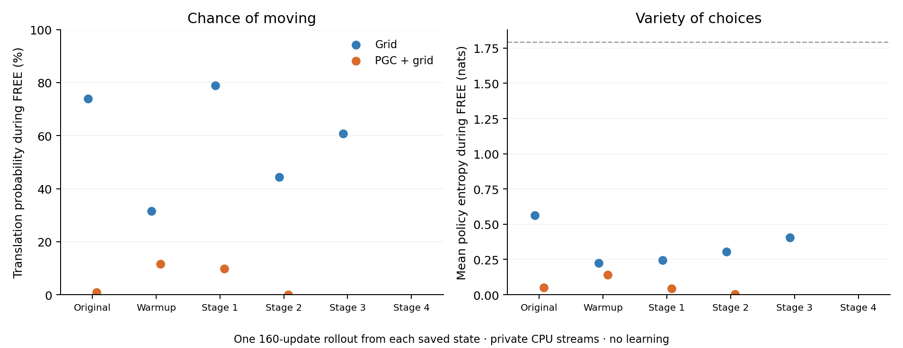

# Does the actor explore movement during the free window?

**Read-only diagnostic, frozen before its rollouts.** Every available prescribed original, post-warmup and stage checkpoint is retained. Each contributes one 160-update rollout from its exact saved non-RNG runtime. No optimizer runs and all checkpoint/weight hashes remain unchanged.

| Model | Checkpoint | FREE steps / exposed slots | FREE entropy (nats) | Translation probability | Actual counts: L, R, F, B, SL, SR |
|---|---|---:|---:|---:|---|
| Grid | incoming | 30 / 1 | 0.5633 | 73.918% | 0, 10, 0, 0, 0, 20 |
| Grid | after_warmup | 540 / 18 | 0.2263 | 31.598% | 0, 373, 0, 0, 0, 167 |
| Grid | stage1 | 551 / 20 | 0.2446 | 78.978% | 0, 107, 0, 0, 0, 444 |
| Grid | stage2 | 511 / 18 | 0.3068 | 44.423% | 0, 286, 0, 0, 0, 225 |
| Grid | stage3 | 370 / 13 | 0.4063 | 60.673% | 0, 139, 0, 0, 0, 231 |
| PGC + grid | incoming | 30 / 1 | 0.0519 | 0.888% | 0, 29, 0, 0, 0, 1 |
| PGC + grid | after_warmup | 420 / 14 | 0.1419 | 11.556% | 0, 366, 0, 0, 0, 54 |
| PGC + grid | stage1 | 540 / 18 | 0.0436 | 9.898% | 0, 486, 0, 0, 0, 54 |
| PGC + grid | stage2 | 450 / 15 | 0.0026 | 0.040% | 0, 450, 0, 0, 0, 0 |

Translation means any forward, backward or strafe action; it does not mean goalward movement. L/R are left/right turns. Each rollout contains 32 environment slots. The original incoming states provide only the exposure actually encountered; no extra rollouts are added to obtain a desired number of FREE samples. Within each model, incoming and post-warmup weights are identical; their saved histories differ.

Entropy is measured separately for each decision, then averaged. A uniform choice among six actions has entropy 1.792 nats (dashed line); values near zero mean the actor is almost certain of one action at each state. Probabilities are measured before action sampling, alongside the actual sampled counts. A broad repertoire across different states can coexist with low entropy at individual states.

**The usual training-log entropy is a different quantity:**

| Model | Log interval | Logged batches | Masked entropy / all updates | Entropy / policy-controlled updates |
|---|---|---:|---:|---:|
| Grid | warmup (20–200) | 10 | 0.1538 | 0.1657 |
| Grid | stage1 (220–680) | 24 | 0.1532 | 0.1643 |
| Grid | stage2 (700–1160) | 24 | 0.1709 | 0.1883 |
| Grid | stage3 (1180–1660) | 25 | 0.1594 | 0.1832 |
| Grid | stage4 (1680–1800) | 7 | 0.1486 | 0.1858 |
| PGC + grid | warmup (20–200) | 10 | 0.1574 | 0.1682 |
| PGC + grid | stage1 (220–680) | 24 | 0.1282 | 0.1370 |
| PGC + grid | stage2 (700–1160) | 24 | 0.1270 | 0.1399 |
| PGC + grid | stage3 (1180–1400) | 12 | 0.1150 | 0.1302 |

The log masks forced actions and divides by all 160 updates. Its policy-controlled average includes waiting, visible and FREE decisions. It cannot identify a FREE-specific turning bias by itself. All captured complete log rows remain in [the JSON](summary.json).

The original entropy coefficient is 0.00008. The [primary-literature and loss-convention audit](../../../docs/research/reorientation_exploration_audit.md) explains the A3C/A2C precedent of 0.01 and why a numerical coefficient comparison is not an exploration guarantee. This diagnostic changes neither coefficient nor active training.

CUDA RNG blobs are preserved in provenance and each rollout archive. Future draws use the declared private CPU seeds because CUDA generator state cannot be loaded into a CPU generator. This is a fresh short trajectory from a saved state, not exact replay of the cloud worker’s future. State noise and native physical randomness remain enabled. Sampled steps/checkpoints are nested observations of one original seed pair.

[Frozen protocol](protocol.json) · [All numbers and source hashes](summary.json) · [Diagnostic source](../../../scripts/lstm_reorientation_entropy_diagnostic.py)

Reproduce or append newly available fixed stages: `OPENBLAS_NUM_THREADS=2 /opt/anaconda3/bin/python scripts/lstm_reorientation_entropy_diagnostic.py`, then `OPENBLAS_NUM_THREADS=2 /opt/anaconda3/bin/python scripts/plot_reorientation_entropy_diagnostic.py`. Existing results are reused only when checkpoint and frozen diagnostic hashes match.
