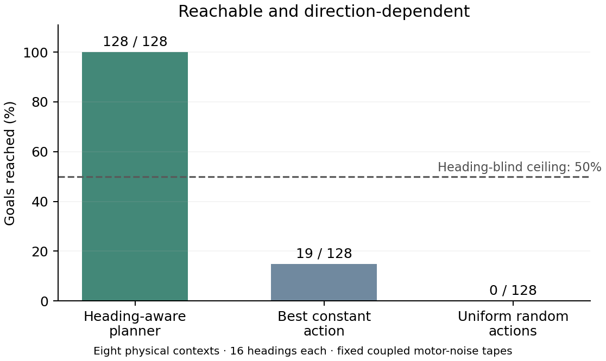

# Local goal-return preflight v2

**The sampled goals are reachable, and losing heading information limits success to at most 50% under the certified conditions.** The heading-aware planner reaches all 128. Uniform random actions reach none, exposing a remaining exploration problem. No training was run.

We sampled eight endpoints inside the central ±0.30 m square, goal distances uniformly from 0.58–0.62 m, and independent goal bearings and heading offsets. Each context contains 16 headings, including eight opposite-heading pairs. The actual saved goal code is fixed across all headings. The same body-frame motor-noise tape and action-uniform tape are repeated within each context and reused across policies. All eight contexts passed the physical preparation check; no replacement was selected from behavioral outcomes.

**Why the 50% bound holds:** after heading information is erased, opposite-heading agents receive the same observations, previous actions, rewards, goal snapshot and motor state. Coupled body-frame randomness makes their paths reflections of one another until a goal hit. One common path reaching both reflected goal disks must travel at least three times the starting gap to the goal disk. Here that minimum exceeds the maximum path permitted by the exact native motor dynamics and saved noise tape. A separate bound keeps every possible path away from walls, preserving the reflection. Therefore at most one of each opposite-heading pair can succeed.

This covers arbitrary common-state stochastic controllers, including clocks and previous-action memory. It assumes the frozen held-current/goal/black-image observation rule and no heading-informed initial hidden or private random state. The 64 unique physical pairs are checked with both models’ inputs; those repeated input checks are not additional trials. The result is conditional on the saved tapes, with numerical guards, and is not an unconditional statement about all Gaussian noise draws.

| Context | Goal distance | Delay | Total updates | Planner /16 | Best constant /16 | Uniform /16 | Incoming Grid /16 | Incoming PGC /16 |
|---|---:|---:|---:|---:|---:|---:|---:|---:|
| 1 | 0.602 m | 46 | 111 | 16 | 2 | 0 | 0 | 0 |
| 2 | 0.589 m | 31 | 93 | 16 | 2 | 0 | 0 | 0 |
| 3 | 0.586 m | 46 | 109 | 16 | 3 | 0 | 3 | 0 |
| 4 | 0.620 m | 59 | 120 | 16 | 2 | 0 | 0 | 0 |
| 5 | 0.581 m | 55 | 115 | 16 | 3 | 0 | 3 | 0 |
| 6 | 0.616 m | 49 | 112 | 16 | 2 | 0 | 0 | 0 |
| 7 | 0.593 m | 37 | 101 | 16 | 3 | 0 | 2 | 0 |
| 8 | 0.615 m | 43 | 108 | 16 | 2 | 0 | 0 | 0 |

The native all-action path bounds are 0.683–0.702 m. Their smallest margin below the required two-goal path is 0.141 m, and every possible path remains at least 0.203 m inside the wall bound. The first free input, saved goal, erased recurrent state, position, body motors and paired tapes pass exact identity checks. Heading opposition is checked numerically with a 0.0001 m spatial guard.

**Physical controls:** the feasible greedy planner uses true physical heading, position and motor state to maximize expected next-step progress; it does not see future motor noise. It reaches 128/128 with native noise and without noise. Best constant actions reach 19/128 with native noise and 18/128 without it. The uniform policy samples six actions equally at every update, using one shared action sequence per context; it reaches 0/128 in both conditions. These are restricted baselines, while the separate certificate supplies the general shared-information bound.

**Learning opportunity remains an issue:** uniform per-step action changes produce a mean path of 0.173 m and mean goalward progress of −0.0035 m. The planner travels about 0.338 m before successful pickup. The task is physically solvable, but uncorrelated action choices do not reliably discover the coherent movement it requires. The eight random sequences are a bounded diagnostic sample, not a precise estimate of a universal random-policy success rate.

**Original-agent transfer:** the incoming 1B Grid agent reaches 8/128 goals with retained state and 7 after post-glimpse erasure; PGC reaches 0 in both cases. Mean free path is 0.217 m for Grid and 0.036 m for PGC, with context-averaged entropy 0.173 and 0.065 nats. These agents were not trained on the proposed local trials. Every zero-hit path, action and entropy value is retained; these results do not substitute for a trained local-task comparison.

**Startup provenance:** we deliberately initialize a setup agent 0.02 m from the goal center, inside the disk and take one actual native forward step. Its +10 pickup event supplies the hit position, direction and velocity to the unchanged `CodeSource.goal` and `NativeGoal.advance` functions. This differs from an ordinary first crossing from outside. One resulting goal snapshot is shared across all headings. Setup reward is excluded from the scored return trial; there is no training gradient. Trial pose is explicitly initialized nearby, motors and h/c are zeroed, and previous action/reward start at −1/0.

Preparation uses 15 visible forced LEFT actions, labelled blind turns, a four-update forward probe, a native endpoint glimpse and a 30–60-update LEFT delay. Motor/image noise is off during this controlled preparation. The largest endpoint rounding correction is 8.70e−8 m. No forced-phase goal hit or wall collision occurred. Complete attempts take 93–120 updates, within 160-step BPTT. The first free action uses the already processed free input; no extra brake is applied. Free movement uses native noise and stops at the first actual hit before respawn.

[Every outcome](summary.json) · [Independent path/information certificate](common_information_certificate.json) · [Initialization attempts](initialization_attempts.json) · [Source](../../../scripts/preflight_local_goal_return_v2.py) · [Certificate source](../../../scripts/certify_local_goal_return.py) · [Preserved v1 preflight](../local_goal_preflight/README.md)

Reproduce with `OPENBLAS_NUM_THREADS=2 python scripts/preflight_local_goal_return_v2.py`, then `python scripts/certify_local_goal_return.py --require-complete`, then `python scripts/plot_local_goal_preflight_v2.py`. Raw NPZ arrays are ignored by Git. This is a separate diagnostic preflight; no training settings are frozen or launched.
