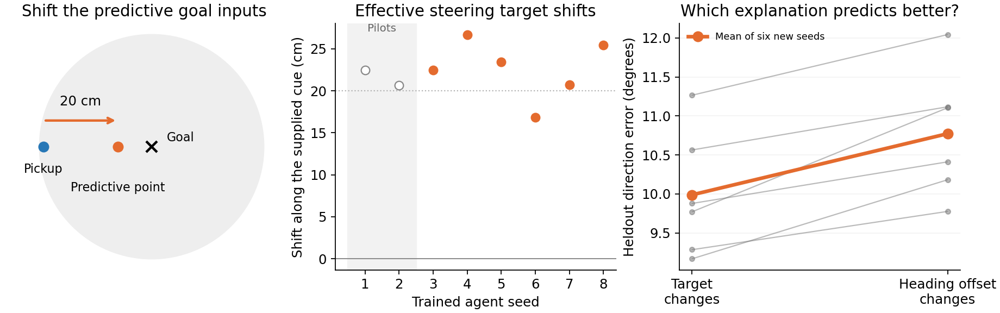

# Predictive goal code changes the original agent’s steering

We kept the original reward-trained LSTM, actual grid maps, rendered room and six-action policy. At fixed physical positions, we changed only the predictive part of its saved goal snapshot and measured how its movement choices changed across facing directions. These are clamped responses, not navigation trajectories.

The six previously untested agents shifted their fitted effective steering target by **22.6 cm along the supplied predictive direction** on average across four fixed contexts (95% interval 18.9 to 26.3 cm; exact two-sided p=0.0312). Seeds1–2 are earlier descriptive pilots and are excluded from this test.

The target-change explanation improved heldout direction prediction by 0.78° versus a change of heading offset alone, and was better in 6/6 new agents. **Effective-target interpretation gate: passed.**

A displaced effective target is a supported description of the clamped steering field; not proof of an encoded neuronal goal coordinate.

The fitted point summarizes a direction field. It is not a directly measured neuronally encoded goal location, and these tests do not demonstrate an autonomous ring attractor. All four translation actions enter the readout; all goal variants use the same position weights; a free common angular offset accounts for policy heading-response bias. Uniform weighting and the former dominant-action readout are retained as robustness checks.

All four contexts and all eight trained agents are retained. Source/checkpoint hashes and optimizer/bound checks are recorded in [summary.json](summary.json). The [frozen protocol](../../../docs/research/original_rl_goal_policy_map_protocol.md) states the endpoint and interpretation gate.
