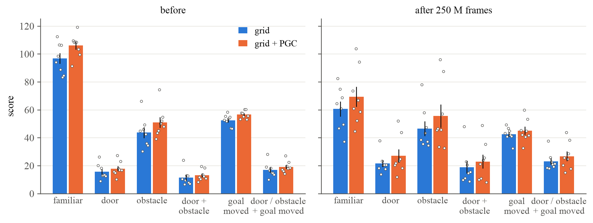
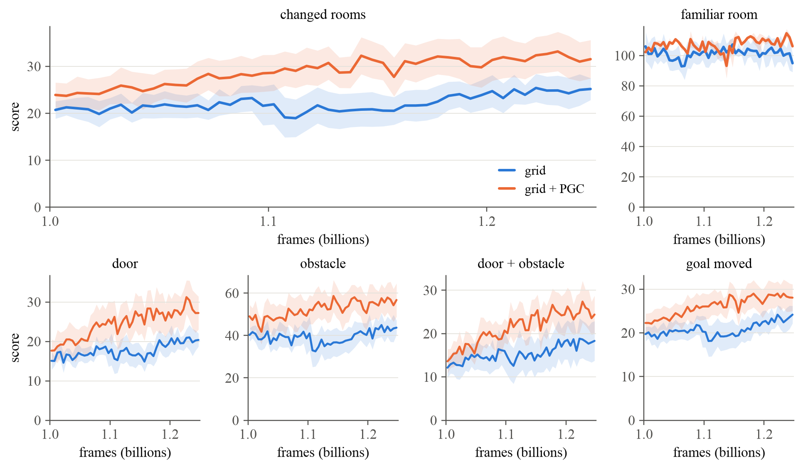

# When the familiar room changes

**Question.** Predictive grid cells (PGC) help an agent reach the goal in the room it was trained in. Do they still help when that room changes?

**What we did.** The sixteen LSTM + vision agents of the main study (8 seeds; 100 % grid cells, or grid + 33 % predictive grid cells; 1 B frames in the open room) were tested with frozen weights in changed versions of their room: a wall with one door, an obstacle, both, and a goal that moves in mid-episode. All sixteen were then trained for another 250 M frames in the changed rooms and tested again. Two references: the same extra frames in the familiar room (2 seeds per code), and agents trained from scratch in the changed rooms (one pair per room).

**Short answers.** Scores are goals × 10 per 90 s episode. Pairs of numbers are always grid first, then PGC. Differences are PGC − grid, mean ± SEM over the 8 seeds, paired; p values are uncorrected paired t-tests.

| | grid | PGC | PGC − grid | p |
|---|---|---|---|---|
| familiar room, 1 B agents | 96.9 | 106.1 | +9.3 ± 3.3 | 0.027 |
| changed rooms, same agents, frozen | 21.5 | 24.4 | +3.0 ± 2.8 | 0.32 |
| changed rooms, after 250 M frames there | 26.5 | 31.3 | +4.8 ± 5.0 | 0.37 |
| familiar room, after 250 M frames in the changed rooms | 60.7 | 69.4 | +8.7 ± 7.7 | 0.29 |
| first 10 PCs, share of variance, 1 B agents | 46.4 % | 52.3 % | +5.9 ± 0.4 points | < 0.001 |
| first 10 PCs, after 250 M frames in the changed rooms | 46.8 % | 49.1 % | +2.3 ± 1.1 points | 0.075 |

1. **A changed room costs both codes about four fifths of their score.** Frozen agents keep 22 % (grid) and 23 % (PGC) of their familiar-room score (difference +1.0 ± 2.3 percentage points). The PGC agents stay ahead on average (in 6/8 seeds), but the lead is +3.0 points instead of +9.3, and eight seeds cannot separate it from zero.
2. **If anything of the advantage survives, it is in the returns.** Once the goal is found, PGC agents collect more goals (grid 2.86, PGC 3.35 per 1000 steps, p = 0.033) and tend to take more direct paths around the wall or obstacle (p = 0.082). No difference was found in how often or how soon the goal is first found. These are the frozen 1 B agents; after fine-tuning neither difference is significant.
3. **Fine-tuning is slow, and whether it favours a code stays open.** After 250 M frames in the changed rooms the score there is +5.0 ± 1.4 (grid) and +6.9 ± 3.1 (PGC) points higher. The lead after fine-tuning is +4.8 (95 % CI −7.1 to +16.7). In the frozen test it changed by +1.9 ± 3.2 (p = 0.58); in the training score it grew by +3.9 ± 1.7 (p = 0.051). Both codes lose more than a third of their familiar-room score.
4. **The PGC agents' activity is more concentrated before fine-tuning; after it the difference is weaker.** At 1 B the first 10 principal components hold more of the variance in the PGC agent of every seed, in the familiar room and just as much in the changed rooms (grid 46.8 %, PGC 52.5 %). After fine-tuning the PGC share is still higher in 7/8 seeds, but with all eight seeds the difference is less than half as large and not significant (p = 0.075); without the seed whose grid agent collapsed during fine-tuning it is about half as large (p = 0.014). In the familiar-room replay the PGC share fell in all eight agents (by 3.2 ± 0.5 points); the grid agents' share did not change on average (+0.3 ± 1.1).
5. **After a goal move the frozen PGC agents stay longer at the old place.** Agents that know the goal keep returning to where it was. In the open room the PGC agents spend more of that time there (share of time near the old goal minus the share in a control zone: grid 0.58, PGC 0.71, p = 0.007), and both codes find the moved goal about equally rarely (in 5.1 % and 4.3 % of episodes). After fine-tuning both codes stay less, and the PGC agents still tend to stay longer (grid 0.25, PGC 0.35, p = 0.098).
6. **The predictive cells are used in the changed rooms.** Silencing the 169 predictive cells of a PGC agent costs more than silencing 169 random grid cells: +3.1 ± 0.6 points in the changed rooms before fine-tuning and +1.9 ± 0.5 after it (both p < 0.01).
7. **Trained from scratch in one room alone, agents score higher there than the fine-tuned agents; trained from scratch on the mixture, they do not.** After 250 M frames in one room they score 41.6 (grid) and 38.7 (PGC) in that room, against 27.2 and 31.9 for the agents that came from the familiar room and trained 250 M frames on the mixture, about a tenth of them in each room. Agents trained from scratch on the mixture score 27.5 and 27.1 in the same rooms (2 seeds). No PGC lead shows among the one-room agents so far (PGC − grid −2.9 ± 3.2 over 11 rooms, one seed per room), and these runs cannot exclude one.

**The planned tests.** Six comparisons were fixed in advance (section 10). None is significant, with or without the correction for six tests. The p values below 0.05 in points 2, 4, 5 and 6 come from other, uncorrected comparisons: read them as leads, not as confirmed effects.

**In one sentence:** in changed rooms the PGC agents score 3 to 5 points more on average, which eight seeds cannot tell from zero; whether they adapt faster stays open; and before fine-tuning they spend more time at a moved goal's old place (p = 0.007, an unplanned comparison).

---

## The rooms

*Figure 1. Top: floor plans. **open** is the familiar room. **D1–D4** add a wall with one 0.6 m door, **O1–O3** one 0.5 m obstacle, **DO1–DO3** both. **H1–H3** are never used for training. **+R** means the goal jumps to a new place, unannounced, halfway through the episode. Bottom: what the agent sees in four of the rooms.*

Everything else is the task of the main study ([main README](../../README.md)): a 2.5 m room, one hidden goal per 90 s episode, +10 for reaching it, then a teleport to a random pose while the goal stays. The four outer walls keep their colours and their per-episode stripes and landmarks; the new wall is grey and the obstacle purple. Walls and the obstacle block movement (the agent slides along them) and sight. The grid and predictive codes are computed from the agent's true position exactly as before, so a predictive cell near a wall reads its map 20 cm ahead even when that point lies behind the wall.

A changed room is one of 21 conditions: the ten layouts D1–DO3, each with the goal fixed or moved, plus the open room with a moved goal. A moved goal lands at least 1 m from the old one.

### Protocol

| step | agents | what |
|---|---|---|
| before | 16 agents at 1 B frames (8 seeds × 2 codes) | frozen test in the familiar room, the 21 changed rooms and 6 never-trained rooms |
| fine-tuning | the same 16 | training continues in the changed rooms: every episode draws one of the 21 conditions; same optimizer state and hyperparameters as before |
| after 250 M | the 16 checkpoints at 1.25 B | the same frozen test |
| reference 1 | seeds 1 and 2 of both codes | the same extra frames in the familiar room, same tests |
| reference 2 | new agents, one grid and one PGC per changed room | trained from scratch in that room alone; two more pairs from scratch on the mixture (section 9) |

Each test is 200 episodes per room; an episode is 1350 steps (90 s). Layouts, goals and start poses are the same for every agent, so the two codes of a seed are compared on the same episodes. The one exception is the place a goal moves to, which differs between the two codes of a seed in about 1 moved-goal episode in 10 (see the caveats). All statistics are paired within seed: difference = PGC − grid, mean ± SEM over the 8 seeds, two-sided paired t-test (a permutation test for the six planned tests of section 10), and "k/8" counts the seeds in which PGC is higher.

### What Banino et al. 2018 changed, and what is new here

Read from the paper and its supplement:

| their test | what changes | weights |
|---|---|---|
| square arena, 2.5 × 2.5 m | goal position, wall and floor textures and one cue are re-drawn every episode | still learning |
| goal-doors, 11 × 11 multi-room mazes | a new maze every episode; door states "changed randomly during an episode each time the agent reached the goal" | still learning |
| larger maze | agents trained 10⁹ steps in 11 × 11 goal-doors, tested in 11 × 17 mazes | frozen |
| linearized Tolman sunburst maze | until the first goal arrival only door 5 is open, then all five | frozen |
| double E-maze | in training the shortest corridors are always closed; at test every corridor opens after the first goal arrival | frozen |
| fake goal code | the stored goal code is replaced by the code of a random place | frozen |

Their tests of a changed environment (the last four rows) all use frozen weights: a larger maze, doors or corridors that open after the first goal arrival, and a swapped goal code. They have no obstacle placed in a familiar room, no goal that moves within an episode, and no agent retrained after a change. Our door walls follow their doors; the obstacle, the moving goal and the fine-tuning are additions.

---

## 1. Before fine-tuning: frozen 1 B agents in the changed rooms

*Figure 2. Score (10 points per goal reached in 90 s) by kind of change. Left: the frozen 1 B agents. Then: after 250 M frames in the changed rooms (section 3). Bars: mean of 8 seeds; lines: SEM; dots: seeds.*

| rooms | grid | PGC | PGC − grid | p | k/8 |
|---|---|---|---|---|---|
| familiar | 96.9 | 106.1 | +9.3 ± 3.3 | 0.027 | 6/8 |
| changed, all 21 | 21.5 | 24.4 | +3.0 ± 2.8 | 0.32 | 6/8 |
| door | 15.7 | 17.9 | +2.2 ± 2.5 | 0.41 | 6/8 |
| obstacle | 43.8 | 51.0 | +7.2 ± 5.7 | 0.25 | 6/8 |
| door + obstacle | 11.5 | 13.2 | +1.7 ± 2.6 | 0.52 | 5/8 |
| goal moved, open room | 52.6 | 56.7 | +4.1 ± 1.4 | 0.021 | 7/8 |
| door / obstacle and goal moved | 16.9 | 19.2 | +2.3 ± 2.4 | 0.38 | 6/8 |

**Both codes collapse, by a similar proportion.** In the changed rooms the agents keep 22 % (grid) and 23 % (PGC) of their familiar-room score (difference +1.0 ± 2.3 percentage points, p = 0.67). Rooms with a door wall are the hardest, most of all with an obstacle added. An obstacle alone or a moved goal in the open room costs about half of the score, and in the moved-goal room most of what is left is earned before the goal moves (section 5).

**In points the predictive lead is smaller on average; whether it is smaller in proportion cannot be decided.** It is +9.3 (95 % CI +1.4 to +17.1) in the familiar room and +3.0 (95 % CI −3.6 to +9.5) in the changed rooms (p = 0.32). The drop is 6.3 ± 2.9 points (p = 0.069). A lead kept in proportion to the score would be about +2 points and a lost lead 0; both lie inside the interval. PGC has the higher mean score in 21 of the 21 changed rooms and in 6 of the 6 never-trained rooms, but these are not independent tests: they are the same 8 pairs of agents.

**The agents push against the new walls.** In the changed rooms with a fixed goal, 41 % (grid) and 34 % (PGC) of all steps are spent pushing against a wall or the obstacle; in the familiar room it is 0.6 % and 0.5 %. The goal is found in fewer episodes (55 % and 56 %, against 87 % and 86 % in the familiar room) and later when it is found (after 391 and 358 steps, against 286 and 286).

**If anything survives of the predictive advantage, it is in the returns.** Once the goal is found, PGC agents collect more goals (grid 2.86, PGC 3.35 per 1000 steps; +0.49 ± 0.18, p = 0.033, PGC higher in 6/8 seeds) and tend to take shorter paths around the wall or obstacle (path efficiency: grid 0.585, PGC 0.651; +0.066 ± 0.033, p = 0.082, PGC higher in 7/8 seeds). These were not planned tests (section 10). No difference shows in the share of episodes in which the goal is found (p = 0.86), in the time of the first find (p = 0.35), or in the ratio of first-find time to return time (grid 2.06, PGC 2.14, p = 0.50).

## 2. Fine-tuning in the changed rooms

*Figure 3. Training score during fine-tuning (5 M-frame bins; line: mean of 8 seeds, band: SEM). The x axis is total training; fine-tuning starts at 1.0 B. Top left: all 21 changed-room conditions. Top right: the reference agents that stayed in the familiar room (2 seeds). Bottom: by kind of change; "goal moved" pools all 11 conditions with a goal move.*

| frames of fine-tuning | grid | PGC | PGC − grid | p | k/8 |
|---|---|---|---|---|---|
| 0–25 M | 20.8 | 24.1 | +3.3 ± 4.2 | 0.46 | 6/8 |
| 100–125 M | 20.4 | 29.4 | +9.0 ± 4.8 | 0.11 | 7/8 |
| 225–250 M | 24.8 | 32.1 | +7.2 ± 5.0 | 0.19 | 6/8 |

*Training score in the changed rooms (the 21 conditions mixed), 25 M-frame windows. These are the episodes played during training, not the frozen tests.*

**Adaptation is slow in both codes.** In 250 M frames, a quarter of the original training, the training score in the changed rooms rises from 20.8 to 24.8 (grid) and from 24.1 to 32.1 (PGC). In the familiar room the same agents scored about 100 in training, and none of the 16 gets back to half of that during these 250 M frames (the closest, the PGC agent of seed 4, reaches 53 of 119 in its best 25 M frames).

**The PGC agents gain more in the training score, by a borderline margin that the frozen test does not confirm.** Their lead is +3.3 ± 4.2 in the first 25 M frames and +7.2 ± 5.0 in the last (p = 0.19 against zero). It grows by +3.9 ± 1.7 points (p = 0.051, larger gain in the PGC agent of 7/8 seeds). The frozen test of section 3, which was the planned comparison, gives +1.9 ± 3.2 (p = 0.58). Seeds differ more than codes: in the frozen test two PGC agents (seeds 4 and 7) gain about 20 points, the other fourteen agents between −3 and +12.

**One grid agent collapsed and recovered.** The policy of the grid agent of seed 3 collapsed between 95 M and 150 M frames of fine-tuning (entropy near zero, score near 1) and then relearned; this is the dip of the blue line in Figure 3 and it widens the gap in the middle of the table. Two other agents (the PGC agents of seeds 4 and 7) had such collapses for about 1 M and 3 M frames and recovered at once. All agents are kept in all statistics. Leaving seed 3 out of both codes leaves the behavioural estimates almost unchanged (changed rooms after fine-tuning: +5.9 ± 5.7, p = 0.34; [all tables without seed 3](RESULTS_excl3.md)), but with seven seeds the borderline p values rise: the goal rate once the goal is known becomes +0.45 ± 0.21 (p = 0.072) and the growth of the training-score lead +3.7 ± 1.9 (p = 0.098). For the PCA, seed 3 matters in the other direction (section 6).

## 3. After fine-tuning

Frozen test of the 1.25 B checkpoints (right panel of Figure 2):

| rooms | grid | PGC | PGC − grid | p | k/8 |
|---|---|---|---|---|---|
| familiar | 60.7 | 69.4 | +8.7 ± 7.7 | 0.29 | 4/8 |
| changed, all 21 | 26.5 | 31.3 | +4.8 ± 5.0 | 0.37 | 5/8 |
| door | 21.6 | 27.1 | +5.5 ± 5.3 | 0.33 | 5/8 |
| obstacle | 46.6 | 55.6 | +9.0 ± 9.0 | 0.35 | 5/8 |
| door + obstacle | 18.9 | 23.0 | +4.1 ± 6.2 | 0.53 | 5/8 |
| goal moved, open room | 42.6 | 45.1 | +2.5 ± 3.0 | 0.43 | 5/8 |
| door / obstacle and goal moved | 23.1 | 26.8 | +3.7 ± 3.8 | 0.36 | 5/8 |

**Both codes gain a few points in the changed rooms.** Grid 21.5 → 26.5 (+5.0 ± 1.4), PGC 24.4 → 31.3 (+6.9 ± 3.1). The gain is clearest in the rooms with a door wall (door: +5.8 ± 1.4 grid, +9.2 ± 3.1 PGC; door + obstacle: +7.4 ± 2.9, +9.8 ± 3.7). With an obstacle alone the average gain is smaller and uncertain (+2.8 ± 2.5, +4.6 ± 5.7): the room with the obstacle in the centre gains (O1: 32.8 → 47.3 grid, 37.7 → 55.4 PGC), the other two do not (O2: 47.6 → 47.2, 60.0 → 58.2; O3: 51.0 → 45.3, 55.2 → 53.2). One condition loses clearly: the open room with a moved goal (−10.0 ± 1.0, −11.6 ± 3.5), where fewer goals are collected before the goal moves (section 5).

**The PGC mean is still higher, by a margin that eight seeds cannot separate from zero.** After fine-tuning the difference in the changed rooms is +4.8 (95 % CI −7.1 to +16.7), p = 0.37, PGC higher in 5/8 seeds. It depends on a few seeds: +23.8 (seed 4) and +25.6 (seed 7) against −17.4 (seed 2); the other five lie between −3.0 and +7.5. Before fine-tuning the difference was +3.0 (95 % CI −3.6 to +9.5). It changed by +1.9 (95 % CI −5.6 to +9.3), p = 0.58. Whether the predictive agents adapt faster stays open (section 2).

**On average both codes lose more than a third of their familiar-room score.** Grid 96.9 → 60.7, PGC 106.1 → 69.4. The two changes differ by −0.5 points (PGC − grid; 95 % CI −17.9 to +16.9, p = 0.95): eight seeds show no difference and cannot exclude a large one. The losses are more uneven among the PGC agents (5 to 64 points) than among the grid agents (28 to 52). During fine-tuning the agents still met the open room, but only in 1 of 21 episodes (the open room with a moving goal). A trade-off between gain and loss can be neither shown nor excluded: the Spearman ρ between gain and familiar-room change is +0.27 over the 16 agents (p = 0.31; a trade-off would make it negative), −0.26 within grid and +0.52 within PGC. The two PGC agents that gained most (seeds 4 and 7) lost least (−4.9 and −8.9 points).

**How the behaviour changed** (changed rooms with a fixed goal; grid, PGC):

| | before | after 250 M |
|---|---|---|
| share of steps pushing against a wall or the obstacle | 41 %, 34 % | 24 %, 20 % |
| episodes in which the goal is found | 55 %, 56 % | 60 %, 62 % |
| steps to the first goal, when it is found | 391, 358 | 312, 300 |
| goals per 1000 steps once the goal is known | 2.86, 3.35 | 3.19, 3.89 |
| path efficiency of completed returns | 0.585, 0.651 | 0.519, 0.573 |

The agents push less against the new surfaces (still far more than in the familiar room), and they find the goal in more episodes and sooner. Their returns do not become more direct: path efficiency falls in both codes, in the changed rooms and in the familiar room (grid 0.701 → 0.532, PGC 0.778 → 0.589). The PGC − grid differences point the same way as before, and none is significant after fine-tuning: goals once the goal is known +0.70 ± 0.62 (p = 0.30), path efficiency +0.054 ± 0.035 (p = 0.17).

*Figure 4. One test episode of the seed-1 agents in a door room (D1) and an obstacle room (O1), before and after fine-tuning. Same start, goal (green disc) and layout for all agents; lines break where the agent is teleported after reaching the goal. An illustration, not a result.*

## 4. Room by room, and rooms never trained in

*Figure 5. PGC − grid score in every room (mean and SEM over 8 seeds). Left: goal fixed. Right: goal moved. H1–H3 were never used for training.*

PGC has the higher mean score in 21 of the 21 changed rooms before fine-tuning and in 21 after it; in the 6 never-trained rooms, in 6 before and 5 after. No single room is significant after fine-tuning, and the rooms are not independent tests.
**Rooms never trained in (H1–H3).** Averaged over the three new layouts with a fixed goal the score did not change (−0.5 ± 1.9 grid, +0.6 ± 3.1 PGC), but the average hides two opposite moves. Of the two new rooms with a door wall, one gains (H3: 12.8 → 17.8 grid, 15.8 → 24.7 PGC) and one hardly changes (H1: 18.6 → 21.5, 19.1 → 20.9). The new obstacle room, the one closest to the open room, loses with the open-room skill (H2: 51.8 → 42.4, 62.0 → 53.1). With a moved goal the same three layouts gain +2.1 ± 0.7 (grid) and +2.5 ± 1.6 (PGC). The predictive lead in the new rooms with a fixed goal is +4.6 ± 3.1 before (p = 0.19) and +5.7 ± 6.0 after (p = 0.38).

## 5. A goal that moves

Open room, goal moved at mid-episode. Only episodes in which the agent had reached the goal before it moved are counted.

| | grid | PGC | PGC − grid | p | k/8 |
|---|---|---|---|---|---|
| before: share of episodes that find the moved goal | 0.051 | 0.043 | −0.008 ± 0.019 | 0.68 | 4/8 |
| before: perseveration index | 0.582 | 0.712 | +0.130 ± 0.034 | 0.007 | 7/8 |
| after 250 M: share of episodes that find the moved goal | 0.278 | 0.201 | −0.077 ± 0.044 | 0.13 | 3/8 |
| after 250 M: perseveration index | 0.250 | 0.347 | +0.097 ± 0.051 | 0.098 | 6/8 |

The perseveration index is the share of time spent within 0.45 m of the old goal, from the move until the moved goal is first reached (or the episode ends), minus the same share for a control zone of the same size on the opposite side of the room.

**Before fine-tuning neither code copes with a moved goal, and the PGC agents stay longer at the old place.** An agent that knows the goal keeps returning to where it was: the moved goal is found in 5.1 % (grid) and 4.3 % (PGC) of those episodes. The grid agents spend 61 % of that time near the old goal and the PGC agents 74 %, against about 3 % in the control zone. The difference in the index is +0.130 ± 0.034, p = 0.007, PGC higher in 7/8 seeds (not a planned test). The higher score of the PGC agents in this room (+4.1 ± 1.4, p = 0.021) is earned before the goal moves.

**After fine-tuning both codes stay less at the old place.** The moved goal is found in 28 % (grid) and 20 % (PGC) of those episodes, and the index falls to 0.250 and 0.347. The PGC agents still tend to stay longer (+0.097 ± 0.051, p = 0.098) and to find the moved goal less often (−0.077 ± 0.044, p = 0.13); neither difference is significant. This is not only learned flexibility. The score in this room falls (52.6 → 42.6 grid, 56.7 → 45.1 PGC) because fewer goals are collected before the move (4.17 → 2.84 and 4.50 → 3.15 per episode), so part of the change is a weaker return to any remembered goal.

In the ten door and obstacle rooms with a goal move the difference points the same way and is weaker (index before: grid 0.226, PGC 0.277, p = 0.052; after: grid 0.140, PGC 0.200, p = 0.23).

This is the one place where the predictive agents look worse. Whether their faster returns to a remembered goal in a stable room and their longer stay at an old goal have the same cause was not tested.

## 6. PCA: do the first 10 components still explain more in the predictive agents?

*Figure 6. PCA of the 256 LSTM outputs with the earlier protocol (the same 16 scripted episodes replayed through every network). Left panels: share of variance in the first n components (line: mean of 8 seeds, band: SEM). Right: share in the first 10 components; small circles are seeds.*

The earlier result ([PCA spectrum of all eight seed pairs](../lstm_variable_1B/pca_spectrum/README.md)): with one scripted set of 16 episodes replayed through every network, the first 10 principal components hold 46.4 % of the variance of the LSTM output in the grid agents and 52.3 % in the PGC agents. Rerunning that protocol reproduces those numbers exactly. We then ran the same protocol in the changed rooms (the same controller, steered around the wall and the obstacle), and on every later checkpoint.

| agents | replay in | grid | PGC | PGC − grid | p | k/n |
|---|---|---|---|---|---|---|
| 1 B (before) | familiar room | 0.4642 | 0.5232 | +0.0591 ± 0.0039 | < 0.001 | 8/8 |
| 1 B (before) | changed rooms | 0.4679 | 0.5249 | +0.0570 ± 0.0056 | < 0.001 | 8/8 |
| +250 M in the changed rooms | familiar room | 0.4676 | 0.4908 | +0.0232 ± 0.0111 | 0.075 | 7/8 |
| +250 M in the changed rooms | changed rooms | 0.4804 | 0.5011 | +0.0207 ± 0.0124 | 0.14 | 6/8 |

**Before fine-tuning the difference carries over to the changed rooms unchanged**: grid 0.468, PGC 0.525, higher in the PGC agent of 8/8 seeds. The difference in the changed-room replay minus the difference in the familiar-room replay is −0.0020 (95 % CI −0.0125 to +0.0084). The 10 strongest components are also largely the same in both kinds of room: those of the changed-room replay capture 85 % (grid) and 86 % (PGC) as much familiar-room variance as the familiar room's own 10 (p = 0.34 between codes).

**After fine-tuning the difference is half as large or less and, with all eight seeds, no longer significant.** With the same replay, the first 10 components hold 46.8 % (grid) and 49.1 % (PGC) of the variance in the familiar room (+0.0232 ± 0.0111, p = 0.075, PGC higher in 7/8 seeds), and 48.0 % and 50.1 % in the changed rooms (+0.0207 ± 0.0124, p = 0.14, PGC higher in 6/8 seeds).

**Seed 3 matters here.** The grid agent whose policy collapsed and was relearned during fine-tuning (section 2) ends with the most concentrated activity of all grid agents (0.512). Seed 3 is the only pair in which the grid agent is above the PGC agent in both replays. Without seed 3 the difference after fine-tuning is +0.0310 ± 0.0091 (p = 0.014, PGC higher in 7/7 seeds) in the familiar room and +0.0284 ± 0.0112 (p = 0.045, 6/7) in the changed rooms. That is 53 % of the 1 B difference of the same seven seeds, against 39 % with all eight. These p values are uncorrected; the planned tests (section 10) use all eight seeds.

**The PGC share fell in almost every agent.** Against its own value at 1 B, the first-10 share fell in 8 of the 8 PGC agents in the familiar-room replay (−0.0324 ± 0.0047) and in 7 of 8 in the changed-room replay (−0.0238 ± 0.0065). The numbers that follow are for the familiar-room replay. The grid agents changed in both directions (−0.038 to +0.056; mean +0.0035 ± 0.0106). The difference between the codes is −0.0359 ± 0.0106 (p = 0.012). In the two reference pairs that stayed in the familiar room the PGC share rose (+0.033 and +0.016). The activity of the PGC agents is still the larger one overall (total variance of the 256 outputs: grid 17.3, PGC 22.0, p = 0.032).

**Fine-tuning changed the 10 strongest components in both codes.** Fed the same inputs, the 10 strongest components of a fine-tuned network capture about half as much of the 1 B activity as the 1 B network's own 10 did (overlap, 1 = the same components: grid 0.50, PGC 0.55, p = 0.14 between codes). In the reference agents, which trained on in the familiar room, the overlap is 0.71 (grid) and 0.74 (PGC) (2 seeds).

**A more concentrated code did not adapt less.** Across agents, a higher first-10 share at 1 B did not go with a smaller gain in the changed rooms (Spearman ρ = +0.35 over the 16 agents, p = 0.18; +0.71 within grid, +0.55 within PGC; description only).

**The agents' own behaviour gives the same answer for the steps with the goal known.** When each agent chooses its own path, the share also depends on what the agent is doing: in the familiar room the first 10 components hold 0.69 of the variance while an agent is still searching and 0.44 once it knows the goal. Restricted to steps with the goal known, the PGC agents are again more concentrated, in the familiar room (grid 0.411, PGC 0.460; +0.048 ± 0.010, p = 0.002, PGC higher in 7/8 seeds) and in the changed rooms with a fixed goal (grid 0.448, PGC 0.483; +0.035 ± 0.010, p = 0.010, PGC higher in 7/8 seeds). Over all steps the difference is +0.032 ± 0.009 (p = 0.011) in the familiar room and +0.011 ± 0.011 (p = 0.32) in the changed rooms, where the agents are still searching in most steps.
After fine-tuning the goal-known comparison gives grid 0.410, PGC 0.432 in the familiar room (+0.023 ± 0.012, p = 0.11, PGC higher in 6/8 seeds) and grid 0.446, PGC 0.464 in the changed rooms (+0.017 ± 0.011, p = 0.18, PGC higher in 5/8 seeds): the same direction, smaller.

## 7. Are the predictive cells themselves still used?

Silencing cells at test time, in the PGC agents only: the 169 predictive cells, or 169 random grid cells (two draws averaged).

| agents | rooms | intact | PGCs silenced | random grid cells silenced | PGC-specific cost | p |
|---|---|---|---|---|---|---|
| 1 B (before) | familiar | 106.1 | 79.2 | 98.4 | +19.2 ± 3.3 | < 0.001 |
| 1 B (before) | changed (21) | 24.4 | 21.6 | 24.7 | +3.1 ± 0.6 | < 0.001 |
| +250 M | familiar | 69.4 | 57.1 | 65.7 | +8.6 ± 1.5 | < 0.001 |
| +250 M | changed (21) | 31.3 | 29.1 | 31.0 | +1.9 ± 0.5 | 0.004 |

The PGC-specific cost is the score with random grid cells silenced minus the score with the predictive cells silenced. Before fine-tuning the agents lean on their predictive cells in the changed rooms as well: losing them costs 3.1 points more than losing as many grid cells, on a score of 24.4.

**After fine-tuning the predictive cells are still used, in both kinds of room.** Silencing them costs 1.9 points more than silencing as many grid cells in the changed rooms (p = 0.004), on a score of 31.3, and 8.6 points more in the familiar room. The cost is smaller than before fine-tuning: by 10.6 ± 3.5 points in the familiar room (p = 0.018) and by 1.2 ± 0.6 in the changed rooms (p = 0.077).

## 8. Reference: the same extra frames in the familiar room

Seeds 1 and 2 of both codes got the same extra frames in the familiar room instead of the changed rooms.

| agent | state | familiar | changed (21) | new rooms, goal fixed (3) |
|---|---|---|---|---|
| grid, seed 1 | 1 B | 94.0 | 23.3 | 28.9 |
| grid, seed 1 | 1.25 B, all in the familiar room | 94.1 | 19.2 | 24.5 |
| grid, seed 1 | 1.25 B, last 250 M in the changed rooms | 64.5 | 21.2 | 23.0 |
| grid, seed 2 | 1 B | 112.5 | 34.0 | 41.5 |
| grid, seed 2 | 1.25 B, all in the familiar room | 112.0 | 37.7 | 45.7 |
| grid, seed 2 | 1.25 B, last 250 M in the changed rooms | 82.6 | 45.5 | 51.7 |
| PGC, seed 1 | 1 B | 91.5 | 20.6 | 24.7 |
| PGC, seed 1 | 1.25 B, all in the familiar room | 99.5 | 25.1 | 28.6 |
| PGC, seed 1 | 1.25 B, last 250 M in the changed rooms | 73.7 | 23.7 | 28.1 |
| PGC, seed 2 | 1 B | 109.6 | 21.2 | 31.7 |
| PGC, seed 2 | 1.25 B, all in the familiar room | 111.2 | 24.1 | 30.7 |
| PGC, seed 2 | 1.25 B, last 250 M in the changed rooms | 61.0 | 28.1 | 25.0 |

**More training in the familiar room moves the changed-room score by a few points, up in three agents and down in one.** From 1 B to 1.25 B in the familiar room, the changed-room score of the four reference agents moves by −4.1 and +3.7 (grid) and +4.6 and +2.9 (PGC), +1.8 on average. That is ordinary drift between two checkpoints of one agent.

**Against that drift the fine-tuning gain is small.** The same four agents, fine-tuned, gain −2.1, +11.5, +3.2 and +6.9: +4.9 on average. With two seeds per code the reference shows the size of the drift; it is not a test.

## 9. Reference: agents trained from scratch in the changed rooms

*Figure 7. Training score against frames of training. Solid: agents trained 1 B frames in the familiar room first (8 seeds), during their fine-tuning on the mixture. Dashed: agents trained from scratch. Left: the mixture of the 21 changed-room conditions (from scratch: 2 seeds). Middle: one room each (dashed: 11 rooms, one grid and one PGC agent per room, all frames in that room; solid: the same rooms within the mixture, where each room gets about a tenth of the frames). Right: the original training in the familiar room (8 seeds). Bands: SEM over seeds, or over the 11 rooms for the dashed lines in the middle.*

For each new room, one grid and one PGC agent were trained from scratch in that room alone: the ten door and obstacle layouts (goal fixed in half of the episodes, moved in the other half) and the open room with a moving goal. That is 11 pairs, with seeds rotating over 1 to 8. Two more pairs were trained from scratch on the mixture that the fine-tuned agents saw. Hyperparameters are those of the original agents. These runs were started later than the fine-tuning. The tables use their frozen test at 250 M frames. The 22 single-room runs stop at about 450 M frames (budget; they can be resumed), and the four mixture runs go on to 1.25 B.

Frozen test in the agent's own room (score, mean of goal fixed and goal moved), next to the pretrained agents in that same room:

| room | seed | from scratch: grid | from scratch: PGC | pretrained, frozen: grid, PGC | pretrained + 250 M: grid, PGC |
|---|---|---|---|---|---|
| D1 | 1 | 13.9 | 14.9 | 17.4, 20.3 | 18.6, 23.2 |
| D2 | 2 | 48.0 | 46.5 | 13.1, 13.8 | 22.7, 26.6 |
| D3 | 3 | 28.6 | 12.5 | 10.8, 12.1 | 21.0, 26.4 |
| D4 | 4 | 46.4 | 55.3 | 17.6, 21.1 | 21.3, 26.8 |
| O1 | 5 | 47.7 | 52.6 | 27.6, 31.3 | 41.3, 46.6 |
| O2 | 6 | 41.6 | 52.5 | 38.9, 47.8 | 40.2, 48.8 |
| O3 | 7 | 45.5 | 46.2 | 41.3, 45.2 | 39.1, 44.4 |
| DO1 | 8 | 49.8 | 24.5 | 10.9, 12.9 | 17.3, 21.0 |
| DO2 | 1 | 46.0 | 42.6 | 9.6, 11.3 | 18.0, 21.5 |
| DO3 | 2 | 47.0 | 44.0 | 11.7, 12.3 | 17.4, 20.9 |
| open room, goal moves | 3 | 43.2 | 34.0 | 52.6, 56.7 | 42.6, 45.1 |
| **mean of the 11 rooms** | | **41.6** | **38.7** | **22.9, 25.9** | **27.2, 31.9** |

Paired comparison of the two codes (over rooms for the from-scratch agents, over seeds for the pretrained ones):

| agents | grid | PGC | PGC − grid | p | PGC higher in |
|---|---|---|---|---|---|
| from scratch, 250 M frames in that room alone | 41.6 | 38.7 | −2.9 ± 3.2 | 0.39 | 5/11 rooms |
| trained 1 B frames in the familiar room, frozen | 22.9 | 25.9 | +3.0 ± 2.7 | 0.29 | 6/8 seeds |
| the same agents + 250 M frames on the mixture of changed rooms | 27.2 | 31.9 | +4.7 ± 4.9 | 0.37 | 5/8 seeds |

**Trained in one room alone, an agent scores about twice as much there as the fine-tuned agents in the door rooms it has learned, and about the same elsewhere.** After 250 M frames in its room, a from-scratch agent scores 41.6 (grid) and 38.7 (PGC) on average, against 27.2 and 31.9 for the agents that had 1 B frames in the familiar room and then 250 M frames on the mixture. The difference is in the rooms with a door wall (rows D and DO of the table). In the three obstacle rooms the two kinds of agent score about the same, and in the open room with a moving goal the pretrained agents were ahead before any fine-tuning. Not every room was learned in that time: D1, whose door is in the middle of a central wall, by neither agent (13.9 and 14.9); D3 not by the PGC agent (12.5) and only partly by the grid agent (28.6); DO1 only partly by the PGC agent (24.5).

**This is a reference level, not a matched comparison.** The from-scratch agent has spent all its frames in its one room; the fine-tuned agent has spent about a tenth of its fine-tuning frames in any one room (2 of 21 episodes). The matched comparison is the mixture (below): agents trained from scratch on it score 27.5 (grid) and 27.1 (PGC) in these 11 rooms, no more than the fine-tuned agents. So the higher scores go with training in one room alone, not with starting from scratch. A change of room costs the from-scratch agents too: in the open room, the ten pairs that had never seen it score 29.8 (grid) and 26.7 (PGC) on average.

**From scratch, no PGC lead shows in the changed rooms so far; these runs cannot exclude one either.** PGC − grid is −2.9 ± 3.2 over the 11 rooms (p = 0.39; 95 % CI −10.1 to +4.3; PGC higher in 5 of 11 rooms). For comparison, the lead of the pretrained agents in the same rooms is +3.0 frozen and +4.7 after 250 M frames of fine-tuning: with one pair per room, these runs could not tell such a lead from none. Room and seed cannot be separated either. In the original training in the familiar room the PGC agents were ahead at the same number of frames by +5.8 ± 4.4 in the training score (p = 0.23, 8 seeds); the one-room agents are at −3.1 ± 3.1 on the same measure.

The mixture, all 21 changed-room conditions (two seeds per code, shown as seed 1, seed 2):

| agents | changed rooms: grid | changed rooms: PGC | familiar room: grid | familiar room: PGC |
|---|---|---|---|---|
| from scratch on the mixture, 250 M frames | 27.6, 26.6 | 24.5, 29.1 | 38.9, 32.0 | 39.2, 30.2 |
| trained 1 B frames in the familiar room, frozen | 23.3, 34.0 | 20.6, 21.2 | 94.0, 112.5 | 91.5, 109.6 |
| the same agents + 250 M frames on the mixture | 21.2, 45.5 | 23.7, 28.1 | 64.5, 82.6 | 73.7, 61.0 |

**For the mixture, a billion frames in the familiar room gave a head start; two seeds cannot show whether any lead is left.** After 250 M frames on the mixture, the from-scratch agents lie inside the range of the eight pretrained agents of their code after 250 M frames of fine-tuning (grid 19.9 to 45.5, mean 26.5; PGC 17.3 to 54.4, mean 31.3). The pretrained agents started at 21.5 and 24.4 without any training in the changed rooms, a level the from-scratch agents needed 150 to 200 M frames to reach (Figure 7, left). What the pretrained agents keep is the familiar room, which the from-scratch agents met only in the moved-goal episodes.

## 10. The six planned tests

Six comparisons were fixed before the fine-tuned agents were tested; the first concerns the frozen 1 B agents, whose result was already known. All are PGC − grid over the 8 seeds. Here p comes from a permutation test (the sign of each seed's difference is flipped in all 256 possible ways), so it differs slightly from the t-test p given for the same comparisons in the other sections; "p, corrected" is that p after the Holm correction for six tests.

| comparison | estimate | 95 % CI | p | p, corrected | k/8 |
|---|---|---|---|---|---|
| score gap, changed rooms, before (frozen 1 B agents) | +3.0 | −3.6 to +9.5 | 0.31 | 1.00 | 6/8 |
| score gap, changed rooms, after 250 M frames | +4.8 | −7.1 to +16.7 | 0.34 | 1.00 | 5/8 |
| change of the score gap in the changed rooms with fine-tuning | +1.9 | −5.6 to +9.3 | 0.59 | 1.00 | 5/8 |
| change of the familiar-room score with fine-tuning (after − before) | −0.5 | −17.9 to +16.9 | 0.93 | 1.00 | 4/8 |
| first-10 variance share, familiar-room replay, after 250 M frames | +0.0232 | −0.0031 to +0.0494 | 0.062 | 0.38 | 7/8 |
| first-10 variance share, changed-room replay, after 250 M frames | +0.0207 | −0.0086 to +0.0500 | 0.12 | 0.62 | 6/8 |

None of the six is significant, before or after correction (smallest uncorrected p = 0.062, smallest corrected p = 0.38). The estimates all favour the PGC agents except the familiar-room change, but none is established: a few points of score in the changed rooms before and after fine-tuning, and a first-10 share about 2 points higher after fine-tuning, all with intervals that include zero.

Every other p value in this text comes from an unplanned comparison and is uncorrected: among them the goal rate once the goal is known (section 1), the time spent at the old goal (section 5), the fall of the first-10 share in the PGC agents and the comparisons without seed 3 (section 6), and the lesion costs (section 7). The score and PCA differences at 1 B in the familiar room are the earlier results, measured again.

## Methods in brief, and caveats

- **Fine-tuning is on the mixture of rooms, not on one room.** Covering many varieties of change with one run per agent meant drawing a new room condition every episode. An agent fine-tuned in a single fixed room would probably adapt faster to that room.
- **The 250 M checkpoint was the planned end.** Training went on only because time allowed; the later checkpoint was not chosen by its score.
- **The reference is two seeds per code**, enough to show the size of ordinary drift, not to test it.
- **Scores per room come from 200 episodes of one checkpoint.** The SEM of a single agent's score in one room is about 1 to 3 points in the changed rooms and 3 to 5 points in the familiar room, so single rooms are descriptive; the tests use averages over rooms.
- **Navigation statistics use the rooms with a fixed goal.** In a room with a goal move, the first arrival can be at the moved goal, so first-goal times there mean something else. "Steps to the first goal, when it is found" leaves out the episodes without a goal; [RESULTS.md](RESULTS.md) also gives the mean with those episodes counted as the full 1350 steps.
- **Path efficiency** is the shortest walkable path from the start pose to the goal (around the wall and the obstacle, minus the goal radius) divided by the distance travelled, for returns to a goal already found. Returns that never finish have no path and are not in it; the goal rate counts them.
- **Relocation statistics use only episodes in which the agent had reached the goal before it moved.** Otherwise most "arrivals at the moved goal" are first finds by agents that never knew the old place.
- **The moved goal is not always the same across agents.** A candidate place that falls within 0.4 m of the agent is skipped, which depends on where the agent is. In the six episodes per room for which the moved goal was recorded, the two codes of a seed have the same moved goal in 92 % of episodes at 1 B and 87 % after fine-tuning. Start poses after the move can then differ as well.
- **PCA.** The headline numbers use the earlier protocol ([results/lstm_variable_1B](../lstm_variable_1B/pca_spectrum/README.md)): one scripted set of 16 episodes is replayed through every network, so all networks see the same images, positions, actions and rewards. The PCA uses every fifth step after step 100 at which the agent moves faster than 0.05 m/s (3,393 states in the familiar room, 3,452 in the changed rooms); the goal is already known in all but 1 and 12 of these states. In the PCA of an agent's own behaviour, the first 10 components hold more of the variance while the agent is searching than once the goal is known, so that PCA is reported for goal-known steps.
- **Lesions** silence the 169 predictive cells in the current code and the goal memory, or 169 random grid cells (two random draws averaged), at test time only.
- An independent review of the code found no error in the environment or the training (walls are never crossed; with no room change the environment is bit-identical to the original). It changed how the relocation and return statistics are defined, as described above. A second review checked every number and claim of this text against the data.

## Methods taken from the literature

| what | used for | source |
|---|---|---|
| frozen-weight probe tests in altered mazes | the "before" test | Banino et al. 2018, *Nature* 557:429 |
| first find versus later returns ("latency 1 : >1") | search versus memory-guided return | Mirowski et al. 2017, arXiv:1611.03673; the water-maze matching-to-place task of Steele & Morris 1999, *Hippocampus* 9:118 |
| deviation from the shortest path around obstructions | path efficiency in the door and obstacle rooms | de Cothi et al. 2022, *Curr Biol* 32:3676 |
| reversal after a goal move; time near the former goal against a control zone, mean distance to the former goal | the moving goal | Vorhees & Williams 2006, *Nat Protoc* 1:848; Garthe et al. 2009, *PLoS One* 4:e5464; Maei et al. 2009, *Front Integr Neurosci* 3:4; Gallagher et al. 1993, *Behav Neurosci* 107:618 |
| jumpstart, gain, time to threshold; backward transfer (forgetting) | sections 1 to 3; the full transfer table is in [RESULTS.md](RESULTS.md) | Taylor & Stone 2009, *JMLR* 10:1633; Lopez-Paz & Ranzato 2017, arXiv:1706.08840 |
| the seed as the unit; test the difference of differences, not "significant here, not there" | all statistics | Matthews et al. 1990, *BMJ* 300:230; Lazic 2010, *BMC Neurosci* 11:5; Nieuwenhuis et al. 2011, *Nat Neurosci* 14:1105 |
| exact sign-flip (permutation) test; Holm correction | the six planned tests (section 10) | Holm 1979, *Scand J Stat* 6:65 |
| variance in the leading components, participation ratio | PCA | Gao et al. 2017, bioRxiv 214262 |
| alignment index between top-10 subspaces | overlap of the 10 strongest components (section 6) | Elsayed et al. 2016, *Nat Commun* 7:13239 |
| rank and plasticity: reported as description only | first-10 share against adaptation (section 6) | Lyle et al. 2023, arXiv:2303.01486; Kumar et al. 2021, ICLR; Gulcehre et al. 2022, arXiv:2207.02099 |

Considered and left out as more than this question needs: rate-map remapping measures (population-vector correlation, local remapping near the new wall), CKA and SVCCA, cross-validated PCA, bootstrap aggregates over rooms.

## Files

Code paths are relative to the repository root, result files to this directory; run the commands from the repository root.

| what | where |
|---|---|
| rooms and the fine-tuning option | `code/env.py` (`ROOMS`, `CHANGED`); option `--rooms changed` of `code/train.py` (defined in `code/common.py`) |
| run preparation and cloud workers | `scripts/room/prepare.py`, `scripts/room/fleet.py` |
| frozen tests (navigation statistics, own-behaviour PCA, lesions) | `scripts/room/eval_rooms.py`, shortest paths in `scripts/room/geo.py` |
| PCA with the earlier protocol | `scripts/room/replay_pca.py` |
| statistics, tables, data files | `scripts/room/analyse.py` → [RESULTS.md](RESULTS.md), `summary.json`, `data/` |
| from-scratch reference runs | `scripts/room/scratch.py`, `scripts/room/scratch_analyse.py` → `scratch.json`, `data/scratch_*.csv` |
| figures | `scripts/room/figures.py` → `figures/` |
| this text | `README.template.md`, numbers filled in by `scripts/room/render_readme.py` |
| tests | `tests/test_rooms.py` |

`data/room_eval.csv` has one row per agent state and room (score, first-goal time, goal rate, path efficiency, wall contact, relocation and perseveration statistics, PCA of own behaviour); `data/pca_replay.csv` the spectra of the scripted replay; `data/pca_spectra.csv` the spectra of own behaviour; `data/finetune_curves.csv` the training score of every run in 5 M-frame bins; `data/scratch_curves.csv` and `data/scratch_eval.csv` the training scores and frozen tests of the from-scratch agents.

To repeat the frozen test of one agent: `python -m scripts.room.eval_rooms --run runs_ext/pgc33_lstm_s1 --tag 1000M --out <dir>`. To fine-tune: `python -m scripts.room.prepare` writes the starting state of every run to `runs_room/init/<run>/` (the 1 B run's `resume.pt` and its `config.json` with `rooms` set to `changed`); copy `runs_room/init/pgc33room_lstm_s1` to `<dir>` and run `python -m code.train --cond pgc33 --seed 1 --policy lstm --vision raycast --encoder_norm layernorm --lr 3e-4 --rms_eps 1e-5 --rooms changed --frames 1250000000 --out <dir> --resume`. The run directories with the weights (`runs_ext/`, `runs_room/`, `runs_scratch/`) and the raw test files (`results_room/`) are not in the repository.
