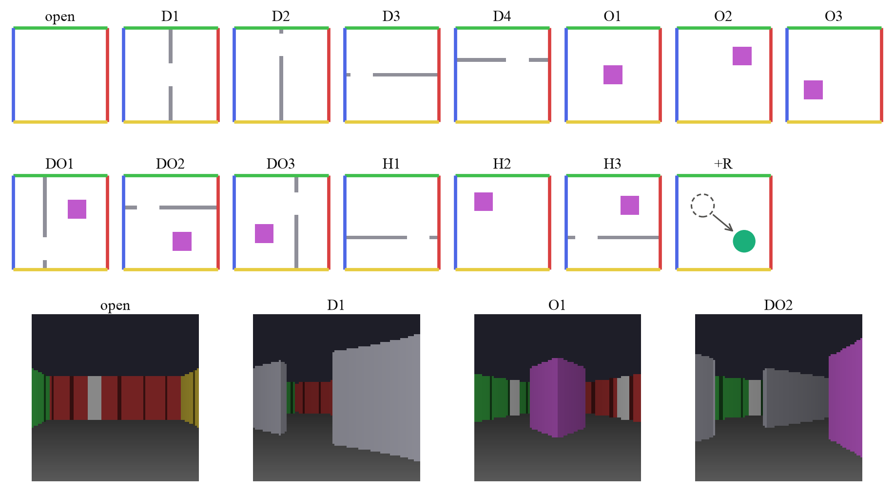
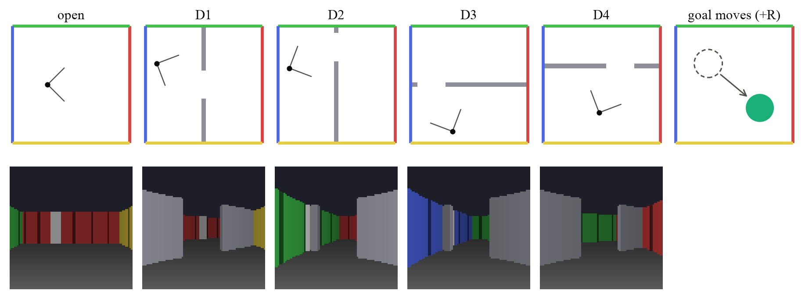
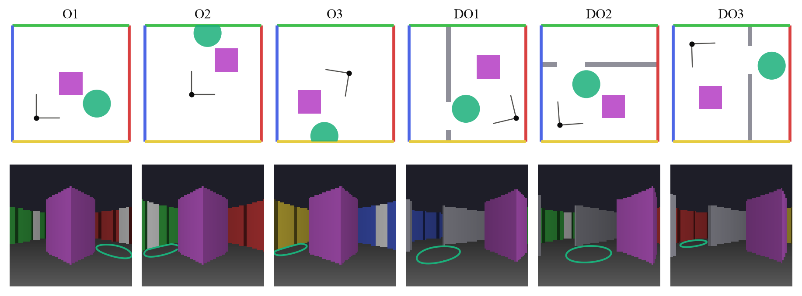
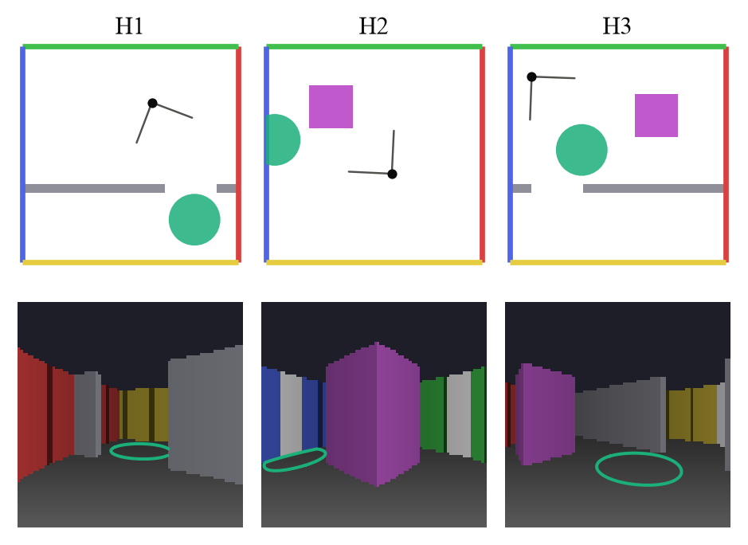
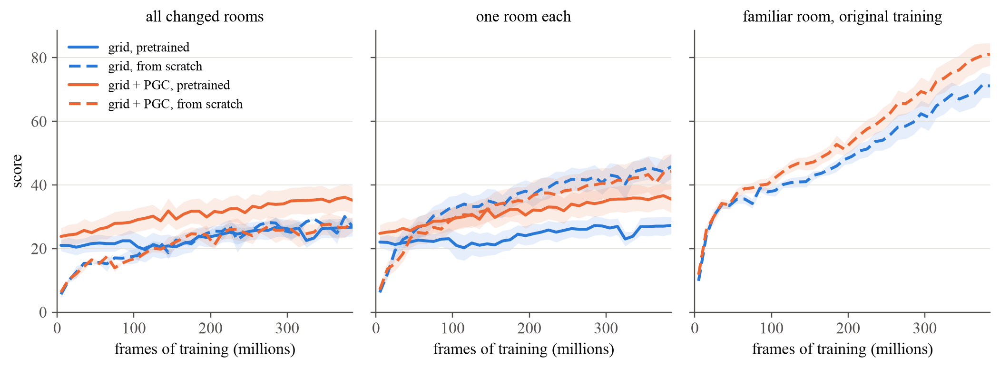
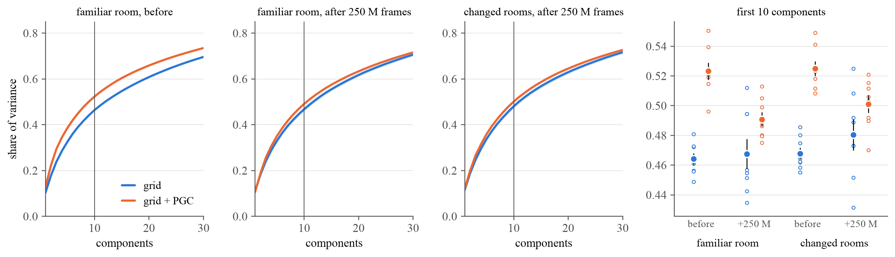

# When the familiar room changes

**The big question.** Do predictive grid cells help an agent reach a goal when a room it already knows changes?

## 1. What was the agent trying to do?

It had 90 seconds (1,350 steps) to find an invisible goal as many times as possible. Each time it reached the goal, it earned 10 points and was dropped somewhere else in the room. The goal usually stayed put. So the first trip tested how well the agent could search. Later trips tested how well it could get back to a place it already knew.

## 2. What were the two kinds of agents?

Both had first-person vision and were both the LSTM agents. We trained eight pairs for one billion frames each in the original open room.

- The **grid-only agent** received spatial signals about where it was.
- The **predictive agent** had one third of those signals replaced with signals about a spot roughly 20 cm ahead of it.

## 3. What did we change about the room?

We changed two things independently.

- **The floor plan** could gain a wall with one doorway, a single obstacle, or both. We tried 10 layouts with these in different places.
- **The goal** could stay put or jump somewhere else halfway through the episode, without warning.

That gave 21 changed conditions: the 10 layouts played both ways, plus the original open room with a moving goal. We also held back three extra layouts to test agents in rooms they never practised in.

*Figure 1. Top: the rooms from above. **open**: the original room. **D**: a wall with a door. **O**: an obstacle. **DO**: both. **H**: held back, never practised in. **+R**: the goal moves from the dashed circle to the green one. Green: the goal. Bottom: what the agent sees in four of the rooms. The green ring is drawn for the reader. The agent cannot see the goal.*

<b>Room diagrams</b> (every room up close)

*Figure 2. Each room from above (top rows) and through the agent's eyes (bottom rows). The dot is the agent and the two lines are the edges of its view. Green: the goal. The agent cannot see it.*

## 4. Which training histories did we compare?

- **Already trained, tested immediately.** Could the agents use what they already knew on their first exposure to the changed rooms?
- **Already trained, then given practice.** The same agents practised in a mix of changed rooms. We tested them after 250 million extra frames and again after 500 million. We also put them back in the original room to see how much they remembered.
- **Extra practice in the original room.** Two pairs stayed in the original room for the same extra training time. This showed how much their scores could change through ordinary practice.
- **Starting from scratch.** Fresh agents learned either one changed room alone or a mix of changed rooms. This asked how well they could learn those rooms without any prior experience in the open room.

[Training setup](DETAILS.md#protocol)

## 5. What did we measure?

- **Navigation.** How quickly did they first find the goal? How directly did they get back? Did they get stuck against walls, or keep searching the old spot after the goal moved?
- **Network activity.** When every agent experienced the same routes, how much of its internal activity could be summarised with just 10 patterns? This is the PCA test.
- **Reliance on predictive cells.** How much did performance drop when we switched off the predictive cells, compared with switching off the same number of ordinary grid cells?

[Experiment details](DETAILS.md#methods-in-brief-and-caveats)

## 6. What were the results?

**When the room first changed**, both groups lost about 77 % of their score. They found the hidden goal about equally often on the first search. Once they knew where it was, predictive agents made 17 % more return trips per 1,000 steps. When the goal moved, they also spent longer looking in its old spot - this may suggest they have difficulty "forgetting", which is a double edged sword imo.

*Figure 3. Score in each kind of room when the room first changed (left), and after 250 million (250 M) and 500 million (500 M) frames of practice. 10 points = 1 goal. "familiar" is the original room. Blue: grid-only. Orange: predictive. Bars: average of the 8 agents. Dots: single agents.*

**With practice**, both groups improved in the changed rooms and lost about a third of their score in the original room. Predictive agents averaged about half an extra goal per episode after 250 million frames. At the exploratory 500-million-frame check, they reached 3.7 goals versus 2.8 and led in 7 of 8 pairs. This might somewhat suggest that predictive agents adapt better overall.

*Figure 4. Score while practising in the changed rooms. Practice starts at 1 billion frames (1.00 on the axis). Blue: grid-only. Orange: predictive. Top right: the two pairs that stayed in the original room. Bottom: by kind of room, where "goal moved" includes every room with a moving goal. Line: average over agents. Shaded band: how uncertain that average is.*

**From scratch**, after 450 million frames practising one changed room, grid-only agents averaged 4.8 goals per episode and predictive agents 4.5. Fresh agents practising a mix of rooms averaged about 3 goals in both groups. There was no clear predictive advantage in learning the changed rooms from zero.

*Figure 5. Score against frames of training. Blue: grid-only. Orange: predictive. Dashed: fresh agents. Solid: agents already trained in the original room, counted from the start of their practice. Left: the mix of changed rooms. Middle: one room per fresh agent, and the already trained agents in those same rooms. Right: fresh agents learning the original room, for comparison.*

**Inside the networks**, the first 10 patterns explained 52.5 % of activity variation in predictive agents versus 46.8 % in grid-only agents when they first entered the changed rooms. That held in all 8 pairs. The gap shrank to about 2 percentage points after practice.

*Figure 6. How much of the network activity the first patterns explain ("components" in the plot, 0.5 = 50 %). Left three panels: by number of patterns. Right: the first 10 only. Blue: grid-only. Orange: predictive. Small circles: single agents.*

**The clearest positive** was that the agents kept using their predictive cells. Switching those cells off hurt navigation more than switching off the same number of ordinary grid cells. That happened immediately after the room changed and at both later checkpoints.

[Full results](DETAILS.md)
