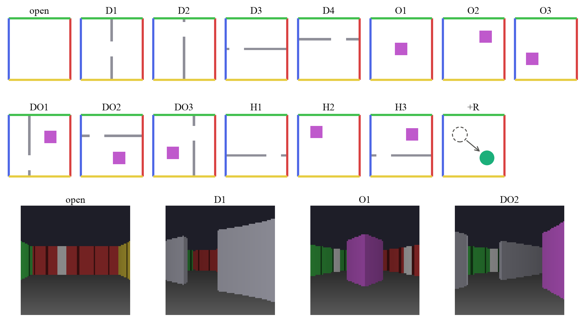
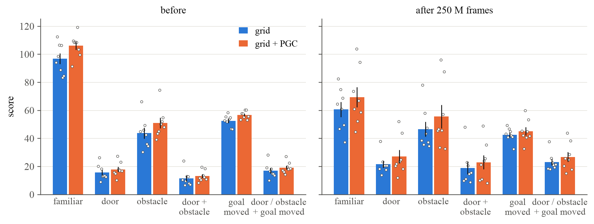
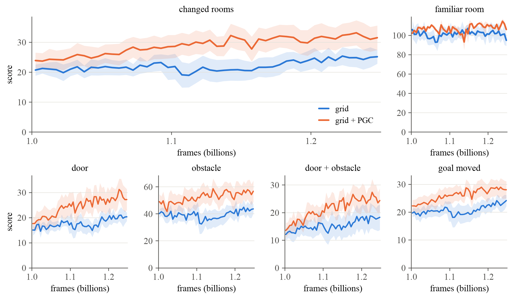
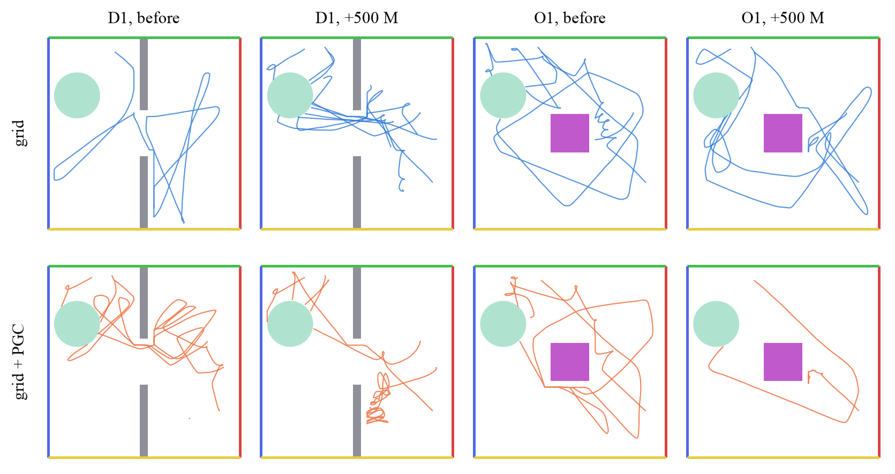
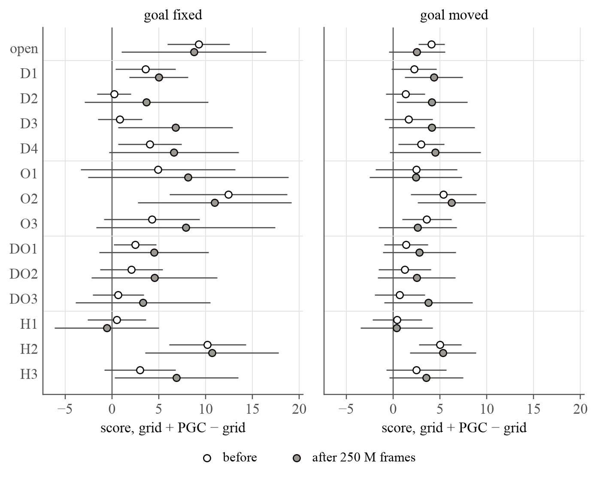
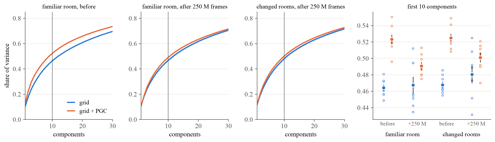
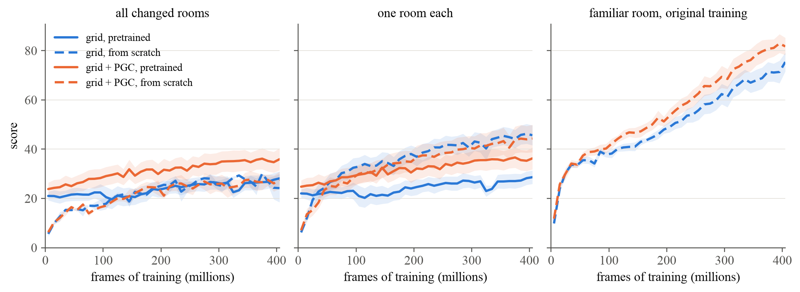

# When the familiar room changes

**Question.** Predictive grid cells (PGC) help an agent reach the goal in the room it was trained in. Do they still help when that room changes?

**What we did.** The sixteen LSTM + vision agents of the main study (8 seeds; 100 % grid cells, or grid + 33 % predictive grid cells; 1 B frames in the open room) were tested with frozen weights in changed versions of their room: a wall with one door, an obstacle, both, and a goal that moves in mid-episode. All sixteen were then trained for another 250 M frames in the changed rooms and tested again<!--IF long-->, and once more after {{extra}} M frames<!--END-->. Two references: the same extra frames in the familiar room (2 seeds per code), and agents trained from scratch in the changed rooms (one pair per room).

**In short.** None of the six planned tests is significant. In changed rooms the PGC agents score more on average: by {{n(st('before','changed','score')['diff'],1)}} points when frozen, {{n(st('after','changed','score')['diff'],1)}} after the planned 250 M frames of fine-tuning ({{p(st('after','changed','score'))}}) and {{n(st('long','changed','score')['diff'],1)}} after {{extra}} M ({{p(st('long','changed','score'))}}), a lead that eight seeds cannot tell from zero. Unplanned comparisons give three leads still to be confirmed: a larger PGC gain with fine-tuning ({{p(chg('before->long','changed','score')['diff'])}} over {{extra}} M frames), activity that stays more concentrated in the PGC agents (first 10 components: +{{n(100 * S['replay_pca']['after']['familiar']['var10']['diff'])}} points after 250 M frames, +{{n(100 * S['replay_pca']['long']['familiar']['var10']['diff'])}} after {{extra}} M, +{{n(100 * S['replay_pca']['before']['familiar']['var10']['diff'])}} before), and more time spent at a moved goal's old place.

**The numbers.** Scores are goals × 10 per 90 s episode. Pairs of numbers are always grid first, then PGC. Differences are PGC − grid, mean ± SEM over the 8 seeds, paired; p values are uncorrected paired t-tests.

| | grid | PGC | PGC − grid | p |
|---|---|---|---|---|
| familiar room, 1 B agents | {{n(st('before','familiar','score')['gc'])}} | {{n(st('before','familiar','score')['pgc'])}} | {{d(st('before','familiar','score'))}} | {{pv(st('before','familiar','score'))}} |
| changed rooms, same agents, frozen | {{n(st('before','changed','score')['gc'])}} | {{n(st('before','changed','score')['pgc'])}} | {{d(st('before','changed','score'))}} | {{pv(st('before','changed','score'))}} |
| changed rooms, after 250 M frames there | {{n(st('after','changed','score')['gc'])}} | {{n(st('after','changed','score')['pgc'])}} | {{d(st('after','changed','score'))}} | {{pv(st('after','changed','score'))}} |
<!--IF long-->
| changed rooms, after {{extra}} M frames there (not planned) | {{n(st('long','changed','score')['gc'])}} | {{n(st('long','changed','score')['pgc'])}} | {{d(st('long','changed','score'))}} | {{pv(st('long','changed','score'))}} |
<!--END-->
| familiar room, after 250 M frames in the changed rooms | {{n(st('after','familiar','score')['gc'])}} | {{n(st('after','familiar','score')['pgc'])}} | {{d(st('after','familiar','score'))}} | {{pv(st('after','familiar','score'))}} |
<!--IF long-->
| familiar room, after {{extra}} M frames in the changed rooms (not planned) | {{n(st('long','familiar','score')['gc'])}} | {{n(st('long','familiar','score')['pgc'])}} | {{d(st('long','familiar','score'))}} | {{pv(st('long','familiar','score'))}} |
<!--END-->
| first 10 PCs, share of variance, 1 B agents | {{pct(S['replay_pca']['before']['familiar']['var10']['gc'],1)}} | {{pct(S['replay_pca']['before']['familiar']['var10']['pgc'],1)}} | {{sg(100 * S['replay_pca']['before']['familiar']['var10']['diff'])}} ± {{n(100 * S['replay_pca']['before']['familiar']['var10']['sem'])}} points | {{pv(S['replay_pca']['before']['familiar']['var10'])}} |
| first 10 PCs, after 250 M frames in the changed rooms | {{pct(S['replay_pca']['after']['familiar']['var10']['gc'],1)}} | {{pct(S['replay_pca']['after']['familiar']['var10']['pgc'],1)}} | {{sg(100 * S['replay_pca']['after']['familiar']['var10']['diff'])}} ± {{n(100 * S['replay_pca']['after']['familiar']['var10']['sem'])}} points | {{pv(S['replay_pca']['after']['familiar']['var10'])}} |
<!--IF long-->
| first 10 PCs, after {{extra}} M frames in the changed rooms (not planned) | {{pct(S['replay_pca']['long']['familiar']['var10']['gc'],1)}} | {{pct(S['replay_pca']['long']['familiar']['var10']['pgc'],1)}} | {{sg(100 * S['replay_pca']['long']['familiar']['var10']['diff'])}} ± {{n(100 * S['replay_pca']['long']['familiar']['var10']['sem'])}} points | {{pv(S['replay_pca']['long']['familiar']['var10'])}} |
<!--END-->

1. **A changed room costs both codes about four fifths of their score.** Frozen agents keep {{pct(S['retention']['before']['changed']['gc'])}} (grid) and {{pct(S['retention']['before']['changed']['pgc'])}} (PGC) of their familiar-room score (difference {{sg(100 * S['retention']['before']['changed']['diff'])}} ± {{n(100 * S['retention']['before']['changed']['sem'])}} percentage points). The PGC agents stay ahead on average (in {{k(st('before','changed','score'))}} seeds), but the lead is {{sg(st('before','changed','score')['diff'])}} points instead of {{sg(st('before','familiar','score')['diff'])}}, and eight seeds cannot separate it from zero.
2. **If anything of the advantage survives, it is in the returns.** Once the goal is found, PGC agents collect more goals ({{gp(st('before','no_relocation','post_rate'),2)}} per 1000 steps, {{p(st('before','no_relocation','post_rate'))}}) and tend to take more direct paths around the wall or obstacle ({{p(st('before','no_relocation','path_eff'))}}). No difference was found in how often or how soon the goal is first found. These are the frozen 1 B agents. After fine-tuning both differences point the same way (goal rate: {{p(st('after','no_relocation','post_rate'))}} after 250 M frames, {{p(st('long','no_relocation','post_rate'))}} after {{extra}} M; path efficiency: {{p(st('after','no_relocation','path_eff'))}} and {{p(st('long','no_relocation','path_eff'))}}).
3. **Fine-tuning is slow, and the PGC agents tend to gain more from it.** After 250 M frames in the changed rooms the score there is {{one(chg('before->after','changed','score')['gc'])}} (grid) and {{one(chg('before->after','changed','score')['pgc'])}} (PGC) points higher, after {{extra}} M frames {{one(chg('before->long','changed','score')['gc'])}} and {{one(chg('before->long','changed','score')['pgc'])}}. The PGC lead is {{d(st('before','changed','score'))}} before, {{d(st('after','changed','score'))}} after 250 M and {{d(st('long','changed','score'))}} after {{extra}} M frames ({{p(st('long','changed','score'))}}, PGC higher in {{k(st('long','changed','score'))}} seeds). The planned test at 250 M frames showed no larger PGC gain ({{one(chg('before->after','changed','score')['diff'])}}, {{p(chg('before->after','changed','score')['diff'])}}); over the whole {{extra}} M frames it is borderline ({{one(chg('before->long','changed','score')['diff'])}}, {{p(chg('before->long','changed','score')['diff'])}}, larger in {{chg('before->long','changed','score')['diff']['pos']}} of 8 seeds). In the frozen tests the extra gain falls in the second half ({{one(chg('after->long','changed','score')['diff'])}}, {{p(chg('after->long','changed','score')['diff'])}}), in the training score in the first half, so when the lead grew is not established. In the familiar room both codes have lost more than a third of their score after 250 M frames; after {{extra}} M frames the grid agents are {{pct(1 - S['retention']['long']['familiar']['gc'])}} below their 1 B score and the PGC agents {{pct(1 - S['retention']['long']['familiar']['pgc'])}} (difference of the two changes {{one(chg('before->long','familiar','score')['diff'])}}, {{p(chg('before->long','familiar','score')['diff'])}}).
4. **After fine-tuning the first 10 principal components hold 2 to 3 points more of the variance in the PGC agents, against 6 points before; at the planned 250 M checkpoint the difference is not significant.** At 1 B the share is higher in the PGC agent of every seed, in the familiar room ({{pct(S['replay_pca']['before']['familiar']['var10']['gc'],1)}} and {{pct(S['replay_pca']['before']['familiar']['var10']['pgc'],1)}}) and just as much in the changed rooms ({{pct(S['replay_pca']['before']['changed']['var10']['gc'],1)}} and {{pct(S['replay_pca']['before']['changed']['var10']['pgc'],1)}}). After 250 M frames of fine-tuning the difference is {{sg(100 * S['replay_pca']['after']['familiar']['var10']['diff'])}} ± {{n(100 * S['replay_pca']['after']['familiar']['var10']['sem'])}} points ({{p(S['replay_pca']['after']['familiar']['var10'])}}, PGC higher in {{k(S['replay_pca']['after']['familiar']['var10'])}} seeds; {{p(X['excl3']['replay_pca']['after']['familiar']['var10'])}} without the seed whose grid agent collapsed during fine-tuning), and after {{extra}} M frames {{sg(100 * S['replay_pca']['long']['familiar']['var10']['diff'])}} ± {{n(100 * S['replay_pca']['long']['familiar']['var10']['sem'])}} points ({{p(S['replay_pca']['long']['familiar']['var10'])}}, {{k(S['replay_pca']['long']['familiar']['var10'])}} seeds). These are the familiar-room replay; in the changed-room replay the difference is {{sg(100 * S['replay_pca']['after']['changed']['var10']['diff'])}} ± {{n(100 * S['replay_pca']['after']['changed']['var10']['sem'])}} ({{p(S['replay_pca']['after']['changed']['var10'])}}) and {{sg(100 * S['replay_pca']['long']['changed']['var10']['diff'])}} ± {{n(100 * S['replay_pca']['long']['changed']['var10']['sem'])}} points ({{p(S['replay_pca']['long']['changed']['var10'])}}). The difference shrank as the PGC share fell in all eight agents (by {{n(-100 * S['replay_pca']['long']['familiar']['var10_change']['pgc']['mean'])}} ± {{n(100 * S['replay_pca']['long']['familiar']['var10_change']['pgc']['sem'])}} points at {{long_b}} B), while the grid share moved less ({{sg(100 * S['replay_pca']['long']['familiar']['var10_change']['gc']['mean'])}} ± {{n(100 * S['replay_pca']['long']['familiar']['var10_change']['gc']['sem'])}}).
5. **After a goal move the PGC agents spend more time at the old place.** Agents that know the goal keep returning to where it was. In the open room the frozen PGC agents spend more of that time there (share of time near the old goal minus the share in a control zone: {{gp(st('before','goal_moved','perseveration_knew'),2)}}, {{p(st('before','goal_moved','perseveration_knew'))}}), and both codes find the moved goal about equally rarely (in {{pct(st('before','goal_moved','refound_knew')['gc'],1)}} and {{pct(st('before','goal_moved','refound_knew')['pgc'],1)}} of episodes). After fine-tuning both codes stay less. The PGC agents tend to stay longer after 250 M frames ({{gp(st('after','goal_moved','perseveration_knew'),2)}}, {{p(st('after','goal_moved','perseveration_knew'))}}) and stay longer after {{extra}} M ({{gp(st('long','goal_moved','perseveration_knew'),2)}}, {{p(st('long','goal_moved','perseveration_knew'))}}). They find the moved goal less often after 250 M frames (grid {{pct(st('after','goal_moved','refound_knew')['gc'])}}, PGC {{pct(st('after','goal_moved','refound_knew')['pgc'])}} of episodes, {{p(st('after','goal_moved','refound_knew'))}}) and about as often after {{extra}} M ({{pct(st('long','goal_moved','refound_knew')['gc'])}} and {{pct(st('long','goal_moved','refound_knew')['pgc'])}}, {{p(st('long','goal_moved','refound_knew'))}}); neither difference is significant.
6. **The predictive cells are used in the changed rooms.** Silencing the 169 predictive cells of a PGC agent costs more than silencing 169 random grid cells: {{one(S['lesion']['before']['changed']['specific'])}} points in the changed rooms before fine-tuning ({{fmt_p(S['lesion']['before']['changed']['specific']['p'])}}), {{one(S['lesion']['after']['changed']['specific'])}} after 250 M frames ({{fmt_p(S['lesion']['after']['changed']['specific']['p'])}}) and {{one(S['lesion']['long']['changed']['specific'])}} after {{extra}} M ({{fmt_p(S['lesion']['long']['changed']['specific']['p'])}}).
<!--IF scratch-->
7. **Trained from scratch in one room alone, agents score higher there than the fine-tuned agents; trained from scratch on the mixture, they score about as much or less; and from scratch the PGC agents are not ahead.** After {{scr_mark()}} M frames in one room they score {{n(SR()['own_room']['gc'])}} (grid) and {{n(SR()['own_room']['pgc'])}} (PGC) in that room, against {{n(SC['finetuned_reference'][scr_ref()]['gc100']['rooms'])}} and {{n(SC['finetuned_reference'][scr_ref()]['pgc33']['rooms'])}} for the agents that came from the familiar room and trained {{scr_ref_m()}} M frames on the mixture, about a tenth of them in each layout. Agents trained from scratch on the mixture score {{n((ST()['mixture']['gc100_s1']['rooms'] + ST()['mixture']['gc100_s2']['rooms']) / 2)}} and {{n((ST()['mixture']['pgc33_s1']['rooms'] + ST()['mixture']['pgc33_s2']['rooms']) / 2)}} in the same rooms (2 seeds). Among the one-room agents PGC − grid is {{d(SR()['own_room'])}} over {{SR()['own_room']['n']}} rooms ({{p(SR()['own_room'])}}, PGC higher in {{SR()['own_room']['pos']}} rooms; one seed per room).
<!--END-->

**The planned tests.** Six comparisons were fixed in advance: one for the frozen 1 B agents and five for the 250 M checkpoint, none for {{long_b}} B (section 10). None is significant, with or without the correction for six tests. The p values below 0.05 in points 2 to 6, and everything at {{long_b}} B, come from other, uncorrected comparisons: read them as leads, not as confirmed effects.

---

## The rooms

*Figure 1. Top: floor plans. **open** is the familiar room. **D1–D4** add a wall with one 0.6 m door, **O1–O3** one 0.5 m obstacle, **DO1–DO3** both. **H1–H3** are never used for training. **+R** means the goal jumps to a new place, unannounced, halfway through the episode. Bottom: what the agent sees in four of the rooms.*

Everything else is the task of the main study ([main README](../../README.md)): a 2.5 m room, one hidden goal per 90 s episode, +10 for reaching it, then a teleport to a random pose while the goal stays. The four outer walls keep their colours and their per-episode stripes and landmarks; the new wall is grey and the obstacle purple. Walls and the obstacle block movement (the agent slides along them) and sight. The grid and predictive codes are computed from the agent's true position exactly as before, so a predictive cell near a wall reads its map 20 cm ahead even when that point lies behind the wall.

A changed room is one of 21 conditions: the ten layouts D1–DO3, each with the goal fixed or moved, plus the open room with a moved goal. A moved goal lands at least 1 m from the old one.

### Protocol

| step | agents | what |
|---|---|---|
| before | 16 agents at 1 B frames (8 seeds × 2 codes) | frozen test in the familiar room, the 21 changed rooms and 6 never-trained rooms |
| fine-tuning | the same 16 | training continues in the changed rooms: every episode draws one of the 21 conditions; same optimizer state and hyperparameters as before |
| after 250 M | the 16 checkpoints at 1.25 B | the same frozen test |
<!--IF long-->
| after {{extra}} M | the 16 checkpoints at {{long_b}} B | training simply went on; the same frozen test |
<!--END-->
| reference 1 | seeds 1 and 2 of both codes | the same extra frames in the familiar room, same tests |
| reference 2 | new agents, one grid and one PGC for each of the ten layouts and for the open room with a moving goal (11 pairs) | trained from scratch in that room alone; two more pairs from scratch on the mixture (section 9) |

Each test is 200 episodes per room; an episode is 1350 steps (90 s). Layouts, goals and start poses are the same for every agent, so the two codes of a seed are compared on the same episodes. The one exception is the place a goal moves to, which differs between the two codes of a seed in about 1 moved-goal episode in 10 (see the caveats). All statistics are paired within seed: difference = PGC − grid, mean ± SEM over the 8 seeds, two-sided paired t-test (a permutation test for the six planned tests of section 10), and "k/8" counts the seeds in which PGC is higher.

### What Banino et al. 2018 changed, and what is new here

Read from the paper and its supplement:

| their test | what changes | weights |
|---|---|---|
| square arena, 2.5 × 2.5 m | goal position, wall and floor textures and one cue are re-drawn every episode | still learning |
| goal-doors, 11 × 11 multi-room mazes | a new maze every episode; door states "changed randomly during an episode each time the agent reached the goal" | still learning |
| larger maze | agents trained 10⁹ steps in 11 × 11 goal-doors, tested in 11 × 17 mazes | frozen |
| linearized Tolman sunburst maze | until the first goal arrival only door 5 is open, then all five | frozen |
| double E-maze | in training the shortest corridors are always closed; at test every corridor opens after the first goal arrival | frozen |
| fake goal code | the stored goal code is replaced by the code of a random place | frozen |

Their tests of a changed environment (the last four rows) all use frozen weights: a larger maze, doors or corridors that open after the first goal arrival, and a swapped goal code. They have no obstacle placed in a familiar room, no goal that moves within an episode, and no agent retrained after a change. Our door walls follow their doors; the obstacle, the moving goal and the fine-tuning are additions.

---

## 1. Before fine-tuning: frozen 1 B agents in the changed rooms

*Figure 2. Score (10 points per goal reached in 90 s) by kind of change. Left: the frozen 1 B agents. Then: after 250 M frames in the changed rooms (section 3)<!--IF long-->, and after {{extra}} M frames<!--END-->. Bars: mean of 8 seeds; lines: SEM; dots: seeds.*

| rooms | grid | PGC | PGC − grid | p | k/8 |
|---|---|---|---|---|---|
{{row('familiar', st('before','familiar','score'))}}
{{row('changed, all 21', st('before','changed','score'))}}
{{row('door', st('before','door','score'))}}
{{row('obstacle', st('before','obstacle','score'))}}
{{row('door + obstacle', st('before','door_obstacle','score'))}}
{{row('goal moved, open room', st('before','goal_moved','score'))}}
{{row('door / obstacle and goal moved', st('before','layout_and_goal_moved','score'))}}

**Both codes collapse, by a similar proportion.** In the changed rooms the agents keep {{pct(S['retention']['before']['changed']['gc'])}} (grid) and {{pct(S['retention']['before']['changed']['pgc'])}} (PGC) of their familiar-room score (difference {{sg(100 * S['retention']['before']['changed']['diff'])}} ± {{n(100 * S['retention']['before']['changed']['sem'])}} percentage points, {{p(S['retention']['before']['changed'])}}). Rooms with a door wall are the hardest, most of all with an obstacle added. An obstacle alone or a moved goal in the open room costs about half of the score, and in the moved-goal room most of what is left is earned before the goal moves (section 5).

**In points the predictive lead is smaller on average; whether it is smaller in proportion cannot be decided.** It is {{ci(st('before','familiar','score'))}} in the familiar room and {{ci(st('before','changed','score'))}} in the changed rooms ({{p(st('before','changed','score'))}}). The drop is {{n(S['gap_drop']['before']['mean'])}} ± {{n(S['gap_drop']['before']['sem'])}} points ({{fmt_p(S['gap_drop']['before']['p'])}}). A lead kept in proportion to the score would be about +2 points and a lost lead 0; both lie inside the interval. PGC has the higher mean score in {{npos('before', trained_rooms)}} of the {{len(trained_rooms)}} changed rooms and in {{npos('before', new_rooms)}} of the {{len(new_rooms)}} never-trained rooms, but these are not independent tests: they are the same 8 pairs of agents.

**The agents push against the new walls.** In the changed rooms with a fixed goal, {{pct(st('before','no_relocation','wall_contact')['gc'])}} (grid) and {{pct(st('before','no_relocation','wall_contact')['pgc'])}} (PGC) of all steps are spent pushing against a wall or the obstacle; in the familiar room it is {{pct(st('before','familiar','wall_contact')['gc'],1)}} and {{pct(st('before','familiar','wall_contact')['pgc'],1)}}. The goal is found in fewer episodes ({{pct(st('before','no_relocation','frac_found')['gc'])}} and {{pct(st('before','no_relocation','frac_found')['pgc'])}}, against {{pct(st('before','familiar','frac_found')['gc'])}} and {{pct(st('before','familiar','frac_found')['pgc'])}} in the familiar room) and later when it is found (after {{n(st('before','no_relocation','first_found_step')['gc'],0)}} and {{n(st('before','no_relocation','first_found_step')['pgc'],0)}} steps, against {{n(st('before','familiar','first_found_step')['gc'],0)}} and {{n(st('before','familiar','first_found_step')['pgc'],0)}}).

**If anything survives of the predictive advantage, it is in the returns.** Once the goal is found, PGC agents collect more goals ({{gp(st('before','no_relocation','post_rate'),2)}} per 1000 steps; {{full(st('before','no_relocation','post_rate'),2)}}) and tend to take shorter paths around the wall or obstacle (path efficiency: {{gp(st('before','no_relocation','path_eff'),3)}}; {{full(st('before','no_relocation','path_eff'),3)}}). These were not planned tests (section 10). No difference shows in the share of episodes in which the goal is found ({{p(st('before','no_relocation','frac_found'))}}), in the time of the first find ({{p(st('before','no_relocation','first_found_step'))}}), or in the ratio of first-find time to return time ({{gp(st('before','no_relocation','latency_ratio'),2)}}, {{p(st('before','no_relocation','latency_ratio'))}}).

## 2. Fine-tuning in the changed rooms

*Figure 3. Training score during fine-tuning (5 M-frame bins; line: mean of 8 seeds, band: SEM). The x axis is total training; fine-tuning starts at 1.0 B<!--IF long-->, and the vertical line marks the planned end at 1.25 B<!--END-->. Top left: all 21 changed-room conditions. Top right: the reference agents that stayed in the familiar room (2 seeds). Bottom: by kind of change; "goal moved" pools all 11 conditions with a goal move.*

| frames of fine-tuning | grid | PGC | PGC − grid | p | k/8 |
|---|---|---|---|---|---|
{{row('0–25 M', S['curve_gap'][0])}}
{{row('100–125 M', S['curve_gap'][4])}}
{{row('225–250 M', S['curve_gap'][9])}}
<!--IF long-->
{{row('350–375 M', S['curve_gap'][14])}}
{{row(str(extra - 25) + '–' + str(extra) + ' M', S['curve_gap'][-1])}}
<!--END-->

*Training score in the changed rooms (the 21 conditions mixed), 25 M-frame windows. These are the episodes played during training, not the frozen tests.*

**Adaptation is slow in both codes.** In 250 M frames, a quarter of the original training, the training score in the changed rooms rises from {{n(S['curve_gap'][0]['gc'])}} to {{n(S['curve_gap'][9]['gc'])}} (grid) and from {{n(S['curve_gap'][0]['pgc'])}} to {{n(S['curve_gap'][9]['pgc'])}} (PGC); after {{extra}} M frames it is {{n(S['curve_gap'][-1]['gc'])}} and {{n(S['curve_gap'][-1]['pgc'])}}. In the familiar room the same agents scored about 100 in training, and none of the 16 gets back to half of that in the {{extra}} M frames (the closest, the PGC agent of seed 4, reaches {{n(S['time_to_threshold']['pgc33']['pgc33room_lstm_s4']['best'],0)}} of {{n(S['time_to_threshold']['pgc33']['pgc33room_lstm_s4']['familiar_training_score'],0)}} in its best 25 M frames).

**The PGC agents gain more in the training score, by a borderline margin; the frozen test does not show it at 250 M frames and is itself borderline at {{extra}} M.** Their lead is {{d(S['curve_gap'][0])}} in the first 25 M frames and {{d(S['curve_gap'][9])}} in frames 225–250 M, the last of the planned run ({{p(S['curve_gap'][9])}} against zero); in frames {{extra - 25}}–{{extra}} M it is {{d(S['curve_gap'][-1])}} ({{p(S['curve_gap'][-1])}}). Over the planned 250 M frames it grows by {{d(S['curve_growth'])}} points ({{p(S['curve_growth'])}}, larger gain in the PGC agent of {{k(S['curve_growth'])}} seeds). The frozen test of section 3 gives {{one(chg('before->after','changed','score')['diff'])}} ({{p(chg('before->after','changed','score')['diff'])}}) at 250 M frames, which was the planned comparison, and {{one(chg('before->long','changed','score')['diff'])}} ({{p(chg('before->long','changed','score')['diff'])}}) at {{extra}} M, which was not. Seeds differ more than codes: in the frozen test at 250 M two PGC agents (seeds 4 and 7) gain about 20 points and the other fourteen agents between −3 and +12; at {{extra}} M the two gain {{n(S['transfer']['long']['gain']['pgc_seeds'][3],0)}} and {{n(S['transfer']['long']['gain']['pgc_seeds'][6],0)}} points and the others between {{sg(min(S['transfer']['long']['gain']['gc_seeds'] + [x for i, x in enumerate(S['transfer']['long']['gain']['pgc_seeds']) if i not in (3, 6)]),1)}} and {{sg(max(S['transfer']['long']['gain']['gc_seeds'] + [x for i, x in enumerate(S['transfer']['long']['gain']['pgc_seeds']) if i not in (3, 6)]),1)}}.

**One grid agent collapsed and recovered.** The policy of the grid agent of seed 3 collapsed between 95 M and 150 M frames of fine-tuning (entropy near zero, score near 1) and then relearned; this is the first dip of the blue line in Figure 3 and it widens the gap in the 100–125 M row of the table. Two other agents (the PGC agents of seeds 4 and 7) had such collapses for about 1 M and 3 M frames and recovered at once<!--IF long-->, and the grid agent of seed 2 had one of about 12 M frames at 322 to 335 M frames of fine-tuning (the second dip of the blue line) and also recovered<!--END-->. All agents are kept in all statistics. Leaving seed 3 out of both codes leaves the behavioural estimates almost unchanged (changed rooms after 250 M frames: {{d(xst('excl3','after','changed','score'))}}, {{p(xst('excl3','after','changed','score'))}}; [all tables without seed 3](RESULTS_excl3.md)), but with seven seeds the borderline p values rise: the goal rate once the goal is known becomes {{d(xst('excl3','before','no_relocation','post_rate'),2)}} ({{p(xst('excl3','before','no_relocation','post_rate'))}}) and the growth of the training-score lead {{d(X['excl3']['curve_growth'])}} ({{p(X['excl3']['curve_growth'])}}). For the PCA, seed 3 matters in the other direction (section 6).

## 3. After fine-tuning

Frozen test of the 1.25 B checkpoints (Figure 2):

| rooms | grid | PGC | PGC − grid | p | k/8 |
|---|---|---|---|---|---|
{{row('familiar', st('after','familiar','score'))}}
{{row('changed, all 21', st('after','changed','score'))}}
{{row('door', st('after','door','score'))}}
{{row('obstacle', st('after','obstacle','score'))}}
{{row('door + obstacle', st('after','door_obstacle','score'))}}
{{row('goal moved, open room', st('after','goal_moved','score'))}}
{{row('door / obstacle and goal moved', st('after','layout_and_goal_moved','score'))}}

**Both codes gain a few points in the changed rooms.** Grid {{n(st('before','changed','score')['gc'])}} → {{n(st('after','changed','score')['gc'])}} ({{one(chg('before->after','changed','score')['gc'])}}), PGC {{n(st('before','changed','score')['pgc'])}} → {{n(st('after','changed','score')['pgc'])}} ({{one(chg('before->after','changed','score')['pgc'])}}). The gain is clearest in the rooms with a door wall (door: {{one(chg('before->after','door','score')['gc'])}} grid, {{one(chg('before->after','door','score')['pgc'])}} PGC; door + obstacle: {{one(chg('before->after','door_obstacle','score')['gc'])}}, {{one(chg('before->after','door_obstacle','score')['pgc'])}}). With an obstacle alone the average gain is smaller and uncertain ({{one(chg('before->after','obstacle','score')['gc'])}}, {{one(chg('before->after','obstacle','score')['pgc'])}}): the room with the obstacle in the centre gains (O1: {{n(pc('before','O1','score')['gc'])}} → {{n(pc('after','O1','score')['gc'])}} grid, {{n(pc('before','O1','score')['pgc'])}} → {{n(pc('after','O1','score')['pgc'])}} PGC), the other two do not (O2: {{n(pc('before','O2','score')['gc'])}} → {{n(pc('after','O2','score')['gc'])}}, {{n(pc('before','O2','score')['pgc'])}} → {{n(pc('after','O2','score')['pgc'])}}; O3: {{n(pc('before','O3','score')['gc'])}} → {{n(pc('after','O3','score')['gc'])}}, {{n(pc('before','O3','score')['pgc'])}} → {{n(pc('after','O3','score')['pgc'])}}). One condition loses clearly: the open room with a moved goal ({{one(chg('before->after','goal_moved','score')['gc'])}}, {{one(chg('before->after','goal_moved','score')['pgc'])}}), where fewer goals are collected before the goal moves (section 5).

**The PGC mean is still higher, by a margin that eight seeds cannot separate from zero.** After fine-tuning the difference in the changed rooms is {{ci(st('after','changed','score'))}}, {{p(st('after','changed','score'))}}, PGC higher in {{k(st('after','changed','score'))}} seeds. It depends on a few seeds: {{sg(st('after','changed','score')['pgc_seeds'][3] - st('after','changed','score')['gc_seeds'][3])}} (seed 4) and {{sg(st('after','changed','score')['pgc_seeds'][6] - st('after','changed','score')['gc_seeds'][6])}} (seed 7) against {{sg(st('after','changed','score')['pgc_seeds'][1] - st('after','changed','score')['gc_seeds'][1])}} (seed 2); the other five lie between {{sg(min(q - g for i, (g, q) in enumerate(zip(st('after','changed','score')['gc_seeds'], st('after','changed','score')['pgc_seeds'])) if i not in (1, 3, 6)))}} and {{sg(max(q - g for i, (g, q) in enumerate(zip(st('after','changed','score')['gc_seeds'], st('after','changed','score')['pgc_seeds'])) if i not in (1, 3, 6)))}}. Before fine-tuning the difference was {{ci(st('before','changed','score'))}}. It changed by {{ci(chg('before->after','changed','score')['diff'])}}, {{p(chg('before->after','changed','score')['diff'])}}. Whether the predictive agents adapt faster is taken up again below, with the later checkpoint.

**On average both codes lose more than a third of their familiar-room score.** Grid {{n(st('before','familiar','score')['gc'])}} → {{n(st('after','familiar','score')['gc'])}}, PGC {{n(st('before','familiar','score')['pgc'])}} → {{n(st('after','familiar','score')['pgc'])}}. The two changes differ by {{sg(chg('before->after','familiar','score')['diff']['mean'])}} points (PGC − grid; 95 % CI {{sg(chg('before->after','familiar','score')['diff']['mean'] - chg('before->after','familiar','score')['diff']['ci95'])}} to {{sg(chg('before->after','familiar','score')['diff']['mean'] + chg('before->after','familiar','score')['diff']['ci95'])}}, {{p(chg('before->after','familiar','score')['diff'])}}): eight seeds show no difference and cannot exclude a large one. The losses are more uneven among the PGC agents ({{n(min(-x for x in S['transfer']['after']['backward']['pgc_seeds']),0)}} to {{n(max(-x for x in S['transfer']['after']['backward']['pgc_seeds']),0)}} points) than among the grid agents ({{n(min(-x for x in S['transfer']['after']['backward']['gc_seeds']),0)}} to {{n(max(-x for x in S['transfer']['after']['backward']['gc_seeds']),0)}}). During fine-tuning the agents still met the open room, but only in 1 of 21 episodes (the open room with a moving goal). A trade-off between gain and loss can be neither shown nor excluded: the Spearman ρ between gain and familiar-room change is {{sg(S['gain_vs_forgetting']['after']['pooled']['rho'], 2)}} over the 16 agents ({{fmt_p(S['gain_vs_forgetting']['after']['pooled']['p'])}}; a trade-off would make it negative), {{sg(S['gain_vs_forgetting']['after']['gc100']['rho'], 2)}} within grid and {{sg(S['gain_vs_forgetting']['after']['pgc33']['rho'], 2)}} within PGC. The two PGC agents that gained most (seeds 4 and 7) lost least ({{sg(S['transfer']['after']['backward']['pgc_seeds'][3])}} and {{sg(S['transfer']['after']['backward']['pgc_seeds'][6])}} points).

**How the behaviour changed** (changed rooms with a fixed goal; grid, PGC):

| | before | after 250 M |
|---|---|---|
| share of steps pushing against a wall or the obstacle | {{pct(st('before','no_relocation','wall_contact')['gc'])}}, {{pct(st('before','no_relocation','wall_contact')['pgc'])}} | {{pct(st('after','no_relocation','wall_contact')['gc'])}}, {{pct(st('after','no_relocation','wall_contact')['pgc'])}} |
| episodes in which the goal is found | {{pct(st('before','no_relocation','frac_found')['gc'])}}, {{pct(st('before','no_relocation','frac_found')['pgc'])}} | {{pct(st('after','no_relocation','frac_found')['gc'])}}, {{pct(st('after','no_relocation','frac_found')['pgc'])}} |
| steps to the first goal, when it is found | {{n(st('before','no_relocation','first_found_step')['gc'],0)}}, {{n(st('before','no_relocation','first_found_step')['pgc'],0)}} | {{n(st('after','no_relocation','first_found_step')['gc'],0)}}, {{n(st('after','no_relocation','first_found_step')['pgc'],0)}} |
| goals per 1000 steps once the goal is known | {{n(st('before','no_relocation','post_rate')['gc'],2)}}, {{n(st('before','no_relocation','post_rate')['pgc'],2)}} | {{n(st('after','no_relocation','post_rate')['gc'],2)}}, {{n(st('after','no_relocation','post_rate')['pgc'],2)}} |
| path efficiency of completed returns | {{n(st('before','no_relocation','path_eff')['gc'],3)}}, {{n(st('before','no_relocation','path_eff')['pgc'],3)}} | {{n(st('after','no_relocation','path_eff')['gc'],3)}}, {{n(st('after','no_relocation','path_eff')['pgc'],3)}} |

The agents push less against the new surfaces (still far more than in the familiar room), and they find the goal in more episodes and sooner. Their returns do not become more direct: path efficiency falls in both codes, in the changed rooms and in the familiar room (grid {{n(st('before','familiar','path_eff')['gc'],3)}} → {{n(st('after','familiar','path_eff')['gc'],3)}}, PGC {{n(st('before','familiar','path_eff')['pgc'],3)}} → {{n(st('after','familiar','path_eff')['pgc'],3)}}). The PGC − grid differences point the same way as before, and none is significant after fine-tuning: goals once the goal is known {{d(st('after','no_relocation','post_rate'),2)}} ({{p(st('after','no_relocation','post_rate'))}}), path efficiency {{d(st('after','no_relocation','path_eff'),3)}} ({{p(st('after','no_relocation','path_eff'))}}).

*Figure 4. One test episode of the seed-1 agents in a door room (D1) and an obstacle room (O1), before and after {{extra if S.get('long_m') else 250}} M frames of fine-tuning. Same start, goal (green disc) and layout for all agents; lines break where the agent is teleported after reaching the goal. An illustration, not a result.*

<!--IF long-->
### After {{extra}} M frames

The 250 M checkpoint was the planned end. Because time allowed, training went on, and the frozen test was repeated at {{long_b}} B frames.

| rooms | grid | PGC | PGC − grid | p | k/8 |
|---|---|---|---|---|---|
{{row('familiar', st('long','familiar','score'))}}
{{row('changed, all 21', st('long','changed','score'))}}
{{row('door', st('long','door','score'))}}
{{row('obstacle', st('long','obstacle','score'))}}
{{row('door + obstacle', st('long','door_obstacle','score'))}}
{{row('goal moved, open room', st('long','goal_moved','score'))}}
{{row('door / obstacle and goal moved', st('long','layout_and_goal_moved','score'))}}
{{row('new rooms, goal fixed (H1–H3, never trained)', st('long','new_rooms','score'))}}

**With twice the fine-tuning the PGC lead is larger, and still short of significance.** Grid {{n(st('before','changed','score')['gc'])}} → {{n(st('after','changed','score')['gc'])}} → {{n(st('long','changed','score')['gc'])}}, PGC {{n(st('before','changed','score')['pgc'])}} → {{n(st('after','changed','score')['pgc'])}} → {{n(st('long','changed','score')['pgc'])}} (before, after 250 M, after {{extra}} M). After {{extra}} M frames the difference is {{ci(st('long','changed','score'))}}, {{p(st('long','changed','score'))}}, PGC higher in {{k(st('long','changed','score'))}} seeds; the exception is seed 2, whose grid agent is the best of its code. Against the frozen 1 B agents the gap has grown by {{ci(chg('before->long','changed','score')['diff'])}}, {{p(chg('before->long','changed','score')['diff'])}}, with the larger gain in the PGC agent of {{chg('before->long','changed','score')['diff']['pos']}} of 8 seeds. Between 250 M and {{extra}} M frames it grew by {{one(chg('after->long','changed','score')['diff'])}} ({{p(chg('after->long','changed','score')['diff'])}}, larger PGC gain in {{chg('after->long','changed','score')['diff']['pos']}} of 8 seeds). That last comparison is one of many unplanned ones, and the training score puts the growth of the lead in the first 250 M frames instead (section 2), so when the lead grew is not established.

**Familiar room.** Grid {{n(st('before','familiar','score')['gc'])}} → {{n(st('after','familiar','score')['gc'])}} → {{n(st('long','familiar','score')['gc'])}}, PGC {{n(st('before','familiar','score')['pgc'])}} → {{n(st('after','familiar','score')['pgc'])}} → {{n(st('long','familiar','score')['pgc'])}}. At {{long_b}} B the difference there is {{d(st('long','familiar','score'))}} ({{p(st('long','familiar','score'))}}); the two changes from 1 B differ by {{one(chg('before->long','familiar','score')['diff'])}} ({{p(chg('before->long','familiar','score')['diff'])}}).

**Behaviour** (changed rooms with a fixed goal; grid, PGC): pushing against a wall or the obstacle in {{pct(st('long','no_relocation','wall_contact')['gc'])}} and {{pct(st('long','no_relocation','wall_contact')['pgc'])}} of steps; the goal is found in {{pct(st('long','no_relocation','frac_found')['gc'])}} and {{pct(st('long','no_relocation','frac_found')['pgc'])}} of episodes; goals per 1000 steps once the goal is known {{n(st('long','no_relocation','post_rate')['gc'],2)}} and {{n(st('long','no_relocation','post_rate')['pgc'],2)}} ({{d(st('long','no_relocation','post_rate'),2)}}, {{p(st('long','no_relocation','post_rate'))}}); path efficiency {{n(st('long','no_relocation','path_eff')['gc'],3)}} and {{n(st('long','no_relocation','path_eff')['pgc'],3)}} ({{d(st('long','no_relocation','path_eff'),3)}}, {{p(st('long','no_relocation','path_eff'))}}).

The later checkpoint was not planned, and its comparisons are not among the six of section 10.
<!--END-->

## 4. Room by room, and rooms never trained in

*Figure 5. PGC − grid score in every room (mean and SEM over 8 seeds). Left: goal fixed. Right: goal moved. H1–H3 were never used for training.*

PGC has the higher mean score in {{npos('before', trained_rooms)}} of the {{len(trained_rooms)}} changed rooms before fine-tuning and in {{npos('after', trained_rooms)}} after it; in the {{len(new_rooms)}} never-trained rooms, in {{npos('before', new_rooms)}} before and {{npos('after', new_rooms)}} after. No single room is significant after 250 M frames (smallest {{fmt_p(min(S['per_condition']['after'][r]['score']['p'] for r in trained_rooms + new_rooms))}}), and the rooms are not independent tests.<!--IF long--> After {{extra}} M frames PGC is ahead in {{npos('long', trained_rooms)}} of the {{len(trained_rooms)}} changed rooms and in {{npos('long', new_rooms)}} of the {{len(new_rooms)}} never-trained rooms; {{sum(S['per_condition']['long'][r]['score']['p'] < 0.05 for r in trained_rooms + new_rooms)}} single rooms then have an uncorrected p below 0.05 ({{', '.join(r + ' ' + fmt_p(S['per_condition']['long'][r]['score']['p']) for r in trained_rooms + new_rooms if S['per_condition']['long'][r]['score']['p'] < 0.05)}}).<!--END-->

**Rooms never trained in (H1–H3).** Averaged over the three new layouts with a fixed goal the score did not change in the first 250 M frames ({{one(chg('before->after','new_rooms','score')['gc'])}} grid, {{one(chg('before->after','new_rooms','score')['pgc'])}} PGC), but the average hides two opposite moves. Of the two new rooms with a door wall, one gains (H3: {{n(pc('before','H3','score')['gc'])}} → {{n(pc('after','H3','score')['gc'])}} grid, {{n(pc('before','H3','score')['pgc'])}} → {{n(pc('after','H3','score')['pgc'])}} PGC) and one hardly changes (H1: {{n(pc('before','H1','score')['gc'])}} → {{n(pc('after','H1','score')['gc'])}}, {{n(pc('before','H1','score')['pgc'])}} → {{n(pc('after','H1','score')['pgc'])}}). The new obstacle room, the one closest to the open room, loses with the open-room skill (H2: {{n(pc('before','H2','score')['gc'])}} → {{n(pc('after','H2','score')['gc'])}}, {{n(pc('before','H2','score')['pgc'])}} → {{n(pc('after','H2','score')['pgc'])}}). With a moved goal the same three layouts gain {{one(chg('before->after','new_rooms_goal_moved','score')['gc'])}} (grid) and {{one(chg('before->after','new_rooms_goal_moved','score')['pgc'])}} (PGC). The predictive lead in the new rooms with a fixed goal is {{d(st('before','new_rooms','score'))}} before ({{p(st('before','new_rooms','score'))}}), {{d(st('after','new_rooms','score'))}} after 250 M frames ({{p(st('after','new_rooms','score'))}})<!--IF long--> and {{d(st('long','new_rooms','score'))}} after {{extra}} M ({{p(st('long','new_rooms','score'))}})<!--END-->.

## 5. A goal that moves

Open room, goal moved at mid-episode. Only episodes in which the agent had reached the goal before it moved are counted.

| | grid | PGC | PGC − grid | p | k/8 |
|---|---|---|---|---|---|
{{row('before: share of episodes that find the moved goal', st('before','goal_moved','refound_knew'), 3)}}
{{row('before: perseveration index', st('before','goal_moved','perseveration_knew'), 3)}}
{{row('after 250 M: share of episodes that find the moved goal', st('after','goal_moved','refound_knew'), 3)}}
{{row('after 250 M: perseveration index', st('after','goal_moved','perseveration_knew'), 3)}}
<!--IF long-->
{{row('after ' + str(extra) + ' M: share of episodes that find the moved goal', st('long','goal_moved','refound_knew'), 3)}}
{{row('after ' + str(extra) + ' M: perseveration index', st('long','goal_moved','perseveration_knew'), 3)}}
<!--END-->

The perseveration index is the share of time spent within 0.45 m of the old goal, from the move until the moved goal is first reached (or the episode ends), minus the same share for a control zone of the same size on the opposite side of the room.

**Before fine-tuning neither code copes with a moved goal, and the PGC agents stay longer at the old place.** An agent that knows the goal keeps returning to where it was: the moved goal is found in {{pct(st('before','goal_moved','refound_knew')['gc'],1)}} (grid) and {{pct(st('before','goal_moved','refound_knew')['pgc'],1)}} (PGC) of those episodes. The grid agents spend {{pct(st('before','goal_moved','old_goal_dwell_knew')['gc'])}} of that time near the old goal and the PGC agents {{pct(st('before','goal_moved','old_goal_dwell_knew')['pgc'])}}, against about 3 % in the control zone. The difference in the index is {{full(st('before','goal_moved','perseveration_knew'),3)}} (not a planned test). The higher score of the PGC agents in this room ({{d(st('before','goal_moved','score'))}}, {{p(st('before','goal_moved','score'))}}) is earned before the goal moves.

**After fine-tuning both codes stay less at the old place.** The moved goal is found in {{pct(st('after','goal_moved','refound_knew')['gc'])}} (grid) and {{pct(st('after','goal_moved','refound_knew')['pgc'])}} (PGC) of those episodes, and the index falls to {{n(st('after','goal_moved','perseveration_knew')['gc'],3)}} and {{n(st('after','goal_moved','perseveration_knew')['pgc'],3)}}. The PGC agents still tend to stay longer ({{d(st('after','goal_moved','perseveration_knew'),3)}}, {{p(st('after','goal_moved','perseveration_knew'))}}) and to find the moved goal less often ({{d(st('after','goal_moved','refound_knew'),3)}}, {{p(st('after','goal_moved','refound_knew'))}}); neither difference is significant. This is not only learned flexibility. The score in this room falls ({{n(st('before','goal_moved','score')['gc'])}} → {{n(st('after','goal_moved','score')['gc'])}} grid, {{n(st('before','goal_moved','score')['pgc'])}} → {{n(st('after','goal_moved','score')['pgc'])}} PGC) because fewer goals are collected before the move ({{n(st('before','goal_moved','goals_pre')['gc'],2)}} → {{n(st('after','goal_moved','goals_pre')['gc'],2)}} and {{n(st('before','goal_moved','goals_pre')['pgc'],2)}} → {{n(st('after','goal_moved','goals_pre')['pgc'],2)}} per episode), so part of the change is a weaker return to any remembered goal.

<!--IF long-->
After {{extra}} M frames the two codes find the moved goal equally often ({{pct(st('long','goal_moved','refound_knew')['gc'])}} and {{pct(st('long','goal_moved','refound_knew')['pgc'])}} of those episodes, {{p(st('long','goal_moved','refound_knew'))}}), and the PGC agents still spend more time at the old place (index {{n(st('long','goal_moved','perseveration_knew')['gc'],3)}} and {{n(st('long','goal_moved','perseveration_knew')['pgc'],3)}}; {{d(st('long','goal_moved','perseveration_knew'),3)}}, {{p(st('long','goal_moved','perseveration_knew'))}}, PGC higher in {{k(st('long','goal_moved','perseveration_knew'))}} seeds).

<!--END-->
In the ten door and obstacle rooms with a goal move the difference points the same way and is weaker (index before: {{gp(st('before','layout_and_goal_moved','perseveration_knew'),3)}}, {{p(st('before','layout_and_goal_moved','perseveration_knew'))}}; after 250 M: {{gp(st('after','layout_and_goal_moved','perseveration_knew'),3)}}, {{p(st('after','layout_and_goal_moved','perseveration_knew'))}}<!--IF long-->; after {{extra}} M: {{gp(st('long','layout_and_goal_moved','perseveration_knew'),3)}}, {{p(st('long','layout_and_goal_moved','perseveration_knew'))}}<!--END-->).

At all three points in time the PGC agents spend more time at the old goal on average ({{p(st('before','goal_moved','perseveration_knew'))}}, {{p(st('after','goal_moved','perseveration_knew'))}} and {{p(st('long','goal_moved','perseveration_knew'))}}). They also collect slightly fewer goals after the move at all three (goals after the move in those episodes, grid and PGC: {{n(st('before','goal_moved','goals_post_knew')['gc'],2)}} and {{n(st('before','goal_moved','goals_post_knew')['pgc'],2)}} before, {{n(st('after','goal_moved','goals_post_knew')['gc'],2)}} and {{n(st('after','goal_moved','goals_post_knew')['pgc'],2)}} after 250 M, {{n(st('long','goal_moved','goals_post_knew')['gc'],2)}} and {{n(st('long','goal_moved','goals_post_knew')['pgc'],2)}} after {{extra}} M); none of these differences is significant. Whether their faster returns to a remembered goal in a stable room and their longer stay at an old goal have the same cause was not tested.

## 6. PCA: do the first 10 components still explain more in the predictive agents?

*Figure 6. PCA of the 256 LSTM outputs with the earlier protocol (the same 16 scripted episodes replayed through every network). Left panels: share of variance in the first n components (line: mean of 8 seeds, band: SEM). Right: share in the first 10 components; small circles are seeds.*

The earlier result ([PCA spectrum of all eight seed pairs](../lstm_variable_1B/pca_spectrum/README.md)): with one scripted set of 16 episodes replayed through every network, the first 10 principal components hold 46.4 % of the variance of the LSTM output in the grid agents and 52.3 % in the PGC agents. Rerunning that protocol reproduces those numbers exactly. We then ran the same protocol in the changed rooms (the same controller, steered around the wall and the obstacle), and on every later checkpoint.

| agents | replay in | grid | PGC | PGC − grid | p | k/n |
|---|---|---|---|---|---|---|
{{row('1 B (before) | familiar room', S['replay_pca']['before']['familiar']['var10'], 4)}}
{{row('1 B (before) | changed rooms', S['replay_pca']['before']['changed']['var10'], 4)}}
{{row('+250 M in the changed rooms | familiar room', S['replay_pca']['after']['familiar']['var10'], 4)}}
{{row('+250 M in the changed rooms | changed rooms', S['replay_pca']['after']['changed']['var10'], 4)}}
<!--IF long-->
{{row('+' + str(extra) + ' M in the changed rooms | familiar room', S['replay_pca']['long']['familiar']['var10'], 4)}}
{{row('+' + str(extra) + ' M in the changed rooms | changed rooms', S['replay_pca']['long']['changed']['var10'], 4)}}
<!--END-->

**Before fine-tuning the difference carries over to the changed rooms unchanged**: {{gp(S['replay_pca']['before']['changed']['var10'], 3)}}, higher in the PGC agent of {{k(S['replay_pca']['before']['changed']['var10'])}} seeds. The difference in the changed-room replay minus the difference in the familiar-room replay is {{ci(S['replay_pca']['before']['changed']['var10_vs_familiar'], 4)}}. The 10 strongest components are also largely the same in both kinds of room: those of the changed-room replay capture {{pct(S['alignment']['before']['familiar_vs_changed']['gc'])}} (grid) and {{pct(S['alignment']['before']['familiar_vs_changed']['pgc'])}} (PGC) as much familiar-room variance as the familiar room's own 10 ({{p(S['alignment']['before']['familiar_vs_changed'])}} between codes).

**After 250 M frames of fine-tuning the difference is less than half as large and, with all eight seeds, not significant.** With the same replay, the first 10 components hold {{pct(S['replay_pca']['after']['familiar']['var10']['gc'],1)}} (grid) and {{pct(S['replay_pca']['after']['familiar']['var10']['pgc'],1)}} (PGC) of the variance in the familiar room ({{full(S['replay_pca']['after']['familiar']['var10'],4)}}), and {{pct(S['replay_pca']['after']['changed']['var10']['gc'],1)}} and {{pct(S['replay_pca']['after']['changed']['var10']['pgc'],1)}} in the changed rooms ({{full(S['replay_pca']['after']['changed']['var10'],4)}}).

**Seed 3 matters here.** The grid agent whose policy collapsed and was relearned during fine-tuning (section 2) ends with the most concentrated activity of all grid agents ({{n(S['replay_pca']['after']['familiar']['var10']['gc_seeds'][2],3)}}). Seed 3 is the only pair in which the grid agent is above the PGC agent in both replays. Without seed 3 the difference after fine-tuning is {{d(X['excl3']['replay_pca']['after']['familiar']['var10'],4)}} ({{p(X['excl3']['replay_pca']['after']['familiar']['var10'])}}, PGC higher in {{k(X['excl3']['replay_pca']['after']['familiar']['var10'])}} seeds) in the familiar room and {{d(X['excl3']['replay_pca']['after']['changed']['var10'],4)}} ({{p(X['excl3']['replay_pca']['after']['changed']['var10'])}}, {{k(X['excl3']['replay_pca']['after']['changed']['var10'])}}) in the changed rooms. That is {{pct(X['excl3']['replay_pca']['after']['familiar']['var10']['diff'] / X['excl3']['replay_pca']['before']['familiar']['var10']['diff'])}} of the 1 B difference of the same seven seeds, against {{pct(S['replay_pca']['after']['familiar']['var10']['diff'] / S['replay_pca']['before']['familiar']['var10']['diff'])}} with all eight. These p values are uncorrected; the planned tests (section 10) use all eight seeds.

<!--IF long-->
**After {{extra}} M frames the PGC share is higher in every seed again in the familiar-room replay, and in {{S['replay_pca']['long']['changed']['var10']['pos']}} of 8 seeds in the changed-room replay.** The first 10 components hold {{pct(S['replay_pca']['long']['familiar']['var10']['gc'],1)}} (grid) and {{pct(S['replay_pca']['long']['familiar']['var10']['pgc'],1)}} (PGC) of the variance in the familiar-room replay ({{full(S['replay_pca']['long']['familiar']['var10'],4)}}) and {{pct(S['replay_pca']['long']['changed']['var10']['gc'],1)}} and {{pct(S['replay_pca']['long']['changed']['var10']['pgc'],1)}} in the changed-room replay ({{full(S['replay_pca']['long']['changed']['var10'],4)}}). In the familiar-room replay that is {{pct(S['replay_pca']['long']['familiar']['var10']['diff'] / S['replay_pca']['before']['familiar']['var10']['diff'])}} of the 1 B difference, in the changed-room replay {{pct(S['replay_pca']['long']['changed']['var10']['diff'] / S['replay_pca']['before']['changed']['var10']['diff'])}}. The grid agent of seed 3 no longer stands out ({{n(S['replay_pca']['long']['familiar']['var10']['gc_seeds'][2],3)}}; without seed 3 the difference is {{d(X['excl3']['replay_pca']['long']['familiar']['var10'],4)}}, {{p(X['excl3']['replay_pca']['long']['familiar']['var10'])}}). This checkpoint was not planned, so these p values are uncorrected.
<!--END-->

**The PGC share fell in almost every agent.** Against its own value at 1 B, the first-10 share fell in {{S['replay_pca']['after']['familiar']['var10_change']['pgc']['n'] - S['replay_pca']['after']['familiar']['var10_change']['pgc']['pos']}} of the 8 PGC agents in the familiar-room replay ({{one(S['replay_pca']['after']['familiar']['var10_change']['pgc'],4)}}) and in {{S['replay_pca']['after']['changed']['var10_change']['pgc']['n'] - S['replay_pca']['after']['changed']['var10_change']['pgc']['pos']}} of 8 in the changed-room replay ({{one(S['replay_pca']['after']['changed']['var10_change']['pgc'],4)}}). The numbers that follow are for the familiar-room replay. The grid agents changed in both directions ({{sg(min(S['replay_pca']['after']['familiar']['var10_change']['gc']['seeds']),3)}} to {{sg(max(S['replay_pca']['after']['familiar']['var10_change']['gc']['seeds']),3)}}; mean {{one(S['replay_pca']['after']['familiar']['var10_change']['gc'],4)}}). The difference between the codes is {{one(S['replay_pca']['after']['familiar']['var10_change']['diff'],4)}} ({{p(S['replay_pca']['after']['familiar']['var10_change']['diff'])}}). In the two reference pairs that stayed in the familiar room the PGC share shows no such fall ({{sg(S['replay_pca']['same']['familiar']['var10_change']['pgc']['seeds'][0],3)}} and {{sg(S['replay_pca']['same']['familiar']['var10_change']['pgc']['seeds'][1],3)}} at 1.25 B<!--IF long-->; {{sg(S['replay_pca']['same_long']['familiar']['var10_change']['pgc']['seeds'][0],3)}} and {{sg(S['replay_pca']['same_long']['familiar']['var10_change']['pgc']['seeds'][1],3)}} at {{long_b}} B<!--END-->). The activity of the PGC agents is still the larger one overall (total variance of the 256 outputs: {{gp(S['replay_pca']['after']['familiar']['total_var'],1)}}, {{p(S['replay_pca']['after']['familiar']['total_var'])}}).<!--IF long--> After {{extra}} M frames the share has fallen in {{S['replay_pca']['long']['familiar']['var10_change']['pgc']['n'] - S['replay_pca']['long']['familiar']['var10_change']['pgc']['pos']}} of the 8 PGC agents in the familiar-room replay and in {{S['replay_pca']['long']['changed']['var10_change']['pgc']['n'] - S['replay_pca']['long']['changed']['var10_change']['pgc']['pos']}} of 8 in the changed-room replay ({{one(S['replay_pca']['long']['familiar']['var10_change']['pgc'],4)}} in the familiar-room replay, against {{one(S['replay_pca']['long']['familiar']['var10_change']['gc'],4)}} for the grid agents; difference {{one(S['replay_pca']['long']['familiar']['var10_change']['diff'],4)}}, {{p(S['replay_pca']['long']['familiar']['var10_change']['diff'])}}).<!--END-->

**Fine-tuning changed the 10 strongest components in both codes.** Fed the same inputs, the 10 strongest components of a fine-tuned network capture about half as much of the 1 B activity as the 1 B network's own 10 did (overlap, 1 = the same components: {{gp(S['alignment']['after']['before_vs_after_familiar'],2)}}, {{p(S['alignment']['after']['before_vs_after_familiar'])}} between codes). In the reference agents, which trained on in the familiar room, the overlap is {{n(S['alignment']['same']['before_vs_same_familiar']['gc'],2)}} (grid) and {{n(S['alignment']['same']['before_vs_same_familiar']['pgc'],2)}} (PGC) (2 seeds).<!--IF long--> After {{extra}} M frames the overlap with 1 B is {{n(S['alignment']['long']['before_vs_long_familiar']['gc'],2)}} (grid) and {{n(S['alignment']['long']['before_vs_long_familiar']['pgc'],2)}} (PGC), against {{n(S['alignment']['same_long']['before_vs_same_long_familiar']['gc'],2)}} and {{n(S['alignment']['same_long']['before_vs_same_long_familiar']['pgc'],2)}} in the reference agents at {{long_b}} B (2 seeds).<!--END-->

**A more concentrated code did not adapt less.** Across agents, a higher first-10 share at 1 B did not go with a smaller gain in the changed rooms (Spearman ρ = {{sg(S['rank_vs_adaptation']['after']['pooled']['rho_gain'], 2)}} over the {{S['rank_vs_adaptation']['after']['pooled']['n']}} agents, {{fmt_p(S['rank_vs_adaptation']['after']['pooled']['p_gain'])}}; {{sg(S['rank_vs_adaptation']['after']['gc100']['rho_gain'], 2)}} within grid, {{sg(S['rank_vs_adaptation']['after']['pgc33']['rho_gain'], 2)}} within PGC; description only).<!--IF long--> With the gain over {{extra}} M frames the correlation is {{sg(S['rank_vs_adaptation']['long']['pooled']['rho_gain'], 2)}} ({{fmt_p(S['rank_vs_adaptation']['long']['pooled']['p_gain'])}}; {{sg(S['rank_vs_adaptation']['long']['gc100']['rho_gain'], 2)}} within grid, {{sg(S['rank_vs_adaptation']['long']['pgc33']['rho_gain'], 2)}} within PGC).<!--END-->

**The agents' own behaviour gives the same answer for the steps with the goal known.** When each agent chooses its own path, the share also depends on what the agent is doing: in the familiar room the first 10 components hold {{n((st('before','familiar','var10_search')['gc'] + st('before','familiar','var10_search')['pgc']) / 2, 2)}} of the variance while an agent is still searching and {{n((st('before','familiar','var10_return')['gc'] + st('before','familiar','var10_return')['pgc']) / 2, 2)}} once it knows the goal. Restricted to steps with the goal known, the PGC agents are again more concentrated, in the familiar room ({{gp(st('before','familiar','var10_return'),3)}}; {{full(st('before','familiar','var10_return'),3)}}) and in the changed rooms with a fixed goal ({{gp(st('before','no_relocation','var10_return'),3)}}; {{full(st('before','no_relocation','var10_return'),3)}}). Over all steps the difference is {{d(st('before','familiar','var10'),3)}} ({{p(st('before','familiar','var10'))}}) in the familiar room and {{d(st('before','no_relocation','var10'),3)}} ({{p(st('before','no_relocation','var10'))}}) in the changed rooms, where the agents are still searching in most steps.
After 250 M frames of fine-tuning the goal-known comparison gives {{gp(st('after','familiar','var10_return'),3)}} in the familiar room ({{full(st('after','familiar','var10_return'),3)}}) and {{gp(st('after','no_relocation','var10_return'),3)}} in the changed rooms ({{full(st('after','no_relocation','var10_return'),3)}}): the same direction, smaller.<!--IF long--> After {{extra}} M frames it gives {{gp(st('long','familiar','var10_return'),3)}} ({{full(st('long','familiar','var10_return'),3)}}) and {{gp(st('long','no_relocation','var10_return'),3)}} ({{full(st('long','no_relocation','var10_return'),3)}}).<!--END-->

## 7. Are the predictive cells themselves still used?

Silencing cells at test time, in the PGC agents only: the 169 predictive cells, or 169 random grid cells (two draws averaged).

| agents | rooms | intact | PGCs silenced | random grid cells silenced | PGC-specific cost | p |
|---|---|---|---|---|---|---|
| 1 B (before) | familiar | {{n(S['lesion']['before']['familiar']['intact'])}} | {{n(S['lesion']['before']['familiar']['no_pgc'])}} | {{n(S['lesion']['before']['familiar']['sham'])}} | {{one(S['lesion']['before']['familiar']['specific'])}} | {{pv(S['lesion']['before']['familiar']['specific'])}} |
| 1 B (before) | changed (21) | {{n(S['lesion']['before']['changed']['intact'])}} | {{n(S['lesion']['before']['changed']['no_pgc'])}} | {{n(S['lesion']['before']['changed']['sham'])}} | {{one(S['lesion']['before']['changed']['specific'])}} | {{pv(S['lesion']['before']['changed']['specific'])}} |
| +250 M | familiar | {{n(S['lesion']['after']['familiar']['intact'])}} | {{n(S['lesion']['after']['familiar']['no_pgc'])}} | {{n(S['lesion']['after']['familiar']['sham'])}} | {{one(S['lesion']['after']['familiar']['specific'])}} | {{pv(S['lesion']['after']['familiar']['specific'])}} |
| +250 M | changed (21) | {{n(S['lesion']['after']['changed']['intact'])}} | {{n(S['lesion']['after']['changed']['no_pgc'])}} | {{n(S['lesion']['after']['changed']['sham'])}} | {{one(S['lesion']['after']['changed']['specific'])}} | {{pv(S['lesion']['after']['changed']['specific'])}} |
<!--IF long-->
| +{{extra}} M | familiar | {{n(S['lesion']['long']['familiar']['intact'])}} | {{n(S['lesion']['long']['familiar']['no_pgc'])}} | {{n(S['lesion']['long']['familiar']['sham'])}} | {{one(S['lesion']['long']['familiar']['specific'])}} | {{pv(S['lesion']['long']['familiar']['specific'])}} |
| +{{extra}} M | changed (21) | {{n(S['lesion']['long']['changed']['intact'])}} | {{n(S['lesion']['long']['changed']['no_pgc'])}} | {{n(S['lesion']['long']['changed']['sham'])}} | {{one(S['lesion']['long']['changed']['specific'])}} | {{pv(S['lesion']['long']['changed']['specific'])}} |
<!--END-->

The PGC-specific cost is the score with random grid cells silenced minus the score with the predictive cells silenced. Before fine-tuning the agents lean on their predictive cells in the changed rooms as well: losing them costs {{n(S['lesion']['before']['changed']['specific']['mean'])}} points more than losing as many grid cells, on a score of {{n(S['lesion']['before']['changed']['intact'])}}.

**After 250 M frames of fine-tuning the predictive cells are still used, in both kinds of room.** Silencing them costs {{n(S['lesion']['after']['changed']['specific']['mean'])}} points more than silencing as many grid cells in the changed rooms ({{fmt_p(S['lesion']['after']['changed']['specific']['p'])}}), on a score of {{n(S['lesion']['after']['changed']['intact'])}}, and {{n(S['lesion']['after']['familiar']['specific']['mean'])}} points more in the familiar room. The cost is smaller than before fine-tuning: by {{n(-S['lesion_change']['after']['familiar']['mean'])}} ± {{n(S['lesion_change']['after']['familiar']['sem'])}} points in the familiar room ({{fmt_p(S['lesion_change']['after']['familiar']['p'])}}) and by {{n(-S['lesion_change']['after']['changed']['mean'])}} ± {{n(S['lesion_change']['after']['changed']['sem'])}} in the changed rooms ({{fmt_p(S['lesion_change']['after']['changed']['p'])}}).

<!--IF long-->
After {{extra}} M frames the PGC-specific cost is {{one(S['lesion']['long']['changed']['specific'])}} points in the changed rooms ({{fmt_p(S['lesion']['long']['changed']['specific']['p'])}}), no longer smaller than before fine-tuning (change {{one(S['lesion_change']['long']['changed'])}}), and {{one(S['lesion']['long']['familiar']['specific'])}} in the familiar room ({{fmt_p(S['lesion']['long']['familiar']['specific']['p'])}}).

<!--END-->
## 8. Reference: the same extra frames in the familiar room

Seeds 1 and 2 of both codes got the same extra frames in the familiar room instead of the changed rooms.

| agent | state | familiar | changed (21) | new rooms, goal fixed (3) |
|---|---|---|---|---|
{{ref_table()}}

**More training in the familiar room moves the changed-room score by a few points, up in three agents and down in one.** From 1 B to 1.25 B in the familiar room, the changed-room score of the four reference agents moves by {{sg(S['transfer']['same']['gc100_s1']['gain'])}} and {{sg(S['transfer']['same']['gc100_s2']['gain'])}} (grid) and {{sg(S['transfer']['same']['pgc33_s1']['gain'])}} and {{sg(S['transfer']['same']['pgc33_s2']['gain'])}} (PGC), {{sg((S['transfer']['same']['gc100_s1']['gain'] + S['transfer']['same']['gc100_s2']['gain'] + S['transfer']['same']['pgc33_s1']['gain'] + S['transfer']['same']['pgc33_s2']['gain']) / 4)}} on average. That is ordinary drift between two checkpoints of one agent.

**Against that drift the fine-tuning gain is small.** The same four agents, fine-tuned, gain {{sg(S['transfer']['after']['gain']['gc_seeds'][0])}}, {{sg(S['transfer']['after']['gain']['gc_seeds'][1])}}, {{sg(S['transfer']['after']['gain']['pgc_seeds'][0])}} and {{sg(S['transfer']['after']['gain']['pgc_seeds'][1])}}: {{sg((S['transfer']['after']['gain']['gc_seeds'][0] + S['transfer']['after']['gain']['gc_seeds'][1] + S['transfer']['after']['gain']['pgc_seeds'][0] + S['transfer']['after']['gain']['pgc_seeds'][1]) / 4)}} on average. With two seeds per code the reference shows the size of the drift; it is not a test.

<!--IF long-->
At {{long_b}} B the changed-room score of the four reference agents has moved by {{sg(S['transfer']['same_long']['gc100_s1']['gain'])}} and {{sg(S['transfer']['same_long']['gc100_s2']['gain'])}} (grid) and {{sg(S['transfer']['same_long']['pgc33_s1']['gain'])}} and {{sg(S['transfer']['same_long']['pgc33_s2']['gain'])}} (PGC) from its 1 B value; the same four agents, fine-tuned for {{extra}} M frames, by {{sg(S['transfer']['long']['gain']['gc_seeds'][0])}}, {{sg(S['transfer']['long']['gain']['gc_seeds'][1])}}, {{sg(S['transfer']['long']['gain']['pgc_seeds'][0])}} and {{sg(S['transfer']['long']['gain']['pgc_seeds'][1])}}. By then three of the four fine-tuned agents have gained clearly more than the drift.
<!--END-->

<!--IF scratch-->
## 9. Reference: agents trained from scratch in the changed rooms

*Figure 7. Training score against frames of training. Solid: agents trained 1 B frames in the familiar room first (8 seeds), during their fine-tuning on the mixture. Dashed: agents trained from scratch. Left: the mixture of the 21 changed-room conditions (from scratch: 2 seeds). Middle: one room each (dashed: 11 rooms, one grid and one PGC agent per room, all frames in that room; solid: the same rooms within the mixture, where each layout gets about a tenth of the frames). Right: the original training in the familiar room (8 seeds). Bands: SEM over seeds, or over the 11 rooms for the dashed lines in the middle.*

For each of the ten changed layouts and for the open room with a moving goal, one grid and one PGC agent were trained from scratch in that room alone (in a layout the goal is fixed in half of the episodes and moved in the other half). That is 11 pairs, with seeds rotating over 1 to 8. Two more pairs were trained from scratch on the mixture that the fine-tuned agents saw. Hyperparameters are those of the original agents. These runs were started later than the fine-tuning. The tables use their frozen test at {{scr_mark()}} M frames. The 22 single-room runs stop at about 450 M frames (budget; they can be resumed), and the four mixture runs go on to about 1.25 B.

Frozen test in the agent's own room (score, mean of goal fixed and goal moved), next to the pretrained agents in that same room:

{{scr_room_header()}}
{{scr_room_table()}}

Paired comparison of the two codes (over rooms for the from-scratch agents, over seeds for the pretrained ones):

| agents | grid | PGC | PGC − grid | p | PGC higher in |
|---|---|---|---|---|---|
{{scr_table()}}

**Trained in one room alone, an agent scores about twice as much there as the fine-tuned agents in the door rooms it has learned; elsewhere the difference is smaller, absent or reversed.** After {{scr_mark()}} M frames in its room, a from-scratch agent scores {{n(SR()['own_room']['gc'])}} (grid) and {{n(SR()['own_room']['pgc'])}} (PGC) on average, against {{n(SC['finetuned_reference'][scr_ref()]['gc100']['rooms'])}} and {{n(SC['finetuned_reference'][scr_ref()]['pgc33']['rooms'])}} for the agents that had 1 B frames in the familiar room and then {{scr_ref_m()}} M frames on the mixture. The difference is largest in the rooms with a door wall (rows D and DO of the table). Some agents had not, or only partly, learned their room in that time (own-room score below 35): {{scr_unlearned()}}. D1 has its door in the middle of a central wall.

**This is a reference level, not a matched comparison.** The from-scratch agent has spent all its frames in its one room; the fine-tuned agent has spent about a tenth of its fine-tuning frames in any one layout (2 of 21 episodes; 1 of 21 for the open room with a moving goal). The matched comparison is the mixture (below): agents trained from scratch on it score {{n((ST()['mixture']['gc100_s1']['rooms'] + ST()['mixture']['gc100_s2']['rooms']) / 2)}} (grid) and {{n((ST()['mixture']['pgc33_s1']['rooms'] + ST()['mixture']['pgc33_s2']['rooms']) / 2)}} (PGC) in these 11 rooms, against {{n(SC['finetuned_reference'][scr_ref()]['gc100']['rooms'])}} and {{n(SC['finetuned_reference'][scr_ref()]['pgc33']['rooms'])}} for the fine-tuned agents: about as much or less, and far below the one-room agents. So the higher scores go with training in one room alone, not with starting from scratch. A change of room costs the from-scratch agents too: in the open room, the ten pairs that had never seen it score {{n(SR()['familiar_room_unseen']['gc'])}} (grid) and {{n(SR()['familiar_room_unseen']['pgc'])}} (PGC) on average.

**From scratch, the PGC agents are not ahead in the changed rooms.** PGC − grid is {{d(SR()['own_room'])}} over the {{SR()['own_room']['n']}} rooms ({{p(SR()['own_room'])}}; 95 % CI {{sg(SR()['own_room']['diff'] - SR()['own_room']['ci95'])}} to {{sg(SR()['own_room']['diff'] + SR()['own_room']['ci95'])}}; PGC higher in {{SR()['own_room']['pos']}} of {{SR()['own_room']['n']}} rooms), and {{scr_learned()}} that both agents of the pair have learned. For comparison, the lead of the pretrained agents in the same rooms is {{sg(SC['finetuned_reference']['1000M']['stat_rooms']['diff'])}} frozen and {{sg(SC['finetuned_reference'][scr_ref()]['stat_rooms']['diff'])}} after {{scr_ref_m()}} M frames of fine-tuning. Each room has one pair of agents with one seed, so room and seed cannot be separated. In the original training in the familiar room the PGC agents were ahead at the same number of frames by {{d(ST()['familiar_original'])}} in the training score ({{p(ST()['familiar_original'])}}, 8 seeds); the one-room agents are at {{d(ST()['scratch_training']['stat'])}} on the same measure.

The mixture, all 21 changed-room conditions (two seeds per code, shown as seed 1, seed 2):

| agents | changed rooms: grid | changed rooms: PGC | familiar room: grid | familiar room: PGC |
|---|---|---|---|---|
{{mix_table()}}

**For the mixture, a billion frames in the familiar room gave a head start of 150 to 200 M frames; after that the from-scratch agents score about as much as the pretrained agents or less.** The pretrained agents started at {{n(SC['finetuned_reference']['1000M']['gc100']['changed'])}} and {{n(SC['finetuned_reference']['1000M']['pgc33']['changed'])}} without any training in the changed rooms, a level the from-scratch agents needed 150 to 200 M frames to reach (Figure 7, left). After 250 M frames on the mixture the from-scratch agents score {{n(SC['tests']['250']['mixture']['gc100_s1']['changed'])}} and {{n(SC['tests']['250']['mixture']['gc100_s2']['changed'])}} (grid) and {{n(SC['tests']['250']['mixture']['pgc33_s1']['changed'])}} and {{n(SC['tests']['250']['mixture']['pgc33_s2']['changed'])}} (PGC), against means of {{n(SC['finetuned_reference']['1250M']['gc100']['changed'])}} and {{n(SC['finetuned_reference']['1250M']['pgc33']['changed'])}} for the eight pretrained agents of each code after 250 M frames of fine-tuning. After {{scr_mark()}} M frames they score {{n(ST()['mixture']['gc100_s1']['changed'])}} and {{n(ST()['mixture']['gc100_s2']['changed'])}} (grid) and {{n(ST()['mixture']['pgc33_s1']['changed'])}} and {{n(ST()['mixture']['pgc33_s2']['changed'])}} (PGC); the pretrained agents after {{scr_ref_m()}} M frames of fine-tuning score {{n(min(x['changed'] for x in SC['finetuned_reference'][scr_ref()]['gc100']['per_seed']))}} to {{n(max(x['changed'] for x in SC['finetuned_reference'][scr_ref()]['gc100']['per_seed']))}} (grid, mean {{n(SC['finetuned_reference'][scr_ref()]['gc100']['changed'])}}) and {{n(min(x['changed'] for x in SC['finetuned_reference'][scr_ref()]['pgc33']['per_seed']))}} to {{n(max(x['changed'] for x in SC['finetuned_reference'][scr_ref()]['pgc33']['per_seed']))}} (PGC, mean {{n(SC['finetuned_reference'][scr_ref()]['pgc33']['changed'])}}). What the pretrained agents keep is the familiar room, which the from-scratch agents met only in the moved-goal episodes. With two seeds per code this is a description, not a test; later rows of the table are added as the mixture runs go on.
<!--END-->

<!--IF noscratch-->
## 9. Reference: agents trained from scratch in the changed rooms

For each of the ten changed layouts and for the open room with a moving goal, one grid and one PGC agent are being trained from scratch in that room alone, and two more pairs from scratch on the mixture of changed rooms. These runs were started later than the fine-tuning and are still training; their frozen tests will be added here.

<!--END-->
## 10. The six planned tests

Six comparisons were fixed before the fine-tuned agents were tested; the first concerns the frozen 1 B agents, whose result was already known. All are PGC − grid over the 8 seeds. Here p comes from a permutation test (the sign of each seed's difference is flipped in all 256 possible ways), so it differs slightly from the t-test p given for the same comparisons in the other sections; "p, corrected" is that p after the Holm correction for six tests.

| comparison | estimate | 95 % CI | p | p, corrected | k/8 |
|---|---|---|---|---|---|
{{conf_table()}}

None of the six is significant, before or after correction (smallest uncorrected p = {{n(min(f['p_perm'] for f in S['confirmatory']), 3)}}, smallest corrected p = {{n(min(f['p_holm'] for f in S['confirmatory']), 2)}}). The estimates all favour the PGC agents except the familiar-room change, but none is established: a few points of score in the changed rooms before and after fine-tuning, and a first-10 share about 2 points higher after fine-tuning, all with intervals that include zero.

Every other p value in this text comes from an unplanned comparison and is uncorrected: among them the goal rate once the goal is known (section 1), the time spent at the old goal (section 5), the fall of the first-10 share in the PGC agents and the comparisons without seed 3 (section 6), and the lesion costs (section 7).<!--IF long--> Every comparison at {{long_b}} B is also unplanned and uncorrected, because {{long_b}} B was not a planned checkpoint: among them the first-10 share there ({{p(S['replay_pca']['long']['familiar']['var10'])}} and {{p(S['replay_pca']['long']['changed']['var10'])}}), the larger PGC gain between 250 M and {{extra}} M frames ({{p(chg('after->long','changed','score')['diff'])}}), path efficiency ({{p(st('long','no_relocation','path_eff'))}}), the time at the old goal ({{p(st('long','goal_moved','perseveration_knew'))}}) and the lesion costs.<!--END--> The score and PCA differences at 1 B in the familiar room are the earlier results, measured again.

## Methods in brief, and caveats

- **Fine-tuning is on the mixture of rooms, not on one room.** Covering many varieties of change with one run per agent meant drawing a new room condition every episode. An agent fine-tuned in a single fixed room would probably adapt faster to that room.
- **The 250 M checkpoint was the planned end.** Training went on only because time allowed; the later checkpoint was not chosen by its score.
- **The reference is two seeds per code**, enough to show the size of ordinary drift, not to test it.
- **Scores per room come from 200 episodes of one checkpoint.** The SEM of a single agent's score in one room is about 1 to 3 points in the changed rooms and 3 to 5 points in the familiar room, so single rooms are descriptive; the tests use averages over rooms.
- **Navigation statistics use the rooms with a fixed goal.** In a room with a goal move, the first arrival can be at the moved goal, so first-goal times there mean something else. "Steps to the first goal, when it is found" leaves out the episodes without a goal; [RESULTS.md](RESULTS.md) also gives the mean with those episodes counted as the full 1350 steps.
- **Path efficiency** is the shortest walkable path from the start pose to the goal (around the wall and the obstacle, minus the goal radius) divided by the distance travelled, for returns to a goal already found. Returns that never finish have no path and are not in it; the goal rate counts them.
- **Relocation statistics use only episodes in which the agent had reached the goal before it moved.** Otherwise most "arrivals at the moved goal" are first finds by agents that never knew the old place.
- **The moved goal is not always the same across agents.** A candidate place that falls within 0.4 m of the agent is skipped, which depends on where the agent is. In the six episodes per room for which the moved goal was recorded, the two codes of a seed have the same moved goal in 92 % of episodes at 1 B and 87 % after fine-tuning. Start poses after the move can then differ as well.
- **PCA.** The headline numbers use the earlier protocol ([results/lstm_variable_1B](../lstm_variable_1B/pca_spectrum/README.md)): one scripted set of 16 episodes is replayed through every network, so all networks see the same images, positions, actions and rewards. The PCA uses every fifth step after step 100 at which the agent moves faster than 0.05 m/s (3,393 states in the familiar room, 3,452 in the changed rooms); the goal is already known in all but 1 and 12 of these states. In the PCA of an agent's own behaviour, the first 10 components hold more of the variance while the agent is searching than once the goal is known, so that PCA is reported for goal-known steps.
- **Lesions** silence the 169 predictive cells in the current code and the goal memory, or 169 random grid cells (two random draws averaged), at test time only.
- An independent review of the code found no error in the environment or the training (walls are never crossed; with no room change the environment is bit-identical to the original). It changed how the relocation and return statistics are defined, as described above. A second review checked every number and claim of this text against the data.

## Methods taken from the literature

| what | used for | source |
|---|---|---|
| frozen-weight probe tests in altered mazes | the "before" test | Banino et al. 2018, *Nature* 557:429 |
| first find versus later returns ("latency 1 : >1") | search versus memory-guided return | Mirowski et al. 2017, arXiv:1611.03673; the water-maze matching-to-place task of Steele & Morris 1999, *Hippocampus* 9:118 |
| deviation from the shortest path around obstructions | path efficiency in the door and obstacle rooms | de Cothi et al. 2022, *Curr Biol* 32:3676 |
| reversal after a goal move; time near the former goal against a control zone, mean distance to the former goal | the moving goal | Vorhees & Williams 2006, *Nat Protoc* 1:848; Garthe et al. 2009, *PLoS One* 4:e5464; Maei et al. 2009, *Front Integr Neurosci* 3:4; Gallagher et al. 1993, *Behav Neurosci* 107:618 |
| jumpstart, gain, time to threshold; backward transfer (forgetting) | sections 1 to 3; the full transfer table is in [RESULTS.md](RESULTS.md) | Taylor & Stone 2009, *JMLR* 10:1633; Lopez-Paz & Ranzato 2017, arXiv:1706.08840 |
| the seed as the unit; test the difference of differences, not "significant here, not there" | all statistics | Matthews et al. 1990, *BMJ* 300:230; Lazic 2010, *BMC Neurosci* 11:5; Nieuwenhuis et al. 2011, *Nat Neurosci* 14:1105 |
| exact sign-flip (permutation) test; Holm correction | the six planned tests (section 10) | Holm 1979, *Scand J Stat* 6:65 |
| variance in the leading components, participation ratio | PCA | Gao et al. 2017, bioRxiv 214262 |
| alignment index between top-10 subspaces | overlap of the 10 strongest components (section 6) | Elsayed et al. 2016, *Nat Commun* 7:13239 |
| rank and plasticity: reported as description only | first-10 share against adaptation (section 6) | Lyle et al. 2023, arXiv:2303.01486; Kumar et al. 2021, ICLR; Gulcehre et al. 2022, arXiv:2207.02099 |

Considered and left out as more than this question needs: rate-map remapping measures (population-vector correlation, local remapping near the new wall), CKA and SVCCA, cross-validated PCA, bootstrap aggregates over rooms.

## Files

Code paths are relative to the repository root, result files to this directory; run the commands from the repository root.

| what | where |
|---|---|
| rooms and the fine-tuning option | `code/env.py` (`ROOMS`, `CHANGED`); option `--rooms changed` of `code/train.py` (defined in `code/common.py`) |
| run preparation and cloud workers | `scripts/room/prepare.py`, `scripts/room/fleet.py` |
| frozen tests (navigation statistics, own-behaviour PCA, lesions) | `scripts/room/eval_rooms.py`, shortest paths in `scripts/room/geo.py` |
| PCA with the earlier protocol | `scripts/room/replay_pca.py` |
| statistics, tables, data files | `scripts/room/analyse.py` → [RESULTS.md](RESULTS.md), `summary.json`, `data/` |
| from-scratch reference runs | `scripts/room/scratch.py`, `scripts/room/scratch_analyse.py` → `scratch.json`, `data/scratch_*.csv`, `figures/rooms_scratch.png` (Figure 7) |
| figures 1 to 6 | `scripts/room/figures.py` → `figures/` |
| this text | `README.template.md`, numbers filled in by `scripts/room/render_readme.py` |
| tests | `tests/test_rooms.py` |

`data/room_eval.csv` has one row per agent state and room (score, first-goal time, goal rate, path efficiency, wall contact, relocation and perseveration statistics, PCA of own behaviour); `data/pca_replay.csv` the spectra of the scripted replay; `data/pca_spectra.csv` the spectra of own behaviour; `data/finetune_curves.csv` the training score of every run in 5 M-frame bins; `data/scratch_curves.csv` and `data/scratch_eval.csv` the training scores and frozen tests of the from-scratch agents.

To repeat the frozen test of one agent: `python -m scripts.room.eval_rooms --run runs_ext/pgc33_lstm_s1 --tag 1000M --out <dir>`. To fine-tune: `python -m scripts.room.prepare` writes the starting state of every run to `runs_room/init/<run>/` (the 1 B run's `resume.pt` and its `config.json` with `rooms` set to `changed`); copy `runs_room/init/pgc33room_lstm_s1` to `<dir>` and run `python -m code.train --cond pgc33 --seed 1 --policy lstm --vision raycast --encoder_norm layernorm --lr 3e-4 --rms_eps 1e-5 --rooms changed --frames 1250000000 --out <dir> --resume`. The run directories with the weights (`runs_ext/`, `runs_room/`, `runs_scratch/`) and the raw test files (`results_room/`) are not in the repository.
